<h1 align="center">📡 TVXLink</h1>

<p align="center">
  <b>Українська версія → <a href="README.uk.md">README.uk.md</a></b>
</p>

<p align="center">
  <b>Open-source desktop companion for the PROMAX TV EXPLORER II / II+ satellite meter</b><br>
  <sub>live measurements · spectrum you can tune like a radio · antenna aiming · lab assistant · CLI for people and AI agents<br>
  <i>by Dmytro</i></sub>
</p>

<p align="center">
  
  
  
  
  
  
  
  
</p>

<p align="center">
  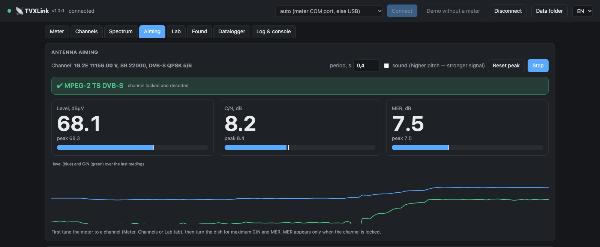
</p>

<p align="center">
  <a href="#-installation"><b>Installation</b></a> ·
  <a href="#-screenshots">Screenshots</a> ·
  <a href="#-what-it-can-do">What it can do</a> ·
  <a href="#-how-it-works">How it works</a> ·
  <a href="#-how-the-protocol-was-recovered">Reverse engineering</a> ·
  <a href="#-verified-on-a-real-meter">Real meter</a> ·
  <a href="#-cli-and-ai-agents">CLI & AI agents</a> ·
  <a href="#-documentation">Docs</a> ·
  <a href="#-tests">Tests</a>
</p>

<p align="center"><b>English</b> · <a href="README.uk.md">Українська</a></p>

---

The PROMAX TV EXPLORER II / II+ is a field meter for satellite and terrestrial TV. Its own PC
software (NetUpdate, RM-404) is Windows-only, dated and mostly made for firmware updates.
**TVXLink** talks to the meter over its USB cable and turns it into a measurement station on a
laptop: tune any transponder with one click, watch level / C/N / MER / BER live, sweep the
spectrum and click on a hump to tune to it, aim the dish by ear, find the decoding threshold,
compare QPSK with 8PSK against theory — and keep every reading in clean CSV files.

It was built for the Satellite Information Systems lab course at KPI RTF and
verified on a real TV EXPLORER II+ on 2026-11-12. As far as we know, there is no other open
program for this meter.

## ⚡ Installation

### 1. Get the program

| Way | What to do |
|---|---|
| **Download** (recommended) | Open the [latest release](https://github.com/RE22GDV/tvxlink/releases/latest), download `Source code (zip)`, unpack it anywhere (e.g. the Desktop). |
| **Git** | `git clone https://github.com/RE22GDV/tvxlink.git` |

### 2. Start it: one double-click installs everything

| System | Start file | Notes |
|---|---|---|
| **Windows 10 / 11** | `Start-Windows.bat` | Nothing to install beforehand. Without Python, the official embedded Python 3.12 (~11 MB) goes into `%LOCALAPPDATA%\TVXLink`. Windows asks **once** for administrator permission to install the meter driver. |
| **macOS** | `Start-Mac.command` | First time: right-click → Open → Open. Needs Python 3.9+ from [python.org](https://www.python.org/downloads/macos/). No driver needed (user-space USB). |
| **Linux** | `./start.sh` | Python 3.9+ with `python3-venv`. The kernel already has the `ti_usb_3410_5052` driver; add yourself to `dialout` once. |

The **first start** does everything once (internet needed, about 1–2 minutes):

1. creates a private Python environment (your system Python stays untouched);
2. installs `pyserial`, `pyusb`, `libusb-package`;
3. downloads the official PROMAX NetUpdate 4.35 package, unpacks the TI TUSB3410 driver and
   firmware and checks every file by **SHA-256** (the driver is not redistributed here);
   on Windows installs the driver (the UAC prompt), on macOS keeps the firmware for the USB upload;
4. runs a self-check, starts the local server and opens the browser.

Each later start of the same file takes about two seconds. Keep the console window open while you
work; close it to quit. Starting it again while it runs just shows the open window.

Measurement data lives in `~/TVXLink` (`%USERPROFILE%\TVXLink`) — outside OneDrive/iCloud on
purpose: sync clients stall writes in the middle of a scan.

<details>
<summary><b>By hand from a console / launcher options</b></summary>

```bash
git clone https://github.com/RE22GDV/tvxlink.git && cd tvxlink
python -m venv .venv && source .venv/bin/activate      # Windows: .venv\Scripts\activate
python -m pip install -e .
python -m tvxlink.vendor --install-driver              # Windows: driver (UAC); macOS: firmware
tvxlink                                                # http://127.0.0.1:8765 opens
```

| Command | What it does |
|---|---|
| `python launcher.py` | what the start files run: install what is missing, then start |
| `python launcher.py --repair` | redo the whole setup |
| `python launcher.py --offline` | never download anything |
| `python launcher.py --check` | show what is installed (creates nothing) |
| `python launcher.py --no-driver` | do not touch the driver / firmware |
| `python launcher.py -- --port 8798 --no-browser --lang en` | options for the program itself |

</details>

## 🖼 Screenshots

All screenshots are rendered by `tools/screenshots.py` from the **real data of the 2026-11-12
session** with a TV EXPLORER II+ (`docs/validation/2026-11-12`): the aiming trend is decoded from
the hex exchange log, the spectrum is the meter's own sweep, the protocol and the threshold run
are the saved session files.

<table>
<tr>
<td width="50%">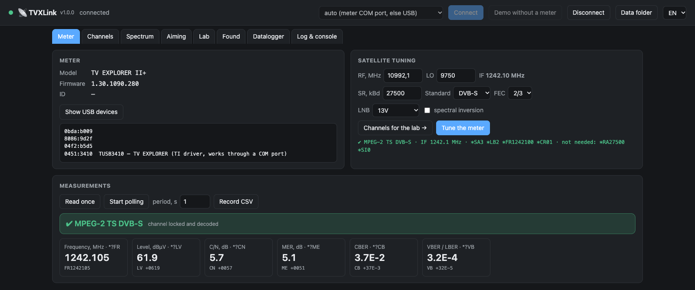<br>
<b>Meter.</b> Model and firmware read over USB, tuning in one click (the meter locked after
<code>*FR</code> and <code>*CR</code>, so SR and inversion were not needed), live readings with the raw replies.</td>
<td width="50%">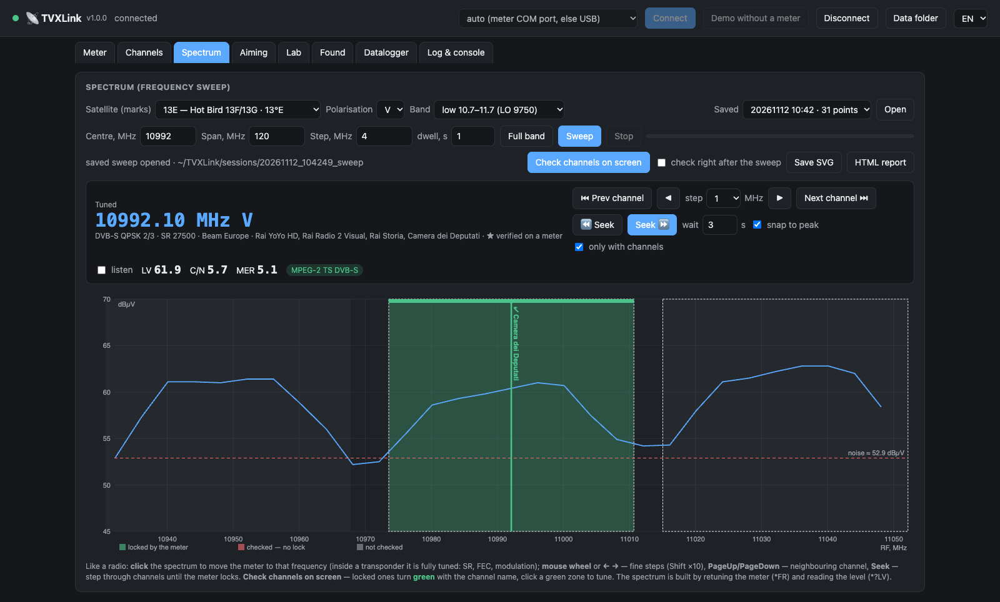<br>
<b>Spectrum like a radio.</b> The meter's sweep around 13°E 10992 V. Click a hump to tune; checked
transponders turn green when the meter locks. Here: Camera dei Deputati, C/N 5.7 dB, MER 5.1 dB.</td>
</tr>
<tr>
<td>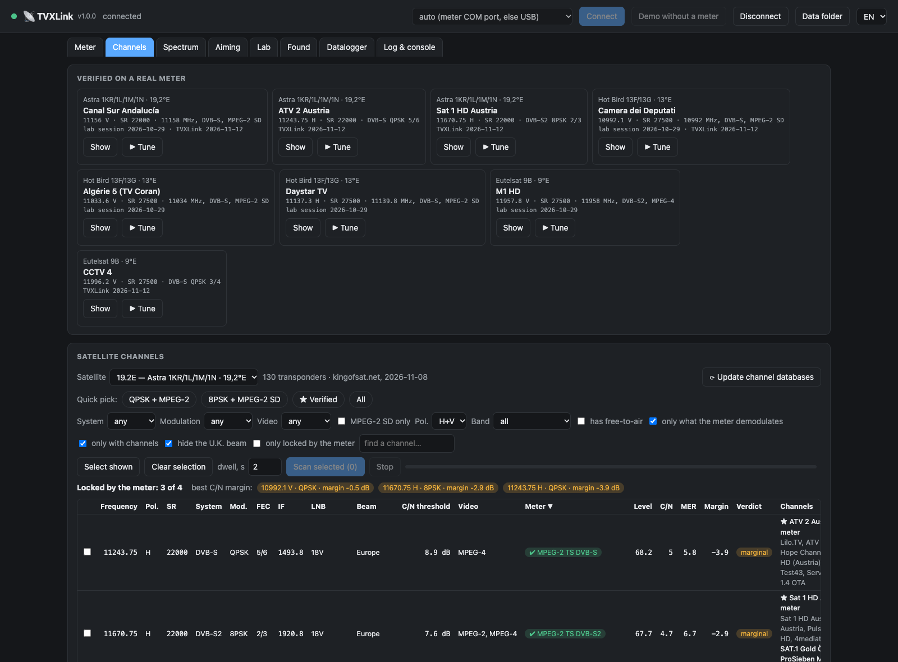<br>
<b>Channels.</b> Fresh KingOfSat databases for seven positions, channels verified on a real meter,
scan results with the ETSI C/N threshold and margin.</td>
<td>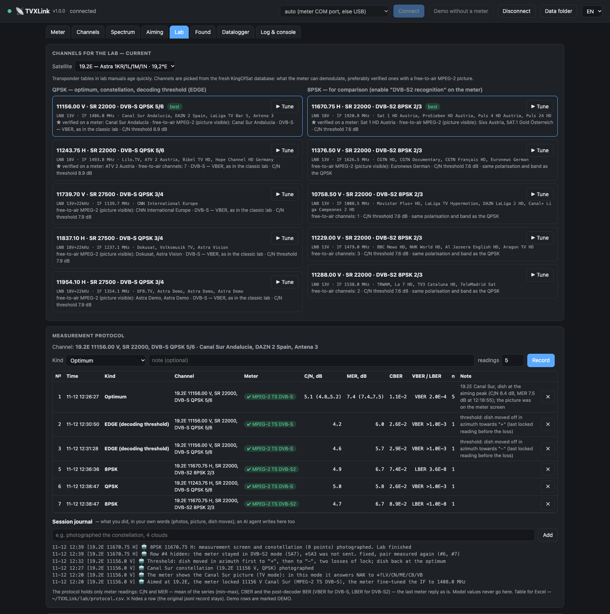<br>
<b>Lab assistant.</b> Recommended channels for the lab tasks, a protocol of meter readings only
and the session journal (an AI agent writes there too).</td>
</tr>
<tr>
<td>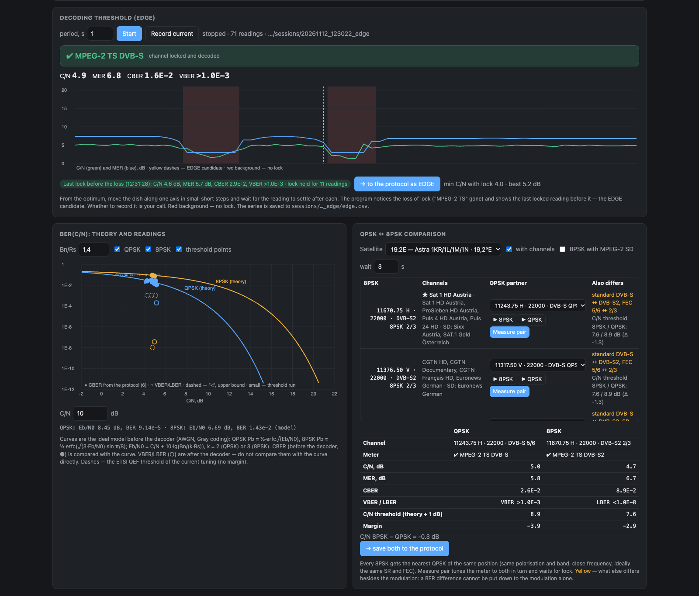<br>
<b>Decoding threshold and BER(C/N).</b> 71 real readings while the dish was moved off and back;
TVXLink caught both losses of lock. Readings against the ideal QPSK/8PSK curves; a measured pair.</td>
<td>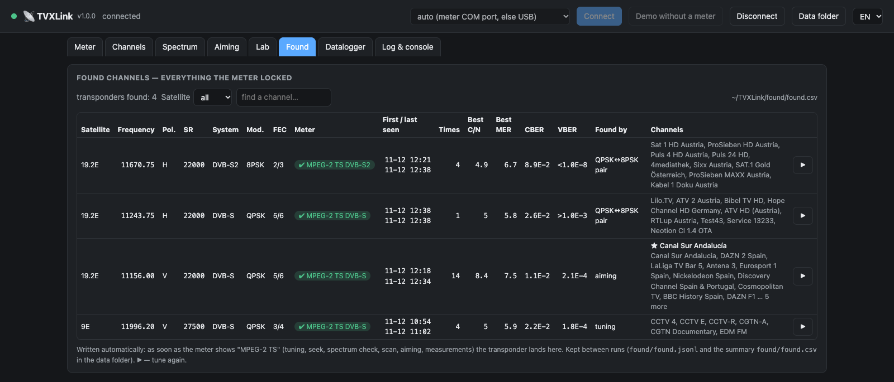<br>
<b>Found channels.</b> Every lock of the session is logged automatically with best C/N and MER.</td>
</tr>
<tr>
<td colspan="2">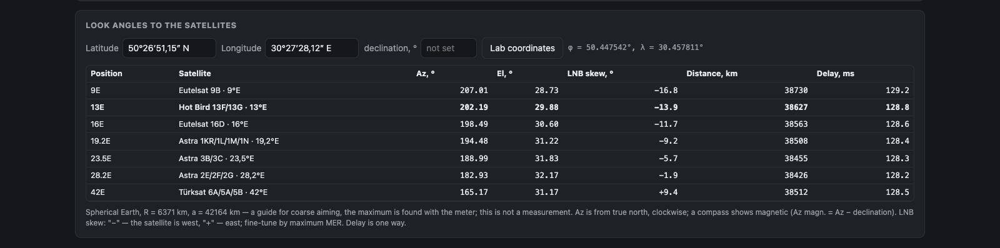<br>
<b>Look angles</b> from the lab coordinates (or yours): azimuth, elevation, LNB skew, distance, delay.</td>
</tr>
</table>

## 🧰 What it can do

| Area | Highlights |
|---|---|
| **Meter link** | USB through the TI TUSB3410 bridge: COM port on Windows/Linux, a user-space libusb driver with firmware upload on macOS. PROMAX XON/XOFF/ACK protocol; full hex log of every byte. |
| **Tuning** | DVB-S / DVB-S2, QPSK / 8PSK, every FEC, LNB 13/18 V ± 22 kHz. RM-404 order: stop as soon as the meter reports "MPEG-2 TS". Re-reads the mode before every tune (the meter switches to DVB-S2 by itself). |
| **Lock status** | `*?ST` = the status line at the bottom of the meter screen — not guessed from numbers. Codes for every mode, labels from the manual. |
| **Measurements** | Frequency, level, C/N, MER, CBER, VBER/LBER with `<`/`>` limits; polling; CSV recording. |
| **Channel databases** | 9°E, 13°E, 16°E, 19.2°E, 23.5°E, 28.2°E, 42°E from KingOfSat with the ETSI QEF threshold per transponder; free-to-air, MPEG-2 SD and beam filters; one-button update of all positions with sanity checks. |
| **Scan & seek** | Go through selected transponders and rank them by C/N margin; "seek" up/down until the meter really locks. |
| **Spectrum** | Sweep with the meter, noise floor, transponder marks; click, wheel or arrows to tune; check every transponder on screen; saved sweeps; SVG and HTML report. |
| **Aiming** | Big level / C/N / MER with peak hold, trend, a tone that rises with C/N; look angles and LNB skew from any coordinates. |
| **Lab assistant** | Recommended channels, measurement protocol (meter readings only, mean/min/max), journal, decoding-threshold detection (EDGE), BER(C/N) theory vs readings, QPSK↔8PSK pairs with what else differs. |
| **Found channels** | Every lock from any tab, kept between runs. |
| **Datalogger** | List, download and parse the meter's `.dl` files into tables and CSV. |
| **Console** | Any protocol command; memory commands need "expert mode", firmware update and file deletion are always refused. |
| **CLI** | `tvx`, `tvxlink-selftest`, `tvxlink-lab` — JSON output for scripts and AI agents. |
| **Languages** | Ukrainian and English everywhere: window, CLI, reports, CSV headers. |

## ⚙ How it works

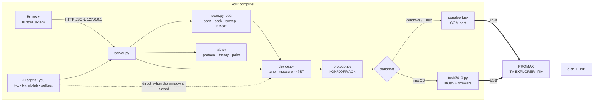

Tuning works like PROMAX RM-404: set the mode, LNB supply and frequency, then send the rest one by
one and **stop as soon as the meter reports a lock** (`*?ST` equals the "MPEG-2 TS" code of the mode):

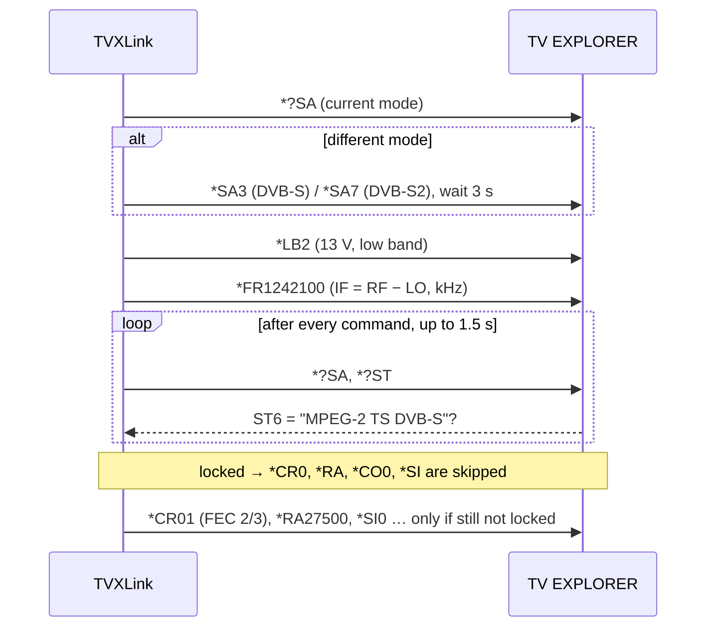

More diagrams — installation, jobs, threshold detection, the channel-database pipeline, data
files — in [docs/HOW_IT_WORKS.md](docs/HOW_IT_WORKS.md).

## 🔬 How the protocol was recovered

PROMAX publishes no protocol for this meter. It was recovered from the official PROMAX Windows
programs: **NetUpdate 4.35** (exchange, reply formats, datalogger transfer), **NetUpdate 3.16 /
PKTools** (the `.dl` file format) and **RM-404 v2.60** (every satellite tuning command and lock
code). The installers were unpacked with 7-Zip, then the programs were decompiled with **Ghidra 12**
in headless mode, with three small scripts that map the functions and decompile every function
that uses a meter command (194 in NetUpdate 4). The Delphi parts of RM-404 were read in an annotated
`objdump` disassembly. The macOS driver follows the Linux kernel driver `ti_usb_3410_5052`.

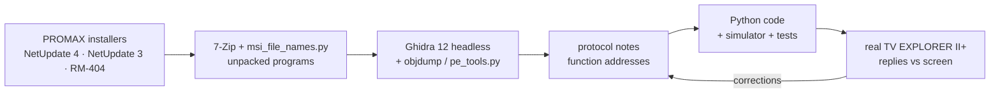

Every finding was then checked byte by byte on a real meter against its screen; the code alone
could not tell, for example, that the BER mantissa is an integer or where the `<` flag stands.
The repository holds no PROMAX code or binaries, only the facts needed for interoperability and
the scripts to repeat the analysis. Firmware update was found and deliberately left out.
Details, function addresses and a step-by-step repeat: [docs/REVERSE_ENGINEERING.md](docs/REVERSE_ENGINEERING.md).

## ✅ Verified on a real meter

TV EXPLORER II+ firmware 1.30.1090.280, Windows 11, TI driver → COM3, dish of KPI RTF lab,
2026-11-12. Full log, self-test reports, sessions and the protocol: [docs/validation/2026-11-12](docs/validation/2026-11-12),
summary in [docs/TESTING.md](docs/TESTING.md).

| Checked | Result |
|---|---|
| Link | XON once a second; `*?NA` → `TV EXPLORER II+`, `*?VE` → `1.30.1090.280`; `*?ID` → NAK (not supported) |
| Formats | `FR` in kHz; LV/CN/ME ×10 with `<`/`>`/`!` flags before the sign; BER as `CB +38E-3` = 3.8·10⁻², `VB<+10E-9` = <1.0·10⁻⁸ |
| Lock codes | `SA3`: `ST6` = MPEG-2 TS DVB-S, `ST0` = No signal received; `SA7`: `ST8` = MPEG-2 TS DVB-S2 |
| Tuning | 13°E 10992.1 V (DVB-S QPSK 2/3): `*SA3 *LB2 *FR1242100 *CR01` in 7.6 s, the meter locked by itself |
| Settling | level settles 0.77 s after `*FR` → default sweep dwell 1.0 s |
| Lab session | 19.2°E Canal Sur: optimum C/N 5.1 dB / MER 7.4 dB / VBER 2.0·10⁻⁴; two EDGE points (C/N 4.2 and 4.6 dB); 8PSK 2/3 pair LBER <1.0·10⁻⁸ |
| Found and fixed on the device | silent meter after the port opens (waits for XON up to 12 s); the meter switches to DVB-S2 itself (mode re-read before every tune); measurements NAK in TV-picture mode (self-test explains it) |

## 🤖 CLI and AI agents

Everything the window does is available from a console, with `--json` for machines. An AI coding
agent (Claude Code, Codex, …) can test the meter and run a whole lab session from chat:
the rules are in [AGENTS.md](AGENTS.md), the full reference in [docs/AI_AGENTS.md](docs/AI_AGENTS.md).

```bash
tvx ports                                   # ★ marks the meter's COM port
tvx --json q LV CN ME CB VB                 # raw replies + parsed values
tvx tune 10992.1 --sr 27500 --fec 2/3       # tune, wait for lock, read everything
tvxlink-selftest                            # read-only self-test → report.md + report.json
tvxlink-selftest --tune --verified 3 --sat 13E   # + tuning, lock, sweep, scan, restore
tvxlink-lab rec 19.2E                       # channels for the lab tasks (window open)
tvxlink-lab record optimum --note "picture is fine"
tvxlink-lab edge start / show / save        # decoding threshold
```

All commands also work without a meter: add `--port demo` (built-in simulator).

## 🗂 Data files

| File (in `~/TVXLink`) | What |
|---|---|
| `logs/session_*.log` | every byte of the exchange in hex, with timestamps |
| `sessions/<time>_scan/scan.csv`, `…_sweep/sweep.csv`, `…_edge/edge.csv`, `…_pair/` | job results (+ `result.json`) |
| `lab/protocol.csv`, `protocol.jsonl` | the measurement protocol (append-only; hiding a row keeps the original) |
| `lab/journal.txt` | the session journal |
| `found/found.csv` | every transponder the meter locked |
| `measure_*.csv`, `datalogger/*.dl` + `.csv` | recordings and downloaded dataloggers |
| `selftest/<time>/report.md` | self-test reports |

CSV files are `;`-separated UTF-8 with BOM, so Excel opens them correctly; headers follow the language.

## 📚 Documentation

| Document | What is inside |
|---|---|
| [How it works](docs/HOW_IT_WORKS.md) · [UK](docs/HOW_IT_WORKS.uk.md) | architecture, installation, tuning, lock detection, jobs, spectrum, aiming, lab math, channel databases, data model |
| [Protocol](docs/PROTOCOL.md) · [UK](docs/PROTOCOL.uk.md) | the PROMAX remote-control protocol as used by TVXLink: framing, queries, reply formats, tuning codes, file transfer |
| [Reverse engineering](docs/REVERSE_ENGINEERING.md) · [UK](docs/REVERSE_ENGINEERING.uk.md) | how the protocol was recovered from the PROMAX programs: sources, unpacking, Ghidra, function addresses, checks on the meter |
| [Testing](docs/TESTING.md) · [UK](docs/TESTING.uk.md) | unit tests, simulator, CI, the self-test stages and the real-meter validation |
| [AI agents & CLI](docs/AI_AGENTS.md) · [UK](docs/AI_AGENTS.uk.md) | every command, JSON outputs, the lab-by-chat workflow |
| [CHANGELOG](CHANGELOG.md) · [CONTRIBUTING](CONTRIBUTING.md) · [SECURITY](SECURITY.md) | |

## 🔒 Privacy and safety

- The server listens on **127.0.0.1 only**, checks the `Host` header and accepts commands only
  from its own page. No accounts, no telemetry, no CDN scripts.
- Network access happens only on the first start (Python, packages, the PROMAX package — all
  checked by SHA-256) and when you press "Update channel databases" (KingOfSat).
- TVXLink never sends firmware-update or delete commands (`*BO`, `*3141&`, `*SB…`, `*FD…`); the
  console refuses commands that write the meter's memory unless "expert mode" is ticked.
- **Tuning powers the LNB input (13/18 V).** Connect only a dish/LNB to the meter's input.

## ⚠ Known limitations

- Measurements answer NAK while the meter shows the TV picture — switch it to the measurement
  screen (button [12]); the self-test says so.
- Intermediate `*?ST` codes (Signal received, Carrier recovered, Viterbi synchronized) are not all
  labelled yet — report what your screen shows ([meter report](.github/ISSUE_TEMPLATE/meter_report.yml)).
- The datalogger parser was reconstructed from PROMAX code; a TV EXPLORER II+ 1.30 did not list
  dataloggers over USB in our test (`*?FI0A` → NAK).
- Terrestrial (DVB-T/C) tuning is not implemented — the meter supports it, the program does not yet.

## ✅ Tests

```bash
python -m unittest discover -s tests -t .      # protocol, parsing, tuning, scans, lab, i18n, page, launcher
python -m tvxlink.cli.selftest --port demo      # the self-test itself against the simulator
python tools/screenshots.py                     # regenerate docs/screenshots from the real data
```

GitHub Actions runs the tests on Windows, macOS and Linux with Python 3.9 and 3.13, runs the CLI
end to end in demo mode, builds the wheel and checks that the PROMAX package still unpacks to the
pinned driver files.

## ⚖ License and credits

MIT, © 2026 Dmytro. TVXLink is an independent project, **not affiliated with PROMAX Electronica**;
"PROMAX" and "TV EXPLORER" are trademarks of their owners. Vendor files are downloaded from their
owners, not redistributed — see [THIRD_PARTY_NOTICES.md](THIRD_PARTY_NOTICES.md).
Transponder data: [KingOfSat](https://en.kingofsat.net). C/N thresholds: ETSI EN 302 307-1 and EN 300 421.

🙏 Thanks to the satellite lab of KPI RTF for the meter, the dish and the lab sessions where all of this was tested.
