<h1 align="center">📡 TVXLink</h1>

<p align="center">
  <b>English version → <a href="README.md">README.md</a></b>
</p>

<p align="center">
  <b>Відкрита програма для супутникового вимірювача PROMAX TV EXPLORER II / II+</b><br>
  <sub>живі вимірювання · спектр, який налаштовується як радіо · наведення антени · помічник лабораторної · CLI для людей та ШІ-агентів<br>
  <i>автор — Дмитро</i></sub>
</p>

<p align="center">
  
  
  
  
  
  
  
  
</p>

<p align="center">
  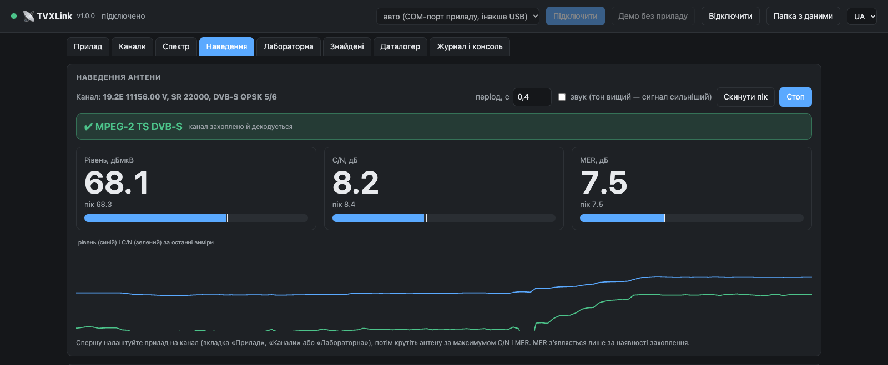
</p>

<p align="center">
  <a href="#-встановлення"><b>Встановлення</b></a> ·
  <a href="#-скриншоти">Скриншоти</a> ·
  <a href="#-що-вміє">Що вміє</a> ·
  <a href="#-як-це-працює">Як це працює</a> ·
  <a href="#-як-відновлено-протокол">Реверс</a> ·
  <a href="#-перевірено-на-справжньому-приладі">Справжній прилад</a> ·
  <a href="#-cli-та-ші-агенти">CLI та ШІ</a> ·
  <a href="#-документація">Документація</a> ·
  <a href="#-тести">Тести</a>
</p>

<p align="center"><a href="README.md">English</a> · <b>Українська</b></p>

---

PROMAX TV EXPLORER II / II+ — польовий вимірювач для супутникового та ефірного ТБ. Його фірмові
програми для ПК (NetUpdate, RM-404) працюють лише під Windows, застарілі й переважно призначені
для оновлення прошивки. **TVXLink** спілкується з приладом через його USB-кабель і перетворює
ноутбук на вимірювальну станцію: налаштування на транспондер одним кліком, рівень / C/N / MER /
BER наживо, спектр, у якому достатньо клікнути по «горбу», наведення тарілки на слух, пошук межі
декодування, порівняння QPSK з 8PSK і теорією — і всі покази в охайних CSV-файлах.

Програму створено для лабораторної з супутникових інформаційних систем РТФ КПІ й перевірено на
справжньому TV EXPLORER II+ 12.11.2026. Наскільки нам відомо, інших відкритих програм для цього
приладу немає.

## ⚡ Встановлення

### 1. Отримати програму

| Спосіб | Що зробити |
|---|---|
| **Завантажити** (рекомендовано) | Відкрийте [останній реліз](https://github.com/RE22GDV/tvxlink/releases/latest), завантажте `Source code (zip)`, розпакуйте будь-куди (наприклад, на Робочий стіл). |
| **Git** | `git clone https://github.com/RE22GDV/tvxlink.git` |

### 2. Запустити: один подвійний клік усе встановлює

| Система | Файл запуску | Примітки |
|---|---|---|
| **Windows 10 / 11** | `Start-Windows.bat` | Нічого встановлювати заздалегідь не треба. Якщо Python немає, офіційний вбудований Python 3.12 (~11 МБ) потрапить у `%LOCALAPPDATA%\TVXLink`. Windows **один раз** попросить дозвіл адміністратора на драйвер приладу. |
| **macOS** | `Start-Mac.command` | Уперше: правий клік → Відкрити → Відкрити. Потрібен Python 3.9+ з [python.org](https://www.python.org/downloads/macos/). Драйвер не потрібен (USB з простору користувача). |
| **Linux** | `./start.sh` | Python 3.9+ з `python3-venv`. Драйвер `ti_usb_3410_5052` уже є в ядрі; один раз додайте себе до групи `dialout`. |

**Перший запуск** робить усе один раз (потрібен інтернет, 1–2 хвилини):

1. створює окреме середовище Python (системний Python не змінюється);
2. встановлює `pyserial`, `pyusb`, `libusb-package`;
3. завантажує офіційний пакет PROMAX NetUpdate 4.35, дістає з нього драйвер і прошивку TI TUSB3410
   та перевіряє кожен файл за **SHA-256** (сам драйвер у репозиторії не поширюється);
   на Windows встановлює драйвер (запит UAC), на macOS зберігає прошивку для завантаження по USB;
4. робить самоперевірку, запускає локальний сервер і відкриває браузер.

Кожен наступний запуск того самого файлу займає близько двох секунд. Тримайте вікно консолі
відкритим, поки працюєте; закрийте його, щоб вийти. Повторний запуск при відкритій програмі
просто покаже її вікно.

Дані вимірів зберігаються в `~/TVXLink` (`%USERPROFILE%\TVXLink`) — навмисно поза OneDrive/iCloud:
синхронізація зупиняє запис посеред проходу.

<details>
<summary><b>Вручну з консолі / параметри запускача</b></summary>

```bash
git clone https://github.com/RE22GDV/tvxlink.git && cd tvxlink
python -m venv .venv && source .venv/bin/activate      # Windows: .venv\Scripts\activate
python -m pip install -e .
python -m tvxlink.vendor --install-driver              # Windows: драйвер (UAC); macOS: прошивка
tvxlink                                                # відкриється http://127.0.0.1:8765
```

| Команда | Що робить |
|---|---|
| `python launcher.py` | те, що запускають стартові файли: доставити відсутнє й запустити |
| `python launcher.py --repair` | повністю перевстановити |
| `python launcher.py --offline` | нічого не завантажувати |
| `python launcher.py --check` | показати, що встановлено (нічого не створює) |
| `python launcher.py --no-driver` | не чіпати драйвер і прошивку |
| `python launcher.py -- --port 8798 --no-browser --lang en` | параметри самої програми |

</details>

## 🖼 Скриншоти

Усі скриншоти створює `tools/screenshots.py` із **справжніх даних сеансу 12.11.2026** з
TV EXPLORER II+ (`docs/validation/2026-11-12`): крива наведення розібрана з hex-журналу обміну,
спектр — власний прохід приладу, протокол і межа — збережені файли сеансу.

<table>
<tr>
<td width="50%">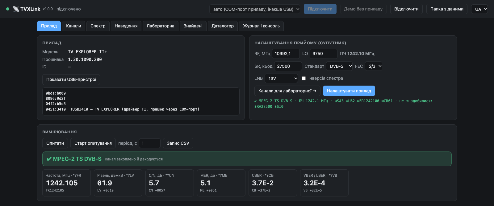<br>
<b>Прилад.</b> Модель і прошивка, прочитані по USB, налаштування одним кліком (прилад захопив канал
після <code>*FR</code> і <code>*CR</code>, тож SR та інверсія не знадобилися), живі покази із сирими відповідями.</td>
<td width="50%">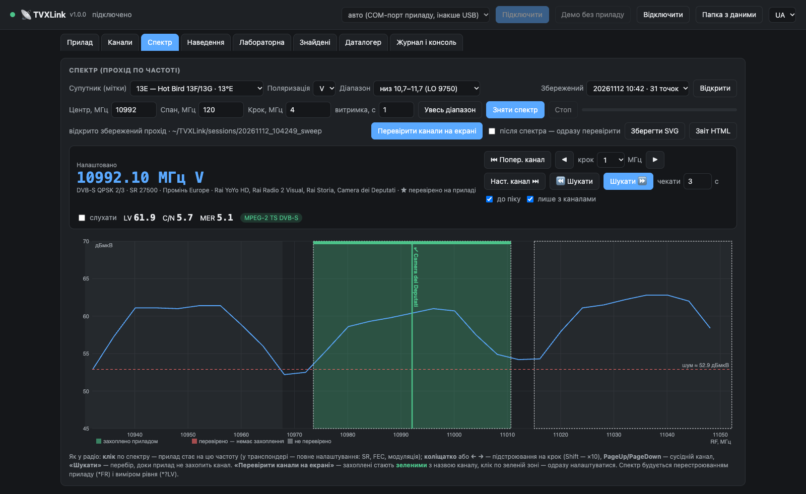<br>
<b>Спектр як у радіо.</b> Прохід приладу навколо 13°E 10992 V. Клік по «горбу» — налаштування;
перевірені транспондери зеленіють, коли прилад захоплює канал. Тут: Camera dei Deputati, C/N 5,7 дБ, MER 5,1 дБ.</td>
</tr>
<tr>
<td>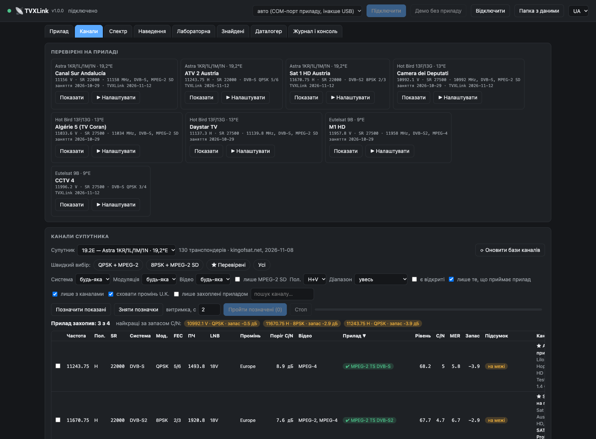<br>
<b>Канали.</b> Свіжі бази KingOfSat для семи позицій, канали, перевірені на справжньому приладі,
результати проходу з порогом C/N за ETSI та запасом.</td>
<td>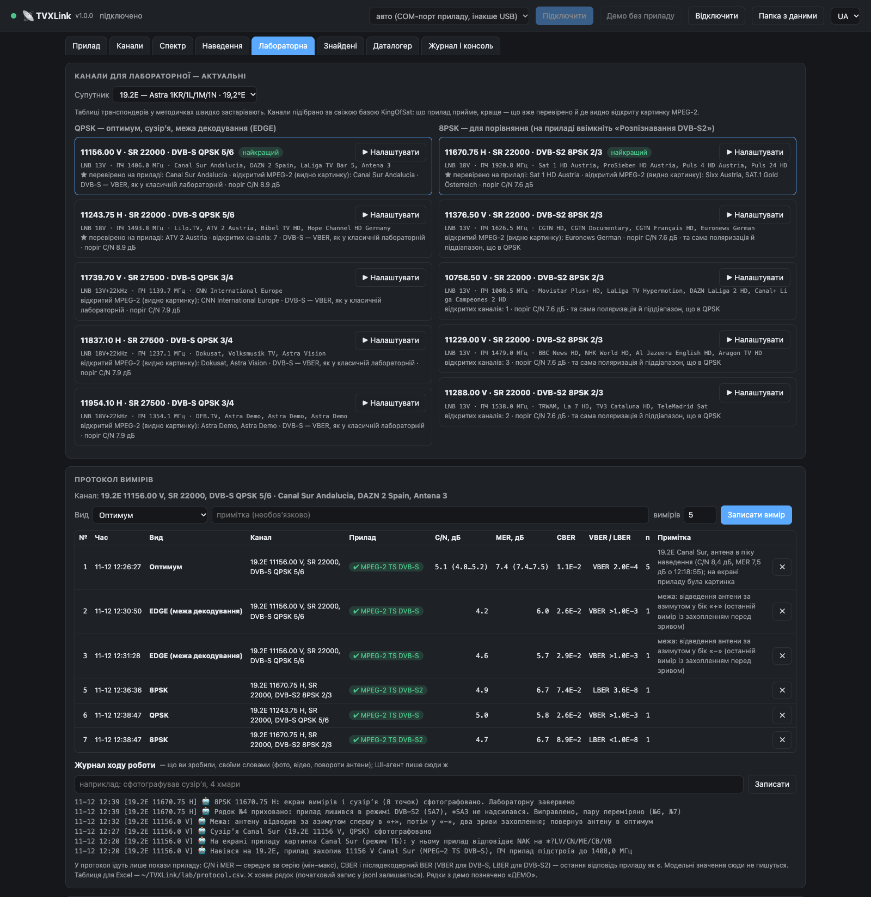<br>
<b>Помічник лабораторної.</b> Рекомендовані канали під завдання, протокол лише з показами приладу
та журнал ходу роботи (туди ж пише ШІ-агент).</td>
</tr>
<tr>
<td>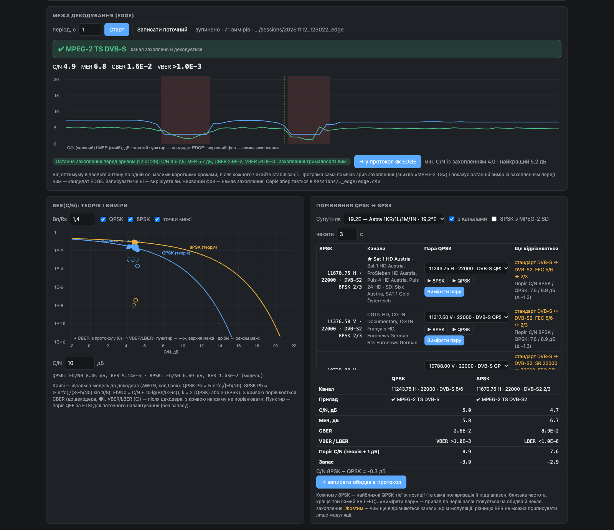<br>
<b>Межа декодування і BER(C/N).</b> 71 справжній вимір, поки антену відводили й повертали; TVXLink
помітив обидва зриви захоплення. Покази поруч з ідеальними кривими QPSK/8PSK; виміряна пара.</td>
<td>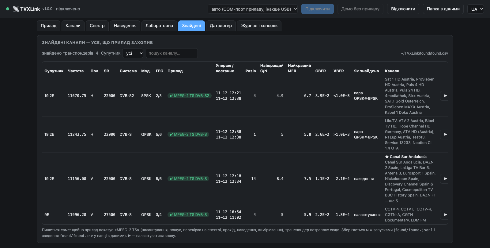<br>
<b>Знайдені канали.</b> Кожне захоплення сеансу записується саме, з найкращими C/N і MER.</td>
</tr>
<tr>
<td colspan="2">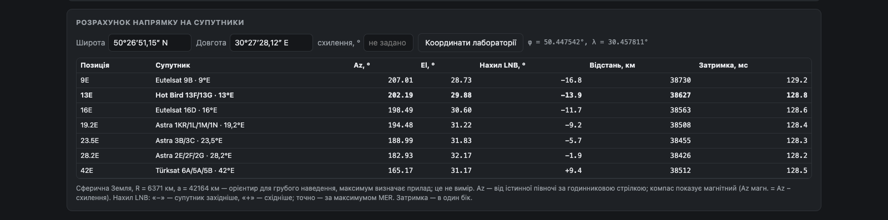<br>
<b>Напрямок на супутники</b> з координат лабораторії (або ваших): азимут, кут місця, нахил LNB, відстань, затримка.</td>
</tr>
</table>

## 🧰 Що вміє

| Розділ | Головне |
|---|---|
| **Зв’язок із приладом** | USB через міст TI TUSB3410: COM-порт на Windows/Linux, libusb-драйвер у просторі користувача із завантаженням прошивки на macOS. Протокол PROMAX XON/XOFF/ACK; повний hex-журнал кожного байта. |
| **Налаштування** | DVB-S / DVB-S2, QPSK / 8PSK, усі FEC, LNB 13/18 В ± 22 кГц. Порядок RM-404: зупинитися, щойно прилад показав «MPEG-2 TS». Перед кожним налаштуванням режим перечитується (прилад сам перемикається на DVB-S2). |
| **Захоплення** | `*?ST` — рядок стану внизу екрана приладу, а не здогад за числами. Коди для кожного режиму, підписи з посібника. |
| **Вимірювання** | Частота, рівень, C/N, MER, CBER, VBER/LBER з межами `<`/`>`; опитування; запис у CSV. |
| **Бази каналів** | 9°E, 13°E, 16°E, 19,2°E, 23,5°E, 28,2°E, 42°E з KingOfSat з порогом QEF за ETSI для кожного транспондера; фільтри відкритих каналів, MPEG-2 SD, променів; оновлення всіх позицій однією кнопкою з перевіркою. |
| **Прохід і пошук** | Пройти вибрані транспондери й упорядкувати за запасом C/N; «пошук» вгору/вниз, доки прилад справді не захопить канал. |
| **Спектр** | Прохід приладом, рівень шуму, мітки транспондерів; клік, коліщатко чи стрілки для налаштування; перевірка всіх транспондерів на екрані; збережені проходи; звіт SVG і HTML. |
| **Наведення** | Великі рівень / C/N / MER з утриманням піку, тренд, тон, що росте з C/N; напрямок і нахил LNB з будь-яких координат. |
| **Помічник лабораторної** | Рекомендовані канали, протокол вимірів (лише покази приладу: середнє/мін/макс), журнал, пошук межі декодування (EDGE), BER(C/N) теорія проти вимірів, пари QPSK↔8PSK з переліком інших відмінностей. |
| **Знайдені канали** | Кожне захоплення з будь-якої вкладки, зберігається між запусками. |
| **Даталогер** | Список, завантаження й розбір файлів `.dl` приладу в таблиці та CSV. |
| **Консоль** | Будь-яка команда протоколу; команди пам’яті потребують «режиму експерта», оновлення прошивки й видалення файлів відхиляються завжди. |
| **CLI** | `tvx`, `tvxlink-selftest`, `tvxlink-lab` — JSON для скриптів та ШІ-агентів. |
| **Мови** | Українська й англійська всюди: вікно, CLI, звіти, заголовки CSV. |

## ⚙ Як це працює

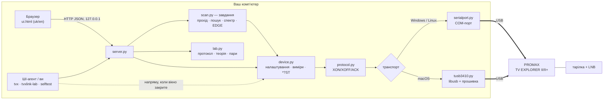

Налаштування працює як у PROMAX RM-404: задати режим, живлення LNB і частоту, далі надсилати
решту по одній команді й **зупинитися, щойно прилад повідомив про захоплення** (`*?ST` дорівнює
коду «MPEG-2 TS» для режиму):

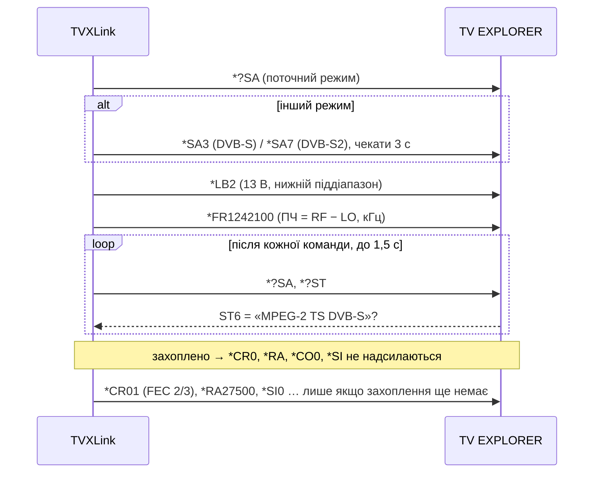

Більше схем — встановлення, завдання, пошук межі, оновлення бази каналів, файли даних — у
[docs/HOW_IT_WORKS.uk.md](docs/HOW_IT_WORKS.uk.md).

## 🔬 Як відновлено протокол

PROMAX не публікує протоколу цього приладу. Його відновлено з офіційних Windows-програм PROMAX:
**NetUpdate 4.35** (обмін, формати відповідей, передача даталогера), **NetUpdate 3.16 / PKTools**
(формат файлу `.dl`) і **RM-404 v2.60** (усі команди налаштування на супутник і коди захоплення).
Інсталятори розпаковано 7-Zip, потім програми декомпільовано в **Ghidra 12** у режимі headless.
Три невеликі скрипти будують карту функцій і декомпілюють кожну функцію, що використовує команду
приладу (у NetUpdate 4 їх 194). Delphi-частини RM-404 прочитано в анотованому дизасемблованому коді
`objdump`. Драйвер для macOS зроблено за зразком драйвера ядра Linux `ti_usb_3410_5052`.

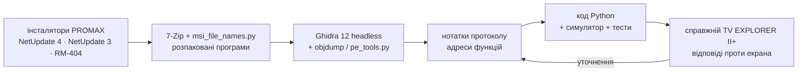

Кожну знахідку потім перевірено байт за байтом на справжньому приладі проти його екрана: сам код
не міг сказати, наприклад, що мантиса BER ціла або де стоїть прапорець `<`. У репозиторії немає
коду чи двійкових файлів PROMAX — лише факти, потрібні для сумісності, і скрипти, щоб повторити
аналіз. Оновлення прошивки знайдено й навмисно не реалізовано.
Подробиці, адреси функцій і покрокове повторення: [docs/REVERSE_ENGINEERING.uk.md](docs/REVERSE_ENGINEERING.uk.md).

## ✅ Перевірено на справжньому приладі

TV EXPLORER II+ з прошивкою 1.30.1090.280, Windows 11, драйвер TI → COM3, тарілка лабораторії РТФ КПІ,
12.11.2026. Повний журнал, звіти самотесту, сесії й протокол: [docs/validation/2026-11-12](docs/validation/2026-11-12),
підсумок — у [docs/TESTING.uk.md](docs/TESTING.uk.md).

| Що перевірено | Результат |
|---|---|
| Зв’язок | XON раз на секунду; `*?NA` → `TV EXPLORER II+`, `*?VE` → `1.30.1090.280`; `*?ID` → NAK (не підтримується) |
| Формати | `FR` у кГц; LV/CN/ME ×10 з прапорцями `<`/`>`/`!` перед знаком; BER як `CB +38E-3` = 3,8·10⁻², `VB<+10E-9` = <1,0·10⁻⁸ |
| Коди захоплення | `SA3`: `ST6` = MPEG-2 TS DVB-S, `ST0` = No signal received; `SA7`: `ST8` = MPEG-2 TS DVB-S2 |
| Налаштування | 13°E 10992,1 V (DVB-S QPSK 2/3): `*SA3 *LB2 *FR1242100 *CR01` за 7,6 с, прилад захопив сам |
| Встановлення рівня | 0,77 с після `*FR` → витримка спектра за замовчуванням 1,0 с |
| Лабораторна | 19,2°E Canal Sur: оптимум C/N 5,1 дБ / MER 7,4 дБ / VBER 2,0·10⁻⁴; дві точки EDGE (C/N 4,2 і 4,6 дБ); пара 8PSK 2/3 з LBER <1,0·10⁻⁸ |
| Знайдено й виправлено на приладі | прилад мовчить після відкриття порту (чекаємо XON до 12 с); прилад сам переходить у DVB-S2 (режим перечитується перед кожним налаштуванням); виміри дають NAK у режимі ТВ-картинки (самотест про це каже) |

## 🤖 CLI та ШІ-агенти

Усе, що робить вікно, доступне з консолі, з `--json` для програм. ШІ-агент для коду (Claude Code,
Codex, …) може перевірити прилад і провести всю лабораторну з чату: правила — в [AGENTS.md](AGENTS.md),
повний довідник — у [docs/AI_AGENTS.uk.md](docs/AI_AGENTS.uk.md).

```bash
tvx ports                                   # ★ позначає COM-порт приладу
tvx --json q LV CN ME CB VB                 # сирі відповіді + розібрані значення
tvx tune 10992.1 --sr 27500 --fec 2/3       # налаштувати, дочекатися захоплення, прочитати все
tvxlink-selftest                            # самотест лише на читання → report.md + report.json
tvxlink-selftest --tune --verified 3 --sat 13E   # + налаштування, захоплення, спектр, прохід, повернення
tvxlink-lab rec 19.2E                       # канали під завдання лабораторної (вікно відкрите)
tvxlink-lab record optimum --note "картинка є"
tvxlink-lab edge start / show / save        # межа декодування
```

Усі команди працюють і без приладу: додайте `--port demo` (вбудований симулятор).

## 🗂 Файли даних

| Файл (у `~/TVXLink`) | Що в ньому |
|---|---|
| `logs/session_*.log` | кожен байт обміну в hex із часом |
| `sessions/<час>_scan/scan.csv`, `…_sweep/sweep.csv`, `…_edge/edge.csv`, `…_pair/` | результати завдань (+ `result.json`) |
| `lab/protocol.csv`, `protocol.jsonl` | протокол вимірів (лише дописується; прихований рядок зберігає оригінал) |
| `lab/journal.txt` | журнал ходу роботи |
| `found/found.csv` | усі транспондери, які захопив прилад |
| `measure_*.csv`, `datalogger/*.dl` + `.csv` | записи вимірів і завантажені даталогери |
| `selftest/<час>/report.md` | звіти самотесту |

CSV — UTF-8 з BOM і роздільником `;`, тож Excel відкриває їх правильно; заголовки — мовою інтерфейсу.

## 📚 Документація

| Документ | Що всередині |
|---|---|
| [Як це працює](docs/HOW_IT_WORKS.uk.md) · [EN](docs/HOW_IT_WORKS.md) | архітектура, встановлення, налаштування, захоплення, завдання, спектр, наведення, математика лабораторної, бази каналів, модель даних |
| [Протокол](docs/PROTOCOL.uk.md) · [EN](docs/PROTOCOL.md) | протокол дистанційного керування PROMAX, як його використовує TVXLink: кадри, запити, формати відповідей, коди налаштування, передача файлів |
| [Реверс протоколу](docs/REVERSE_ENGINEERING.uk.md) · [EN](docs/REVERSE_ENGINEERING.md) | як протокол відновлено з програм PROMAX: джерела, розпакування, Ghidra, адреси функцій, перевірка на приладі |
| [Тестування](docs/TESTING.uk.md) · [EN](docs/TESTING.md) | юніт-тести, симулятор, CI, стадії самотесту й перевірка на справжньому приладі |
| [ШІ-агенти та CLI](docs/AI_AGENTS.uk.md) · [EN](docs/AI_AGENTS.md) | усі команди, JSON-виводи, лабораторна через чат |
| [CHANGELOG](CHANGELOG.md) · [CONTRIBUTING](CONTRIBUTING.md) · [SECURITY](SECURITY.md) | |

## 🔒 Приватність і безпека

- Сервер слухає **лише 127.0.0.1**, перевіряє заголовок `Host` і приймає команди лише від своєї
  сторінки. Жодних акаунтів, телеметрії, скриптів із CDN.
- У мережу програма ходить лише під час першого запуску (Python, пакети, пакет PROMAX — усе з
  перевіркою SHA-256) і коли ви натискаєте «Оновити бази каналів» (KingOfSat).
- TVXLink ніколи не надсилає команд оновлення прошивки чи видалення (`*BO`, `*3141&`, `*SB…`, `*FD…`);
  консоль відмовляє в командах запису пам’яті приладу без «режиму експерта».
- **Налаштування подає живлення на вхід LNB (13/18 В).** Підключайте до входу приладу лише тарілку з LNB.

## ⚠ Відомі обмеження

- Поки прилад показує ТВ-картинку, виміри відповідають NAK — перемкніть його на екран вимірів
  (кнопка [12]); самотест про це каже.
- Не всі проміжні коди `*?ST` (Signal received, Carrier recovered, Viterbi synchronized) підписані —
  повідомте, що показує ваш екран ([звіт про прилад](.github/ISSUE_TEMPLATE/meter_report.yml)).
- Розбір даталогера відтворено з коду PROMAX; TV EXPLORER II+ 1.30 у нашому тесті не віддав список
  даталогерів по USB (`*?FI0A` → NAK).
- Ефірне налаштування (DVB-T/C) не реалізоване — прилад уміє, програма поки ні.

## ✅ Тести

```bash
python -m unittest discover -s tests -t .      # протокол, розбір, налаштування, проходи, лабораторна, мови, сторінка, запускач
python -m tvxlink.cli.selftest --port demo      # сам самотест на симуляторі
python tools/screenshots.py                     # перезняти docs/screenshots зі справжніх даних
```

GitHub Actions запускає тести на Windows, macOS і Linux з Python 3.9 та 3.13, проганяє CLI
наскрізь у демо-режимі, збирає wheel і перевіряє, що пакет PROMAX досі розпаковується в
зафіксовані файли драйвера.

## ⚖ Ліцензія та подяки

MIT, © 2026 Дмитро. TVXLink — незалежний проєкт, **не пов’язаний з PROMAX Electronica**;
«PROMAX» і «TV EXPLORER» — торговельні марки їхніх власників. Файли виробника завантажуються з
сайтів їхніх власників, а не поширюються тут — див. [THIRD_PARTY_NOTICES.md](THIRD_PARTY_NOTICES.md).
Дані транспондерів: [KingOfSat](https://en.kingofsat.net). Пороги C/N: ETSI EN 302 307-1 та EN 300 421.

🙏 Дякую лабораторії супутникового зв’язку РТФ КПІ за прилад, тарілку й заняття, на яких усе це перевірено.
