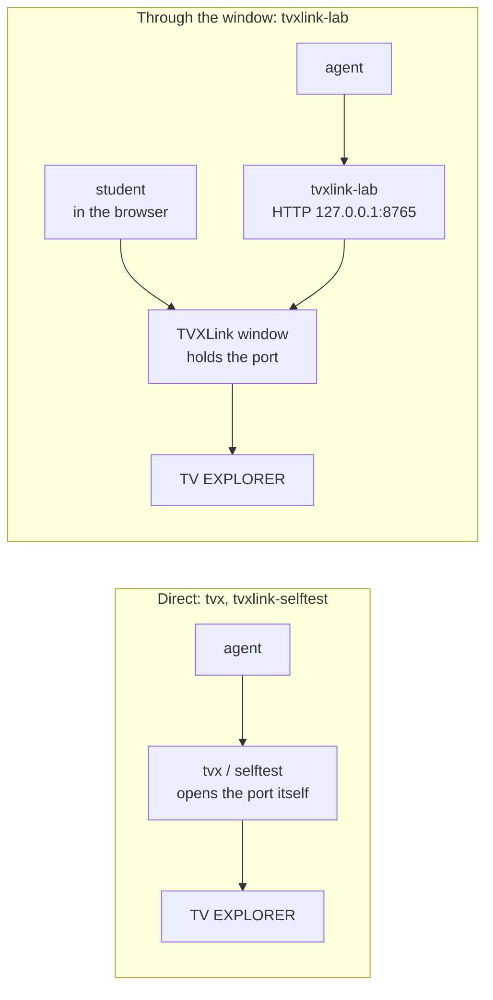
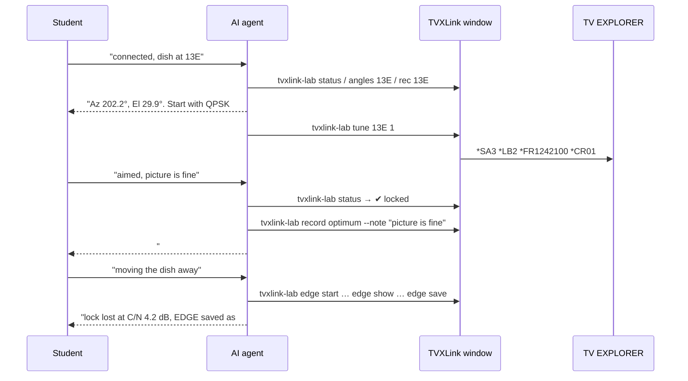

# CLI and AI agents

**English** · [Українська](AI_AGENTS.uk.md)

Everything the window does is also available from a console. `tvx` and `tvxlink-lab` have a `--json` mode
for scripts, and `tvxlink-selftest` writes `report.json`. Any AI coding agent with a terminal (Claude Code, Codex, Cursor, …) can therefore
test a meter, find a fault in the protocol, or run a whole lab session while the student just
writes in chat. The rules an agent must follow are in [AGENTS.md](../AGENTS.md); Claude Code reads
them through [CLAUDE.md](../CLAUDE.md). This page is the full reference.

## Contents

1. [Two ways to talk to the meter](#1-two-ways-to-talk-to-the-meter)
2. [Running the commands](#2-running-the-commands)
3. [`tvx` — direct console](#3-tvx--direct-console)
4. [`tvxlink-selftest` — check a meter](#4-tvxlink-selftest--check-a-meter)
5. [`tvxlink-lab` — a lab session through the window](#5-tvxlink-lab--a-lab-session-through-the-window)
6. [Running a lab session by chat](#6-running-a-lab-session-by-chat)
7. [Rules for agents](#7-rules-for-agents)
8. [The local HTTP API](#8-the-local-http-api)

## 1. Two ways to talk to the meter

Only one program can hold the COM port. So there are two modes, and an agent must not mix them:



| | Direct (`tvx`, `tvxlink-selftest`) | Through the window (`tvxlink-lab`) |
|---|---|---|
| Who holds the port | the command, for its own run | the open window |
| Use for | testing the meter, debugging the protocol, raw bytes | a lab session: the student sees everything on screen, the agent records |
| Window open? | must be **closed** (it holds the port) | must be **open** |
| Data | `~/TVXLink/logs`, `selftest/`, `measure_*.csv` | the same files the window writes: `lab/`, `sessions/`, `found/` |

Every command also works without a meter: add `--port demo` (built-in simulator) or connect the
window in demo mode.

## 2. Running the commands

`Start-Windows.bat` / `Start-Mac.command` install the packages into a private Python in the per-user
folder (`%LOCALAPPDATA%\TVXLink`, `~/Library/Application Support/TVXLink`, `~/.local/share/tvxlink`),
not into the system Python. For the commands below either run `pip install -e .` once, or call that
private Python (`…\TVXLink\python\python.exe` or `…\TVXLink\venv\Scripts\python.exe` on Windows,
`…/TVXLink/venv/bin/python` on macOS and Linux). From the repository folder:

```bash
python -m tvxlink.cli.tvx …            # direct console
python -m tvxlink.cli.selftest …       # self-test
python -m tvxlink.cli.lab …            # lab session through the window
```

`tools/tvx.py`, `tools/selftest.py` and `tools/labchat.py` are the same commands as plain scripts.
After `pip install .` they are on the PATH as `tvx`, `tvxlink-selftest` and `tvxlink-lab`. This
page uses the short names.

Options of `tvx`: `--lang uk|en` (output language; default is the saved choice, else Ukrainian),
`--json` (machine output), `--port auto|COM3|/dev/ttyUSB0|usb|demo`, `-v` (connection log to stderr).
`tvxlink-selftest` takes `--lang` and `--port`; `tvxlink-lab` takes `--lang`, `--json` and `--url`,
and its `connect` takes `--port`.

## 3. `tvx` — direct console

| Command | What it does | Changes the meter? |
|---|---|---|
| `tvx ports` | COM ports and USB devices; ★ marks the meter (VID 0451 PID 3410) | no |
| `tvx listen 3` | listen to raw bytes for 3 s: a live meter sends XON once a second | no |
| `tvx ident` | `*?NA`, `*?VE`, `*?ID` with ACK/NAK and reply time | no |
| `tvx q LV CN ME CB VB FR SA ST` | any queries; prints the raw reply, hex and the parsed value | no |
| `tvx status [-n N]` | is the channel locked: `*?SA`, `*?ST`, the lock code, MER | no |
| `tvx measure -n 10 -p 1` | a series of readings → `measure_*.csv` | no |
| `tvx tune 10992.1 --sr 27500 --fec 2/3 [--lnb 13V] [--std DVB-S2 --mod 8PSK]` | full tuning, wait for lock, read everything | **yes, powers the LNB** |
| `tvx goto 10992.1 [--lo 9750]` | frequency only (RF in MHz; the IF is computed from the LO) | yes |
| `tvx set *LB2` | one tuning command; only the safe tuning commands pass (`*SA *LB *FR *CR0 *RA *CO0 *SI`, and the analog/terrestrial `*SY *GI *MO *BW`) | yes |
| `tvx sweep 10900 11100 4 --settle 1.0` | spectrum sweep: from, to, step in MHz (RF) → CSV | yes (frequency) |
| `tvx dl list`, `tvx dl get NAME` | list / download a datalogger (`.dl` + parsed `.csv`) | no |

A query with `--json`:

```bash
tvx --port demo --json q LV ME CB
```

```json
{
 "results": [
  {"cmd": "*?LV", "ack": true, "reply": "LV +0606", "raw_hex": "2a 4c 56 20 2b 30 36 30 36", "ms": 0,
   "parsed": {"value": 60.6, "note": null}},
  {"cmd": "*?ME", "ack": true, "reply": "ME!", "raw_hex": "2a 4d 45 21", "ms": 0,
   "parsed": {"value": null, "note": "---"}},
  {"cmd": "*?CB", "ack": true, "reply": "CB>+10E-2", "raw_hex": "2a 43 42 3e 2b 31 30 45 2d 32", "ms": 0,
   "parsed": {"value": 0.1, "note": ">"}}
 ]
}
```

`note` is the meter's flag: `<` below the limit (the value is an upper bound), `>` above it,
`---` no value. A NAK has `"ack": false`. If all five measurements are NAK, the meter is showing
the TV picture and the student must press [12].

`tvx tune` (here against the simulator):

```text
Sent: *LB2 *FR1242100 *CR01 *RA27500 *SI0  (IF 1242.1 MHz, 1.04 s)
meter status: no lock (code 1) (*?ST=1)
  FR: 'FR1242100' → 1242.1
  LV: 'LV +0603' → 60.3
  CN: 'CN +0182' → 18.2
  ME: 'ME!' → None ---
  …
```

`tvx` never sends firmware or delete commands (`*BO`, `*3141&`, `*SB…`, `*FD…`): they are refused
before anything reaches the port. Exit code 2 means "refused" and 1 means an error; in both cases the
`--json` output has an `"error"` field, e.g. `"*BO: not one of the safe tuning commands (…)"`.

## 4. `tvxlink-selftest` — check a meter

```bash
tvxlink-selftest                                     # read-only, safe
tvxlink-selftest --tune --verified 3 --sat 13E       # + tuning to index 3 (from 0) of verified.json
tvxlink-selftest --tune --rf 11156 --sr 22000 --fec 5/6 --lnb 13V --sat 19.2E --pol V
tvxlink-selftest --dl                                 # + download and parse the first datalogger
```

| Option | Meaning |
|---|---|
| `--tune` | stages 5–10: tuning, lock, readings, settling, sweep, scan, restore. **Powers the LNB** |
| `--verified N` | target from `tvxlink/satellites/verified.json` by index (channels already locked on a real meter) |
| `--rf --lo --sr --fec --lnb --std --mod --pol --sat` | a target given by hand |
| `--samples N`, `--dwell S` | readings in stage 6; pause per step |
| `--listen S` | seconds to count XON in stage 1 |
| `--skip-unittests` | do not run the unit tests in stage 0 |

Output: `~/TVXLink/selftest/<time>/report.md`, `report.json` and the hex log. An agent reads
`report.json`:

```json
{
 "verdict": "go_warn",
 "verdict_text": "GO, with warnings",
 "why": "…",
 "checks": [
  {"stage": "lock", "name": "…", "status": "PASS", "detail": "5/5 …"},
  {"stage": "queries", "name": "*?CB", "status": "WARN", "detail": "…"}
 ],
 "recommendations": ["…"],
 "notes": ["…"],
 "data": {"ports": [], "info": {}, "queries": [], "measure_series": []}
}
```

`verdict` is one of `go`, `go_readonly`, `go_warn`, `partial_read`, `partial_tune`, `no`;
`stage` is a stage code (`env`, `link`, `ident`, `queries`, `dl`, `tune`, `lock`, `series`,
`settle`, `sweep`, `scan`, `restore`) — stages 0–10.

It explains every FAIL and WARN to the user and asks them what the screen shows when a format
needs checking. The stages and verdicts are described in [TESTING.md](TESTING.md#3-self-test-of-a-real-meter).

## 5. `tvxlink-lab` — a lab session through the window

Talks to the open window over `http://127.0.0.1:8765`. Everything it records appears in the
window at once, and the student sees the same tables and plots.

| Command | What it does |
|---|---|
| `status` | connected?, current channel, lock, LV / C/N / MER / CBER / VBER |
| `connect [--port COM3\|demo]` | connect the window to the meter |
| `angles [POS]` | azimuth, elevation and LNB skew for the lab dish (all positions without `POS`) |
| `rec POS` | channels for the lab tasks on this satellite: QPSK for the optimum / constellation / EDGE, 8PSK for the comparison, with reasons |
| `tune POS N [--8psk]` | tune to recommendation N |
| `record KIND [--note TEXT] [-n N]` | write N readings of the meter to the protocol; `KIND` = `optimum`, `edge`, `qpsk`, `8psk`, `measure` |
| `note TEXT` | write the student's words to the journal |
| `edge start [--interval S]` / `show` / `save` / `stop` | the decoding-threshold run: readings until lock is lost; `save` writes the last locked reading as EDGE |
| `pair POS [N] [--save]` | QPSK↔8PSK pairs on one satellite; with `N --save` both are tuned in turn and recorded |
| `list` | protocol and journal so far, with file paths |

A real exchange against the simulator (output in English, `--lang en`):

```text
$ tvxlink-lab connect --port demo
connected (DEMO): {'model': 'TV EXPLORER II+ (SIMULATOR)', 'firmware': '0.00-sim', 'id': '0000'}
$ tvxlink-lab angles 13E
   13E  Az 202.19°  El 29.88°  LNB -13.9°  (Hot Bird 13F/13G · 13°E)
$ tvxlink-lab rec 13E
QPSK — optimum, constellation, decoding threshold (EDGE):
  1. 10992.1 V · SR 27500 · DVB-S QPSK 2/3 · LNB 13V · Rai YoYo HD, Rai Radio 2 Visual, Rai Storia
     ★ verified on a meter: Camera dei Deputati · free-to-air MPEG-2 (picture visible) · C/N threshold 6.9 dB
  …
$ tvxlink-lab tune 13E 1
✔ MPEG-2 TS DVB-S · 13E 10992.1 V SR 27500 DVB-S QPSK 2/3 · IF 1242.1 · *LB2 *FR1242100 *CR01 *RA27500
$ tvxlink-lab record optimum --note "picture is fine" -n 3
saved #1 (Optimum): C/N 21.6, MER 20.2, CBER 1.0E-08 — 13E 10992.1 V, SR 27500, DVB-S QPSK 2/3
C/N 21.6…21.6 · VBER 1.0E-08 · locked in every reading · DEMO
$ tvxlink-lab note "photographed the [12] screen"
Session journal: 07:30:46 [13E 10992.1 V] photographed the [12] screen
$ tvxlink-lab edge start --interval 0.5
threshold: watching the lock. Let the user move the dish along one axis in small steps.
$ tvxlink-lab edge show
watching · 10 readings · 0 losses
✔ MPEG-2 TS DVB-S · C/N 6.0 · MER 4.4 · CBER 9.0E-03
```

No window? Ask the student to start it with `Start-Windows.bat` / `Start-Mac.command`, or start
it yourself in the background with `python -m tvxlink --no-browser`, then run `tvxlink-lab connect`.

## 6. Running a lab session by chat

The student writes short messages while working at the dish. The agent answers with commands:



| The student writes | The agent does |
|---|---|
| "connected", "let's start" | `status` (not connected → `connect`); `rec 13E` (or their satellite); suggest QPSK #1 |
| "pointing at 13E" | `angles 13E` — say Az/El; `tune 13E 1`; then `status` on request: is C/N / MER growing? |
| "locked", "optimum" | `status` → if ✔ `record optimum --note "<what they said about the picture>"`; remind to photograph the [12] screen |
| "photographed …", "picture ok / black" | `note "…"` |
| "constellation" | remind: short press [22] → Constellation, photo with the axes; then `note` |
| "moving the dish", "threshold", "EDGE" | `edge start`; `edge show` along the way; after the loss `edge save`, `edge stop`; remind: half a step back and a photo |
| "dish back" | `status` (is the lock back?) + `note` |
| "8PSK", "compare" | remind to enable DVB-S2 recognition on the meter; `pair 13E`, `pair 13E 1 --save` (or `tune 13E 1 --8psk` + `record 8psk`) |
| "what's recorded?" | `list`; check: optimum + photos, EDGE + photo, QPSK and 8PSK + photos |
| "done" | `list`; give the paths `lab/protocol.csv`, `lab/journal.txt`, `sessions/…_edge/edge.csv` |

## 7. Rules for agents

- **The protocol holds meter readings only** (`record`, `edge save`, `pair --save`). Numbers the
  student reads off the screen go to the journal (`note`) and are marked as such. Never write
  model or expected values into the protocol.
- **The journal holds the student's words** (`note`): photos taken, picture or black screen, how
  the dish was moved.
- Check `status` before `record`. Without a lock, say so and ask.
- **Before any tuning, ask** whether a dish with an LNB is connected and which satellite it points
  at: tuning puts 13 or 18 V on the meter input.
- Do not run `tvx` or the self-test while the window is open: the window holds the port.
- Never implement or send firmware or memory commands (`*3141&`, `*BO`, `*SB…`, `.pro`, `*FD…`).
  TVXLink refuses them anyway.
- Transponder tables in lab manuals age quickly. Pick channels with `tvxlink-lab rec POS`.
- Demo rows are marked DEMO. Offer to hide them (✕ in the Lab tab) before a real session.
- Answer in the student's language; `--lang uk|en` switches the program output.

## 8. The local HTTP API

The window and `tvxlink-lab` use the same JSON API. It listens on 127.0.0.1 only and checks the
`Host` header. POST requests are refused when they come from another web page (an `Origin` other
than `http://127.0.0.1` / `http://localhost`).

| Method | Path | What |
|---|---|---|
| GET | `/api/status` | connection, meter info, current channel, job |
| GET | `/api/ports`, `/api/usb` | COM ports / USB devices |
| GET | `/api/sats`, `/api/sat?pos=13E` | satellite list / one database |
| GET | `/api/verified` | transponders confirmed on a real meter |
| GET | `/api/found` | every locked transponder |
| GET | `/api/lab/protocol`, `/api/lab/journal` | protocol and journal |
| GET | `/api/lab/recommend?pos=`, `/api/lab/pairs?pos=` | channels for the lab tasks, QPSK↔8PSK pairs |
| GET | `/api/lab/angles?pos=`, `/api/lab/theory` | look angles; BER(C/N) theory curves |
| GET | `/api/sessions?kind=sweep`, `/api/session?name=` | saved jobs |
| GET | `/api/job`, `/api/log` | running job; the connection log |
| GET | `/api/i18n` | dictionaries |
| GET/POST | `/api/lang` | language |
| POST | `/api/connect`, `/api/disconnect` | `{"port": "auto"}` |
| POST | `/api/measure`, `/api/record` | one set of readings; record to CSV |
| POST | `/api/tune`, `/api/goto`, `/api/aim` | tune; frequency only; aiming mode |
| POST | `/api/command` | one console command (`{"cmd": "*?LV"}`); write commands only with `"expert": true`; firmware/delete never |
| POST | `/api/lab/record`, `/api/lab/add`, `/api/lab/note`, `/api/lab/delete` | protocol and journal |
| POST | `/api/lab/edge`, `/api/scan`, `/api/sweep`, `/api/job/stop` | jobs |
| POST | `/api/dl/list`, `/api/dl/download`, `/api/dl/open` | datalogger |
| POST | `/api/sats/update` | download fresh channel databases (KingOfSat) |
