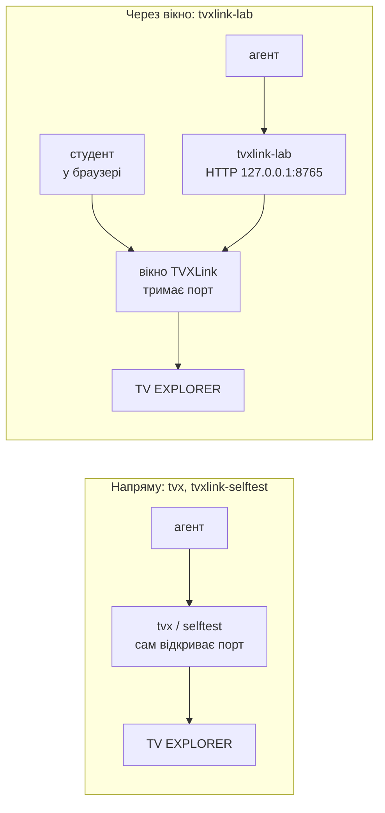
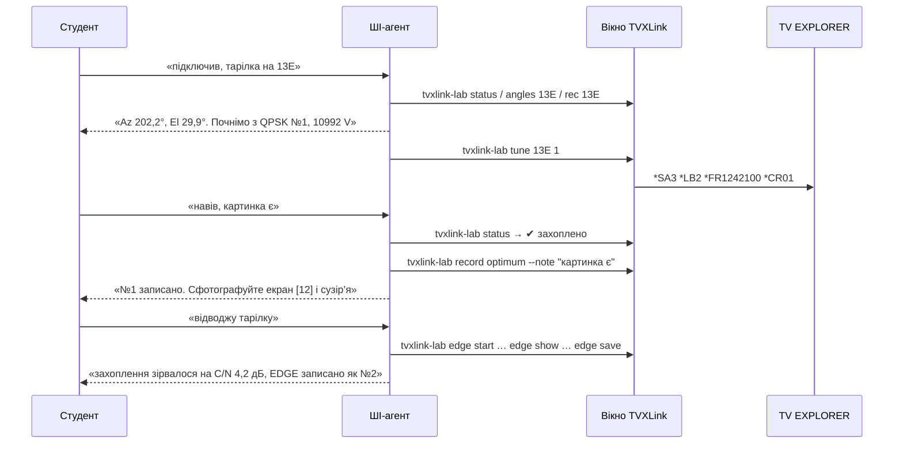

# CLI та ШІ-агенти

[English](AI_AGENTS.md) · **Українська**

Усе, що робить вікно, доступне й із консолі. `tvx` і `tvxlink-lab` мають режим `--json` для скриптів, а `tvxlink-selftest` записує `report.json`.
Тому будь-який ШІ-агент для коду з доступом до терміналу (Claude Code, Codex, Cursor, …) може
перевірити прилад, знайти помилку в протоколі або провести всю лабораторну, поки студент просто
пише в чат. Правила, яких агент має дотримуватися, — в [AGENTS.md](../AGENTS.md); Claude Code
читає їх через [CLAUDE.md](../CLAUDE.md). Тут — повний довідник.

## Зміст

1. [Два способи говорити з приладом](#1-два-способи-говорити-з-приладом)
2. [Як запускати команди](#2-як-запускати-команди)
3. [`tvx` — пряма консоль](#3-tvx--пряма-консоль)
4. [`tvxlink-selftest` — перевірка приладу](#4-tvxlink-selftest--перевірка-приладу)
5. [`tvxlink-lab` — лабораторна через вікно](#5-tvxlink-lab--лабораторна-через-вікно)
6. [Лабораторна через чат](#6-лабораторна-через-чат)
7. [Правила для агентів](#7-правила-для-агентів)
8. [Локальний HTTP API](#8-локальний-http-api)

## 1. Два способи говорити з приладом

COM-порт може тримати лише одна програма. Тому є два режими, і агент не повинен їх змішувати:



| | Напряму (`tvx`, `tvxlink-selftest`) | Через вікно (`tvxlink-lab`) |
|---|---|---|
| Хто тримає порт | сама команда, на час свого запуску | відкрите вікно |
| Для чого | перевірка приладу, налагодження протоколу, сирі байти | лабораторна: студент бачить усе на екрані, агент записує |
| Вікно відкрите? | має бути **закрите** (воно тримає порт) | має бути **відкрите** |
| Дані | `~/TVXLink/logs`, `selftest/`, `measure_*.csv` | ті самі файли, що пише вікно: `lab/`, `sessions/`, `found/` |

Кожна команда працює й без приладу: додайте `--port demo` (вбудований симулятор) або підключіть
вікно в демо-режимі.

## 2. Як запускати команди

`Start-Windows.bat` / `Start-Mac.command` встановлюють пакети в окремий Python у папці користувача
(`%LOCALAPPDATA%\TVXLink`, `~/Library/Application Support/TVXLink`, `~/.local/share/tvxlink`), а не в
системний Python. Для команд нижче або один раз виконайте `pip install -e .`, або викликайте цей
Python (`…\TVXLink\python\python.exe` чи `…\TVXLink\venv\Scripts\python.exe` на Windows,
`…/TVXLink/venv/bin/python` на macOS і Linux). З папки репозиторію:

```bash
python -m tvxlink.cli.tvx …            # пряма консоль
python -m tvxlink.cli.selftest …       # самотест
python -m tvxlink.cli.lab …            # лабораторна через вікно
```

`tools/tvx.py`, `tools/selftest.py` і `tools/labchat.py` — ті самі команди у вигляді звичайних
скриптів. Після `pip install .` вони є в PATH як `tvx`, `tvxlink-selftest` і `tvxlink-lab`. Далі
використано короткі назви.

Параметри `tvx`: `--lang uk|en` (мова виводу; типово — збережений вибір, інакше українська),
`--json` (машинний вивід), `--port auto|COM3|/dev/ttyUSB0|usb|demo`, `-v` (журнал з’єднання в stderr).
`tvxlink-selftest` приймає `--lang` і `--port`; `tvxlink-lab` приймає `--lang`, `--json` і `--url`,
а його `connect` — `--port`.

## 3. `tvx` — пряма консоль

| Команда | Що робить | Змінює прилад? |
|---|---|---|
| `tvx ports` | COM-порти й USB-пристрої; ★ позначає прилад (VID 0451 PID 3410) | ні |
| `tvx listen 3` | 3 с слухати сирі байти: живий прилад шле XON раз на секунду | ні |
| `tvx ident` | `*?NA`, `*?VE`, `*?ID` з ACK/NAK і часом відповіді | ні |
| `tvx q LV CN ME CB VB FR SA ST` | будь-які запити; друкує сиру відповідь, hex і розібране значення | ні |
| `tvx status [-n N]` | чи захоплено канал: `*?SA`, `*?ST`, код захоплення, MER | ні |
| `tvx measure -n 10 -p 1` | серія вимірювань → `measure_*.csv` | ні |
| `tvx tune 10992.1 --sr 27500 --fec 2/3 [--lnb 13V] [--std DVB-S2 --mod 8PSK]` | повне налаштування, очікування захоплення, читання всього | **так, живить LNB** |
| `tvx goto 10992.1 [--lo 9750]` | лише частота (RF у МГц; ПЧ обчислюється з LO) | так |
| `tvx set *LB2` | одна команда налаштування; проходять лише безпечні (`*SA *LB *FR *CR0 *RA *CO0 *SI` і для аналогу/ефіру `*SY *GI *MO *BW`) | так |
| `tvx sweep 10900 11100 4 --settle 1.0` | прохід спектром: від, до, крок у МГц (RF) → CSV | так (частота) |
| `tvx dl list`, `tvx dl get NAME` | список / завантаження даталогера (`.dl` + розібраний `.csv`) | ні |

Запит із `--json`:

```bash
tvx --port demo --json q LV ME CB
```

```json
{
 "results": [
  {"cmd": "*?LV", "ack": true, "reply": "LV +0606", "raw_hex": "2a 4c 56 20 2b 30 36 30 36", "ms": 0,
   "parsed": {"value": 60.6, "note": null}},
  {"cmd": "*?ME", "ack": true, "reply": "ME!", "raw_hex": "2a 4d 45 21", "ms": 0,
   "parsed": {"value": null, "note": "---"}},
  {"cmd": "*?CB", "ack": true, "reply": "CB>+10E-2", "raw_hex": "2a 43 42 3e 2b 31 30 45 2d 32", "ms": 0,
   "parsed": {"value": 0.1, "note": ">"}}
 ]
}
```

`note` — прапорець приладу: `<` нижче межі (значення — верхня межа), `>` вище межі, `---` значення
немає. NAK має `"ack": false`. Якщо всі п’ять вимірювань дали NAK, прилад показує картинку ТБ, і
студентові треба натиснути [12].

`tvx tune` (тут — на симуляторі):

```text
Sent: *LB2 *FR1242100 *CR01 *RA27500 *SI0  (IF 1242.1 MHz, 1.04 s)
meter status: no lock (code 1) (*?ST=1)
  FR: 'FR1242100' → 1242.1
  LV: 'LV +0603' → 60.3
  CN: 'CN +0182' → 18.2
  ME: 'ME!' → None ---
  …
```

`tvx` ніколи не надсилає команд прошивки чи видалення (`*BO`, `*3141&`, `*SB…`, `*FD…`): їх
відхилено ще до порту. Код виходу 2 означає «відхилено», а 1 — помилку; в обох випадках у виводі `--json` є
поле `"error"`, наприклад `"*BO: not one of the safe tuning commands (…)"`.

## 4. `tvxlink-selftest` — перевірка приладу

```bash
tvxlink-selftest                                     # лише читання, безпечно
tvxlink-selftest --tune --verified 3 --sat 13E       # + налаштування на індекс 3 (від 0) з verified.json
tvxlink-selftest --tune --rf 11156 --sr 22000 --fec 5/6 --lnb 13V --sat 19.2E --pol V
tvxlink-selftest --dl                                 # + завантажити й розібрати перший даталогер
```

| Параметр | Значення |
|---|---|
| `--tune` | стадії 5–10: налаштування, захоплення, покази, витримка, спектр, прогін, повернення. **Живить LNB** |
| `--verified N` | ціль із `tvxlink/satellites/verified.json` за номером (канали, уже захоплені на справжньому приладі) |
| `--rf --lo --sr --fec --lnb --std --mod --pol --sat` | ціль, задана вручну |
| `--samples N`, `--dwell S` | кількість замірів на стадії 6; пауза на крок |
| `--listen S` | скільки секунд рахувати XON на стадії 1 |
| `--skip-unittests` | не запускати юніт-тести на стадії 0 |

Результат: `~/TVXLink/selftest/<час>/report.md`, `report.json` і hex-журнал. Агент читає `report.json`:

```json
{
 "verdict": "go_warn",
 "verdict_text": "МОЖНА, із застереженнями",
 "why": "…",
 "checks": [
  {"stage": "lock", "name": "…", "status": "PASS", "detail": "5/5 …"},
  {"stage": "queries", "name": "*?CB", "status": "WARN", "detail": "…"}
 ],
 "recommendations": ["…"],
 "notes": ["…"],
 "data": {"ports": [], "info": {}, "queries": [], "measure_series": []}
}
```

`verdict` — одне з `go`, `go_readonly`, `go_warn`, `partial_read`, `partial_tune`, `no`;
`stage` — код стадії (`env`, `link`, `ident`, `queries`, `dl`, `tune`, `lock`, `series`, `settle`,
`sweep`, `scan`, `restore`) — стадії 0–10.

Агент пояснює користувачеві кожен FAIL і WARN і питає, що на екрані, коли формат треба перевірити.
Стадії й вердикти описано в [TESTING.uk.md](TESTING.uk.md#3-самотест-справжнього-приладу).

## 5. `tvxlink-lab` — лабораторна через вікно

Говорить із відкритим вікном через `http://127.0.0.1:8765`. Усе, що вона записує, одразу з’являється
у вікні, і студент бачить ті самі таблиці й графіки.

| Команда | Що робить |
|---|---|
| `status` | чи підключено, поточний канал, захоплення, LV / C/N / MER / CBER / VBER |
| `connect [--port COM3\|demo]` | підключити вікно до приладу |
| `angles [POS]` | азимут, кут місця й нахил LNB для лабораторної тарілки (без `POS` — для всіх позицій) |
| `rec POS` | канали під завдання лабораторної на цьому супутнику: QPSK для оптимуму / сузір’я / EDGE, 8PSK для порівняння, з поясненнями |
| `tune POS N [--8psk]` | налаштуватися на рекомендацію N |
| `record KIND [--note TEXT] [-n N]` | записати N показів приладу в протокол; `KIND` = `optimum`, `edge`, `qpsk`, `8psk`, `measure` |
| `note TEXT` | записати слова студента в журнал |
| `edge start [--interval S]` / `show` / `save` / `stop` | пошук межі декодування: заміри, доки не зірветься захоплення; `save` записує останній замір із захопленням як EDGE |
| `pair POS [N] [--save]` | пари QPSK↔8PSK на одному супутнику; з `N --save` обидва канали налаштовуються по черзі й записуються |
| `list` | протокол і журнал на цю мить, зі шляхами до файлів |

Справжній обмін із симулятором (вивід англійською, `--lang en`):

```text
$ tvxlink-lab connect --port demo
connected (DEMO): {'model': 'TV EXPLORER II+ (SIMULATOR)', 'firmware': '0.00-sim', 'id': '0000'}
$ tvxlink-lab angles 13E
   13E  Az 202.19°  El 29.88°  LNB -13.9°  (Hot Bird 13F/13G · 13°E)
$ tvxlink-lab rec 13E
QPSK — optimum, constellation, decoding threshold (EDGE):
  1. 10992.1 V · SR 27500 · DVB-S QPSK 2/3 · LNB 13V · Rai YoYo HD, Rai Radio 2 Visual, Rai Storia
     ★ verified on a meter: Camera dei Deputati · free-to-air MPEG-2 (picture visible) · C/N threshold 6.9 dB
  …
$ tvxlink-lab tune 13E 1
✔ MPEG-2 TS DVB-S · 13E 10992.1 V SR 27500 DVB-S QPSK 2/3 · IF 1242.1 · *LB2 *FR1242100 *CR01 *RA27500
$ tvxlink-lab record optimum --note "picture is fine" -n 3
saved #1 (Optimum): C/N 21.6, MER 20.2, CBER 1.0E-08 — 13E 10992.1 V, SR 27500, DVB-S QPSK 2/3
C/N 21.6…21.6 · VBER 1.0E-08 · locked in every reading · DEMO
$ tvxlink-lab note "photographed the [12] screen"
Session journal: 07:30:46 [13E 10992.1 V] photographed the [12] screen
$ tvxlink-lab edge start --interval 0.5
threshold: watching the lock. Let the user move the dish along one axis in small steps.
$ tvxlink-lab edge show
watching · 10 readings · 0 losses
✔ MPEG-2 TS DVB-S · C/N 6.0 · MER 4.4 · CBER 9.0E-03
```

Вікно не відкрите? Попросіть студента запустити `Start-Windows.bat` / `Start-Mac.command` або
запустіть його самі у фоні командою `python -m tvxlink --no-browser`, а потім `tvxlink-lab connect`.

## 6. Лабораторна через чат

Студент пише короткі повідомлення, працюючи біля тарілки. Агент відповідає командами:



| Студент пише | Агент робить |
|---|---|
| «підключив», «почнімо» | `status` (не підключено → `connect`); `rec 13E` (або його супутник); пропонує QPSK №1 |
| «наводжу на 13E» | `angles 13E` — називає Az/El; `tune 13E 1`; далі за запитом `status`: чи ростуть C/N / MER? |
| «захопив», «оптимум» | `status` → якщо ✔ `record optimum --note "<що сказав про картинку>"`; нагадує сфотографувати екран [12] |
| «сфотографував …», «картинка є / чорний екран» | `note "…"` |
| «сузір’я» | нагадує: коротко [22] → Constellation, фото з осями; потім `note` |
| «відводжу тарілку», «межа», «EDGE» | `edge start`; по ходу `edge show`; після зриву `edge save`, `edge stop`; нагадує: пів кроку назад і фото |
| «повернув тарілку» | `status` (захоплення повернулося?) + `note` |
| «8PSK», «порівняти» | нагадує ввімкнути розпізнавання DVB-S2 на приладі; `pair 13E`, `pair 13E 1 --save` (або `tune 13E 1 --8psk` + `record 8psk`) |
| «що записано?» | `list`; перевіряє: оптимум + фото, EDGE + фото, QPSK і 8PSK + фото |
| «готово» | `list`; дає шляхи `lab/protocol.csv`, `lab/journal.txt`, `sessions/…_edge/edge.csv` |

## 7. Правила для агентів

- **У протоколі — лише покази приладу** (`record`, `edge save`, `pair --save`). Числа, які студент
  прочитав з екрана, ідуть у журнал (`note`) з відповідною позначкою. Ніколи не записувати в
  протокол модельні чи очікувані значення.
- **У журналі — слова студента** (`note`): які фото зроблено, картинка чи чорний екран, як рухали
  тарілку.
- Перед `record` перевіряти `status`. Без захоплення — сказати про це й запитати.
- **Перед будь-яким налаштуванням спитати**, чи під’єднано тарілку з LNB і на який супутник вона
  дивиться: налаштування подає на вхід приладу 13 або 18 В.
- Не запускати `tvx` чи самотест, поки відкрите вікно: воно тримає порт.
- Ніколи не реалізовувати й не надсилати команд прошивки чи пам’яті (`*3141&`, `*BO`, `*SB…`, `.pro`,
  `*FD…`). TVXLink їх і так відхиляє.
- Таблиці транспондерів у методичках швидко старіють. Канали вибирати через `tvxlink-lab rec POS`.
- Демо-рядки позначено DEMO. Перед справжньою сесією запропонувати їх приховати (✕ на вкладці
  «Лабораторна»).
- Відповідати мовою студента; `--lang uk|en` перемикає мову виводу програми.

## 8. Локальний HTTP API

Вікно й `tvxlink-lab` користуються тим самим JSON API. Він слухає лише 127.0.0.1 і перевіряє
заголовок `Host`. POST-запити відхиляються, якщо прийшли з іншої вебсторінки (`Origin`, відмінний
від `http://127.0.0.1` / `http://localhost`).

| Метод | Шлях | Що |
|---|---|---|
| GET | `/api/status` | з’єднання, дані приладу, поточний канал, завдання |
| GET | `/api/ports`, `/api/usb` | COM-порти / USB-пристрої |
| GET | `/api/sats`, `/api/sat?pos=13E` | список супутників / одна база |
| GET | `/api/verified` | транспондери, підтверджені на справжньому приладі |
| GET | `/api/found` | усі захоплені транспондери |
| GET | `/api/lab/protocol`, `/api/lab/journal` | протокол і журнал |
| GET | `/api/lab/recommend?pos=`, `/api/lab/pairs?pos=` | канали під завдання лабораторної, пари QPSK↔8PSK |
| GET | `/api/lab/angles?pos=`, `/api/lab/theory` | кути наведення; теоретичні криві BER(C/N) |
| GET | `/api/sessions?kind=sweep`, `/api/session?name=` | збережені завдання |
| GET | `/api/job`, `/api/log` | поточне завдання; журнал з’єднання |
| GET | `/api/i18n` | словники |
| GET/POST | `/api/lang` | мова |
| POST | `/api/connect`, `/api/disconnect` | `{"port": "auto"}` |
| POST | `/api/measure`, `/api/record` | один набір показів; запис у CSV |
| POST | `/api/tune`, `/api/goto`, `/api/aim` | налаштування; лише частота; режим наведення |
| POST | `/api/command` | одна команда консолі (`{"cmd": "*?LV"}`); команди запису — лише з `"expert": true`; прошивка й видалення — ніколи |
| POST | `/api/lab/record`, `/api/lab/add`, `/api/lab/note`, `/api/lab/delete` | протокол і журнал |
| POST | `/api/lab/edge`, `/api/scan`, `/api/sweep`, `/api/job/stop` | завдання |
| POST | `/api/dl/list`, `/api/dl/download`, `/api/dl/open` | даталогер |
| POST | `/api/sats/update` | завантажити свіжі бази каналів (KingOfSat) |
