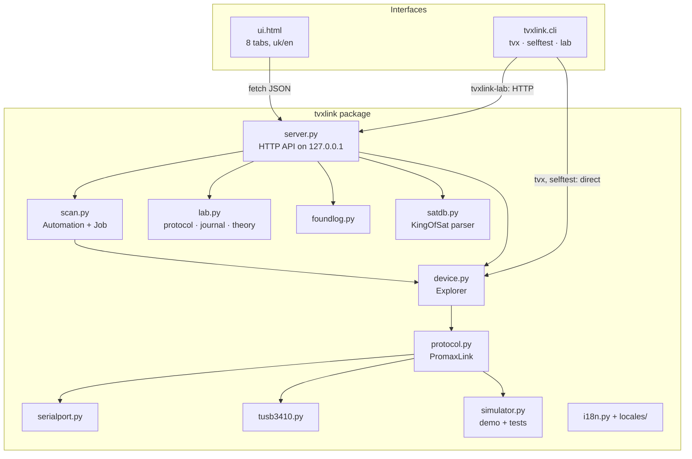
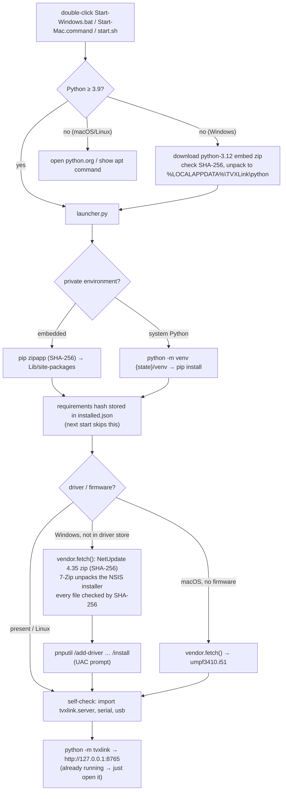
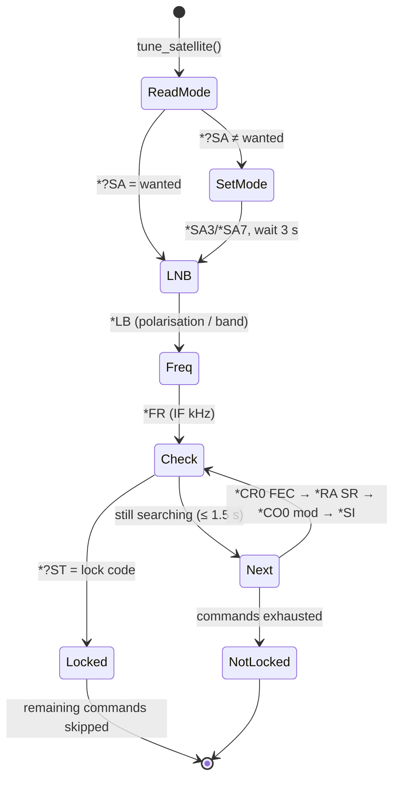
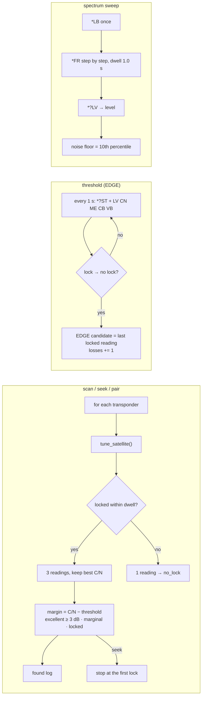
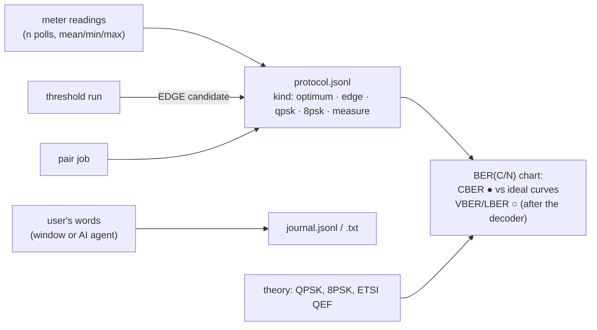
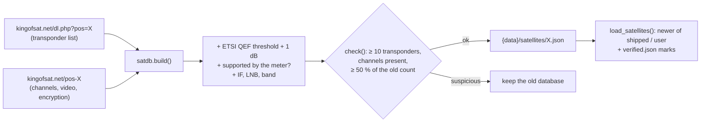

# How TVXLink works

[Українська](HOW_IT_WORKS.uk.md) · [README](../README.md)

1. [Components](#1-components)
2. [Installation and start](#2-installation-and-start)
3. [Talking to the meter](#3-talking-to-the-meter)
4. [Tuning and lock detection](#4-tuning-and-lock-detection)
5. [Background jobs: scan, seek, sweep, threshold](#5-background-jobs)
6. [Spectrum like a radio](#6-spectrum-like-a-radio)
7. [Antenna aiming and look angles](#7-antenna-aiming-and-look-angles)
8. [Lab assistant](#8-lab-assistant)
9. [Channel databases](#9-channel-databases)
10. [Data files and languages](#10-data-files-and-languages)

## 1. Components

Python standard library only (plus `pyserial` / `pyusb` for the hardware). One local HTTP server,
one HTML page, no web framework, no build step.



| Module | Responsibility |
|---|---|
| `protocol.py` | framing: wait for XON, send `*CMD\r`, expect XOFF + ACK/NAK + `*reply\r`; binary file transfer |
| `device.py` | `Explorer`: connect (COM / libusb / demo), identify, measure, `lock_status()`, `tune_satellite()`, `goto_frequency()`, datalogger |
| `serialport.py` | pyserial transport, finds the meter by VID/PID 0451:3410 or driver name |
| `tusb3410.py` | user-space TUSB3410 driver: firmware upload, UART set-up, bulk transfers |
| `simulator.py` | a meter in software: same protocol, a noise floor and transponders, real reply formats |
| `scan.py` | one background job at a time: scan, seek, pair, sweep, threshold (EDGE) |
| `lab.py` | measurement protocol, session journal, look angles, BER theory, QEF, QPSK↔8PSK pairs, recommendations |
| `foundlog.py` | every lock event → `found/found.jsonl` + `found.csv` |
| `satdb.py` | KingOfSat download, parsing, ETSI thresholds, sanity checks, diff |
| `server.py` + `ui.html` | the window |
| `i18n.py` + `locales/*.json` | every user-visible string, shared by server, CLI and page |
| `vendor.py`, `launcher.py` | one-click installation |

## 2. Installation and start



The per-user state folder is `%LOCALAPPDATA%\TVXLink`, `~/Library/Application Support/TVXLink` or
`~/.local/share/tvxlink` (`TVXLINK_STATE`). User data goes to `~/TVXLink` (`TVXLINK_DATA`); an
existing `~/TVExplorer` folder of the pre-1.0 versions is reused.

## 3. Talking to the meter

The TV EXPLORER contains a TI TUSB3410 USB-to-UART bridge (VID 0451, PID 3410). Over it the meter
speaks the PROMAX ASCII remote-control protocol at 115200 baud, 8N1 — details in
[PROTOCOL.md](PROTOCOL.md).

| OS | Path |
|---|---|
| Windows | the TI driver (`umpusbvista.sys`) uploads the firmware and creates "UMP USB Serial Port (COMn)"; TVXLink opens it with pyserial |
| macOS | no driver exists: `tusb3410.py` finds the boot loader, uploads `umpf3410.i51` over bulk OUT (`<len LE16><sum8>` header), waits for the re-enumeration, sets configuration 2 and opens the UART with vendor requests — the same as Linux `ti_usb_3410_5052` |
| Linux | the kernel driver gives `/dev/ttyUSB0`; pyserial |

Every exchanged byte goes to `logs/session_*.log` in hex — that log is what made the real-meter
debugging possible (and what the aiming screenshot is decoded from).

## 4. Tuning and lock detection

**Lock = the status line of the meter.** `*?ST` returns the demodulator state shown at the bottom
of the screen. RM-404 compares it with the "MPEG-2 TS" code of the current mode; so does TVXLink:

| `*?SA` mode | lock code `*?ST` | text |
|---|---|---|
| 3 (DVB-S) | 6 | MPEG-2 TS DVB-S (verified) |
| 7 (DVB-S2) | 8 | MPEG-2 TS DVB-S2 (verified) |
| 1 (DVB-T) / 2 (DVB-C) | 2 / 4 | from RM-404 |

MER is used only as a fallback when the meter does not answer `*?ST`.



Unchanged parameters are not sent again; the mode is re-read every time because the meter switches
itself to DVB-S2 when "DVB-S2 recognition" is on (found on the real meter).

## 5. Background jobs

`scan.Automation` runs one job at a time in a thread; the page polls `/api/job?since=N` and gets
only new items. Every job writes `sessions/<time>_<kind>/` (CSV + `result.json`).



## 6. Spectrum like a radio

The meter has no remote spectrum command, so TVXLink builds the spectrum itself: `*FR` + `*?LV`
for every step (the level settles in 0.77 s, the default dwell is 1.0 s). Transponders of the chosen
satellite are drawn as zones; a click inside one sends a full tune (SR, FEC, modulation), a click
outside moves only the frequency (`goto_frequency`). The wheel and arrows step the frequency and
the meter is retuned when you stop turning. "Seek" runs a scan that stops at the first channel the
meter really locks. "Check channels on screen" scans every visible transponder: locked ones turn
green with the channel name. Saved sweeps can be reopened; SVG and an HTML report can be exported.

## 7. Antenna aiming and look angles

The Aiming tab polls `*?LV *?CN *?ME` and `*?ST` every 0.4 s, holds the peaks, draws the trend and
can play a tone whose pitch follows C/N.

Look angles for a geostationary satellite (spherical Earth, R = 6371 km, a = 42164 km):

```
Δλ = λsat − λ;   cos b = cos φ · cos Δλ;   d = √(a² + R² − 2aR·cos b)
El = atan2(cos b − R/a, √(1 − cos² b))
Az = atan2(sin Δλ, −sin φ · cos Δλ)        (from true north, clockwise)
skew = atan2(sin Δλ, tan φ)                (LNB polarisation tilt)
```

For the dish of the KPI RTF lab (50°26′51.15″ N, 30°27′28.12″ E) and 16°E: Az 198.48965°, El 30.59637°,
d 38563.09 km — `tests/test_lab.py` checks these against the lab manual.

## 8. Lab assistant



- **Protocol** holds only meter readings. A row is never erased: ✕ appends a "hidden" marker.
- **BER theory** (before the decoder, AWGN, Gray): `Eb/N0 = C/N + 10·lg(Bn/(k·Rs))`, `Bn = 1.4·Rs`,
  `k = 2` for QPSK, `3` for 8PSK; QPSK `Pb = ½·erfc√(Eb/N0)`, 8PSK `Pb ≈ ⅓·erfc(√(3·Eb/N0)·sin π/8)`.
  CBER is compared with the curves; VBER/LBER are post-decoder and are drawn hollow.
- **QEF threshold** on the C/N scale: `Es/N0(ETSI) − 10·lg(Bn/Rs)`.
- **Pairs**: each 8PSK transponder gets the nearest QPSK ones (same polarisation and band, close
  frequency, ideally same SR and FEC) and a list of what else differs — so a BER difference is not
  blamed on the modulation alone.
- **Recommendations** score transponders: verified on a meter, free-to-air MPEG-2, DVB-S (VBER),
  low C/N threshold, wide carrier; penalise narrow carriers and spot beams.

## 9. Channel databases



The meter demodulates DVB-S QPSK 2–45 Mbd and DVB-S2 QPSK ≤ 33 / 8PSK ≤ 30 Mbd; 16/32APSK
transponders are listed but marked as not supported.

## 10. Data files and languages

User data: see the table in the README. Kinds, sources and statuses are stored as language-neutral
codes and shown in the chosen language.

Languages: `tvxlink/locales/uk.json` and `en.json` hold every string (≈ 575 keys). The server and
CLI use `tr("key", **values)`, the page fetches the dictionary from `/api/i18n` and uses `T('key')`.
Results and protocols store **codes** (`excellent`, `optimum`, `scan`…), so switching the language
re-labels old data too. `tests/test_i18n.py` fails on a missing key, mismatched placeholders, or
Cyrillic text hard-coded outside the dictionaries.
