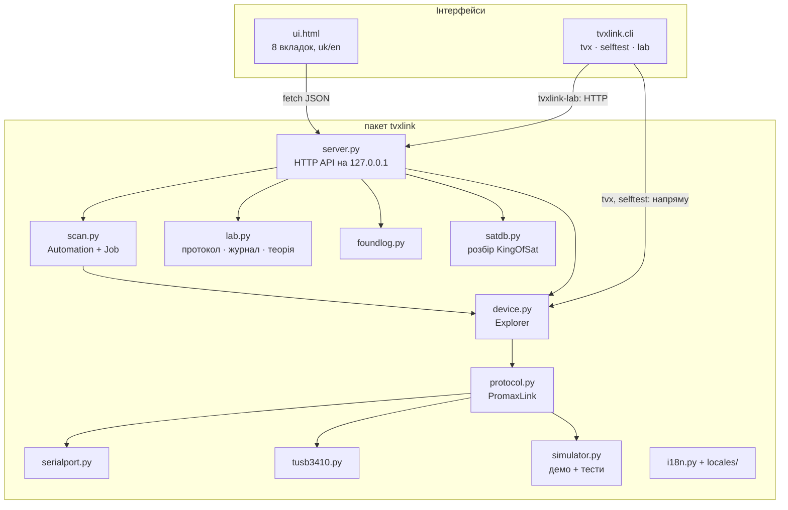
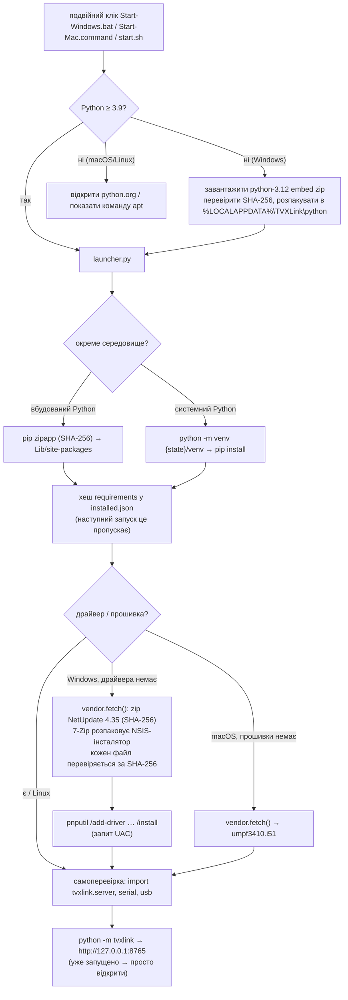
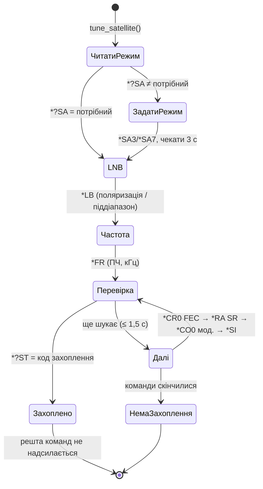
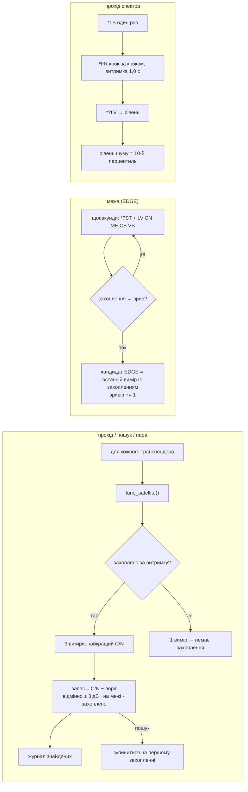
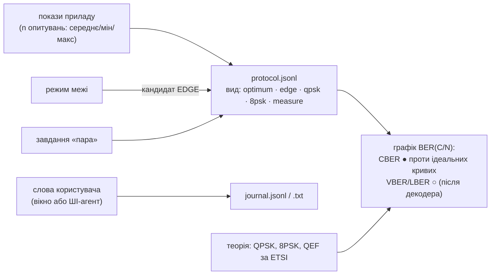
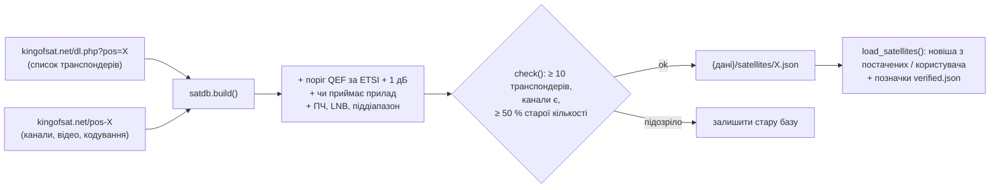

# Як працює TVXLink

[English](HOW_IT_WORKS.md) · [README](../README.uk.md)

1. [Складові](#1-складові)
2. [Встановлення і запуск](#2-встановлення-і-запуск)
3. [Зв’язок із приладом](#3-звязок-із-приладом)
4. [Налаштування і захоплення](#4-налаштування-і-захоплення)
5. [Фонові завдання: прохід, пошук, спектр, межа](#5-фонові-завдання)
6. [Спектр як у радіо](#6-спектр-як-у-радіо)
7. [Наведення антени та напрямок](#7-наведення-антени-та-напрямок)
8. [Помічник лабораторної](#8-помічник-лабораторної)
9. [Бази каналів](#9-бази-каналів)
10. [Файли даних і мови](#10-файли-даних-і-мови)

## 1. Складові

Лише стандартна бібліотека Python (плюс `pyserial` / `pyusb` для заліза). Один локальний
HTTP-сервер, одна HTML-сторінка, без веб-фреймворків і без збирання.



| Модуль | Відповідає за |
|---|---|
| `protocol.py` | кадри: чекати XON, надіслати `*CMD\r`, отримати XOFF + ACK/NAK + `*відповідь\r`; двійкова передача файлів |
| `device.py` | `Explorer`: підключення (COM / libusb / демо), ідентифікація, виміри, `lock_status()`, `tune_satellite()`, `goto_frequency()`, даталогер |
| `serialport.py` | транспорт pyserial, знаходить прилад за VID/PID 0451:3410 або назвою драйвера |
| `tusb3410.py` | драйвер TUSB3410 у просторі користувача: завантаження прошивки, налаштування UART, bulk-обмін |
| `simulator.py` | прилад у програмі: той самий протокол, шум і транспондери, справжні формати відповідей |
| `scan.py` | одне фонове завдання за раз: прохід, пошук, пара, спектр, межа (EDGE) |
| `lab.py` | протокол вимірів, журнал, напрямок, теорія BER, QEF, пари QPSK↔8PSK, рекомендації |
| `foundlog.py` | кожне захоплення → `found/found.jsonl` + `found.csv` |
| `satdb.py` | завантаження й розбір KingOfSat, пороги ETSI, перевірки, різниця баз |
| `server.py` + `ui.html` | вікно |
| `i18n.py` + `locales/*.json` | усі тексти — спільні для сервера, CLI і сторінки |
| `vendor.py`, `launcher.py` | встановлення одним кліком |

## 2. Встановлення і запуск



Папка стану користувача: `%LOCALAPPDATA%\TVXLink`, `~/Library/Application Support/TVXLink` або
`~/.local/share/tvxlink` (`TVXLINK_STATE`). Дані — у `~/TVXLink` (`TVXLINK_DATA`); наявна папка
`~/TVExplorer` версій до 1.0 використовується далі.

## 3. Зв’язок із приладом

У TV EXPLORER стоїть міст USB-UART TI TUSB3410 (VID 0451, PID 3410). Через нього прилад говорить
ASCII-протоколом дистанційного керування PROMAX на 115200 бод, 8N1 — подробиці в
[PROTOCOL.uk.md](PROTOCOL.uk.md).

| ОС | Шлях |
|---|---|
| Windows | драйвер TI (`umpusbvista.sys`) завантажує прошивку й створює «UMP USB Serial Port (COMn)»; TVXLink відкриває його через pyserial |
| macOS | драйвера немає: `tusb3410.py` знаходить завантажувач, надсилає `umpf3410.i51` через bulk OUT (заголовок `<len LE16><sum8>`), чекає перепідключення, вибирає конфігурацію 2 й відкриває UART vendor-запитами — так само, як Linux `ti_usb_3410_5052` |
| Linux | драйвер ядра дає `/dev/ttyUSB0`; pyserial |

Кожен байт обміну пишеться в `logs/session_*.log` у hex — саме цей журнал дозволив налагодити
роботу зі справжнім приладом (і з нього розібрано скриншот наведення).

## 4. Налаштування і захоплення

**Захоплення = рядок стану приладу.** `*?ST` повертає стан демодулятора, який прилад пише внизу
екрана. RM-404 порівнює його з кодом «MPEG-2 TS» поточного режиму; TVXLink робить так само:

| режим `*?SA` | код захоплення `*?ST` | напис |
|---|---|---|
| 3 (DVB-S) | 6 | MPEG-2 TS DVB-S (перевірено) |
| 7 (DVB-S2) | 8 | MPEG-2 TS DVB-S2 (перевірено) |
| 1 (DVB-T) / 2 (DVB-C) | 2 / 4 | з RM-404 |

MER — лише запасна ознака, якщо прилад не відповідає на `*?ST`.



Незмінені параметри повторно не надсилаються; режим перечитується щоразу, бо прилад сам
переходить у DVB-S2, коли ввімкнено «Розпізнавання DVB-S2» (знайдено на справжньому приладі).

## 5. Фонові завдання

`scan.Automation` виконує одне завдання за раз у потоці; сторінка опитує `/api/job?since=N` і
отримує лише нові елементи. Кожне завдання пише `sessions/<час>_<вид>/` (CSV + `result.json`).



## 6. Спектр як у радіо

Команди дистанційного спектра в приладі немає, тому TVXLink будує спектр сам: `*FR` + `*?LV` на
кожному кроці (рівень встановлюється за 0,77 с, витримка за замовчуванням 1,0 с). Транспондери
вибраного супутника малюються зонами; клік усередині зони — повне налаштування (SR, FEC,
модуляція), клік поза нею — лише частота (`goto_frequency`). Коліщатко та стрілки змінюють частоту,
прилад перебудовується, коли ви перестали крутити. «Шукати» — прохід, що зупиняється на першому
каналі, який прилад справді захопив. «Перевірити канали на екрані» проходить усі видимі
транспондери: захоплені зеленіють із назвою каналу. Збережені проходи можна відкрити знову; є
експорт SVG і HTML-звіт.

## 7. Наведення антени та напрямок

Вкладка «Наведення» кожні 0,4 с опитує `*?LV *?CN *?ME` і `*?ST`, утримує піки, малює тренд і може
грати тон, висота якого йде за C/N.

Напрямок на геостаціонарний супутник (сферична Земля, R = 6371 км, a = 42164 км):

```
Δλ = λсуп − λ;   cos b = cos φ · cos Δλ;   d = √(a² + R² − 2aR·cos b)
El = atan2(cos b − R/a, √(1 − cos² b))
Az = atan2(sin Δλ, −sin φ · cos Δλ)        (від істинної півночі за годинниковою)
нахил = atan2(sin Δλ, tan φ)               (нахил поляризації LNB)
```

Для тарілки лабораторії РТФ КПІ (50°26′51,15″ пн. ш., 30°27′28,12″ сх. д.) і 16°E: Az 198,48965°,
El 30,59637°, d 38563,09 км — `tests/test_lab.py` звіряє це з методичкою.

## 8. Помічник лабораторної



- **Протокол** містить лише покази приладу. Рядок ніколи не стирається: ✕ дописує позначку «приховано».
- **Теорія BER** (до декодера, AWGN, код Грея): `Eb/N0 = C/N + 10·lg(Bn/(k·Rs))`, `Bn = 1,4·Rs`,
  `k = 2` для QPSK, `3` для 8PSK; QPSK `Pb = ½·erfc√(Eb/N0)`, 8PSK `Pb ≈ ⅓·erfc(√(3·Eb/N0)·sin π/8)`.
  З кривими порівнюється CBER; VBER/LBER — після декодера й малюються порожніми кружками.
- **Поріг QEF** у шкалі C/N: `Es/N0(ETSI) − 10·lg(Bn/Rs)`.
- **Пари**: кожному 8PSK — найближчі QPSK (та сама поляризація й піддіапазон, близька частота,
  краще той самий SR і FEC) і перелік інших відмінностей, щоб різницю BER не приписати лише модуляції.
- **Рекомендації** оцінюють транспондери: перевірені на приладі, відкритий MPEG-2, DVB-S (VBER),
  низький поріг C/N, широка несуча; штрафують вузькі несучі та вузькі промені.

## 9. Бази каналів



Прилад демодулює DVB-S QPSK 2–45 Мбод і DVB-S2 QPSK ≤ 33 / 8PSK ≤ 30 Мбод; транспондери 16/32APSK
показуються, але позначені як непідтримувані.

## 10. Файли даних і мови

Дані користувача — див. таблицю в README. Види, джерела й підсумки
зберігаються як коди, незалежні від мови, і показуються вибраною мовою.

Мови: `tvxlink/locales/uk.json` і `en.json` містять усі тексти (≈ 575 ключів). Сервер і CLI
використовують `tr("ключ", **значення)`, сторінка бере словник з `/api/i18n` і використовує
`T('ключ')`. Результати й протоколи зберігають **коди** (`excellent`, `optimum`, `scan`…), тож зміна
мови перепідписує і старі дані. `tests/test_i18n.py` падає на відсутньому ключі, розбіжних
підстановках або кирилиці, вписаній у код поза словниками.
