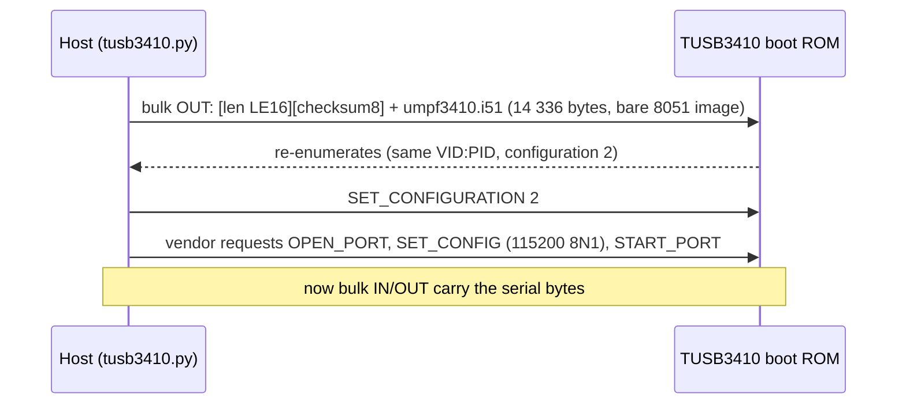
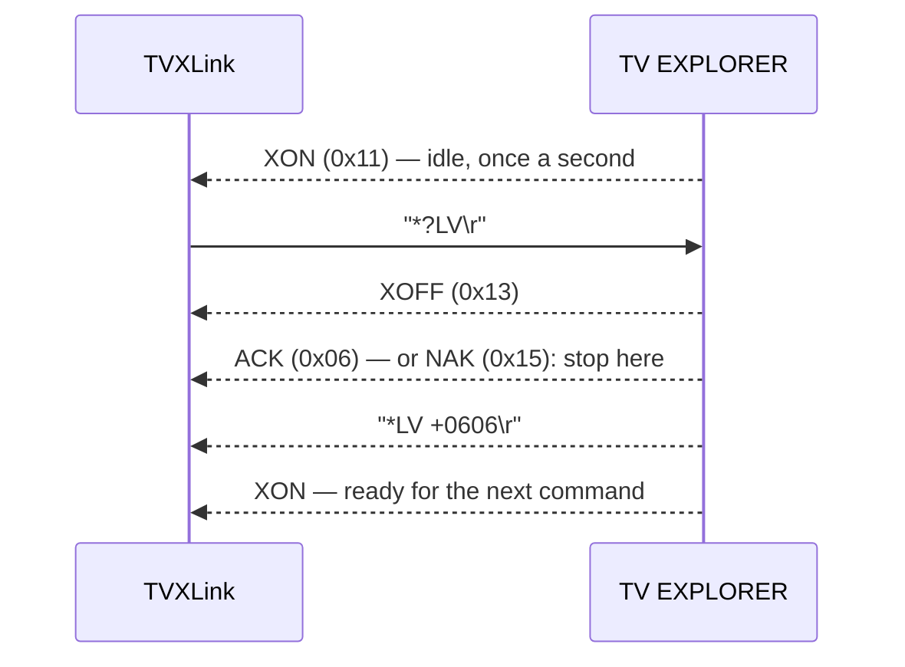
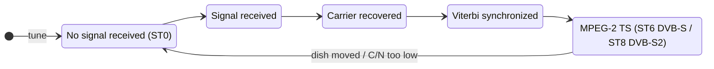
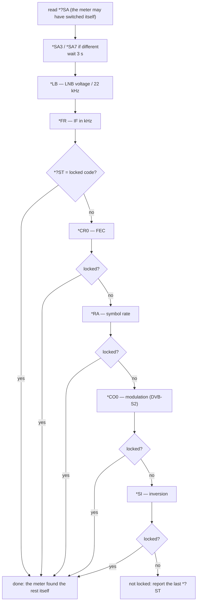

# PROMAX remote-control protocol (as used by TVXLink)

**English** · [Українська](PROTOCOL.uk.md)

PROMAX does not publish this protocol. Everything here was reconstructed from the official
PROMAX Windows programs: **NetUpdate 4.35** (`NetUpdate4.exe`, C++/MFC), **NetUpdate 3.16**
(the `.dl` format) and **RM-404 v2.60** (tuning). They were taken apart with Ghidra and objdump.
Every fact marked ✔ was then checked on a real **TV EXPLORER II+ (firmware 1.30.1090.280)** on
2026-11-12. The raw notes, addresses and scripts are in [`reverse/`](../reverse) (Ukrainian).

Legend: ✔ checked on the meter · ◇ from the PROMAX code only, not yet seen on the meter.

## Contents

1. [Physical link](#1-physical-link)
2. [Framing and handshake](#2-framing-and-handshake)
3. [Identification](#3-identification)
4. [Measurement queries and reply formats](#4-measurement-queries-and-reply-formats)
5. [Mode and lock status](#5-mode-and-lock-status)
6. [Satellite tuning](#6-satellite-tuning)
7. [Datalogger transfer and the `.dl` format](#7-datalogger-transfer-and-the-dl-format)
8. [Spectrum](#8-spectrum)
9. [Dangerous commands (never sent)](#9-dangerous-commands-never-sent)
10. [Timing](#10-timing)
11. [How to add a new fact](#11-how-to-add-a-new-fact)

## 1. Physical link

| | |
|---|---|
| USB bridge | Texas Instruments **TUSB3410**, VID:PID `0451:3410` ✔ (`24A7:0002` is also listed in `Equipment.xml` ◇) |
| Serial | **115200 baud, 8N1**, no hardware flow control ✔ (`<Baud>115200</Baud>` of the EXPLORER-II family) |
| Windows | TI driver `umpusbvista.sys` + firmware `umpf3410.i51` → a COM port ✔. TVXLink downloads both from the PROMAX package (see [HOW_IT_WORKS](HOW_IT_WORKS.md#2-installation-and-start)) |
| Linux | kernel driver `ti_usb_3410_5052` → `/dev/ttyUSB0` |
| macOS | no driver: TVXLink loads the firmware itself through libusb (`tvxlink/tusb3410.py`) |

How the firmware gets into a bare TUSB3410 (same as `ti_usb_3410_5052` in Linux):



## 2. Framing and handshake

Commands are ASCII, start with `*` and end with `\r`. Queries have `?` after the star.
Flow control uses single bytes:

| Byte | Name | Meaning |
|---|---|---|
| `0x11` | XON | "ready for a command". The meter sends it **once a second** while idle ✔ |
| `0x13` | XOFF | "command received, busy" |
| `0x06` | ACK | command accepted |
| `0x15` | NAK | command refused (unknown, or not possible in the current screen) |
| `0x0D` | CR | end of command / end of reply |



The exchange in NetUpdate (function `0x4a1cd0`):

1. wait for XON, else error `ErrXON`;
2. send the command string;
3. wait for XOFF, else `ErrXOFF`;
4. wait for ACK, else `ErrNAK`;
5. sleep 200 ms, then read up to 50 bytes.

If XON arrives right after the reply's CR, the next command does not wait for another one.
`\r` and `\x11` are removed from the reply.

TVXLink (`tvxlink/protocol.py`, class `PromaxLink`) follows this flow with two changes:

- it reads until CR instead of sleeping a fixed 200 ms;
- after the port opens it waits **up to 12 s** for the first XON and repeats the identification ✔.
  Once the meter stayed silent for about 35 s after the port opened, while a 2.5 s wait had left
  the model and firmware empty.

Every byte in both directions goes to `logs/session_*.log` as hex with a timestamp.

## 3. Identification

| Query | Reply on TV EXPLORER II+ 1.30 | |
|---|---|---|
| `*?NA` (also `*?NAM`) | `NATV EXPLORER II+` | model ✔ |
| `*?VE` (also `*?VER`) | `VE1.30.1090.280` | firmware ✔ |
| `*?ID`, `*?IDA`, `*?IDEXT` | NAK | listed in `Equipment.xml` as `<EID>` but **not supported** by this firmware ✔. TVXLink treats it as optional |
| `*?SY` | `SY00` | analog TV system, meaningless in satellite mode ✔ |

## 4. Measurement queries and reply formats

A reply is `*` + the two letters of the query + data. TVXLink parses `data = reply[3:]` in
`device.parse_measure()`.

| Query | Example reply ✔ | Value | Unit |
|---|---|---|---|
| `*?FR` | `FR1174631` | 1174.631 | MHz. The meter sends **kHz**; in satellite mode this is the IF 950–2150 MHz |
| `*?LV` | `LV +0591` | 59.1 | dBµV, **×10** |
| `*?CN` | `CN -0060` | −6.0 | dB, ×10 |
| `*?ME` | `ME<+0030` | < 3.0 | dB (MER), ×10 |
| `*?CB` | `CB +38E-3` | 3.8·10⁻² | CBER (before Viterbi / LDPC) |
| `*?VB` | `VB<+10E-9` | < 1.0·10⁻⁸ | VBER (DVB-S, after Viterbi) or LBER (DVB-S2, after LDPC) |

**Flags.** One character **before the sign** ✔ (`ME<+0030`, not `ME+<0030`):

| Flag | Meaning | On the meter screen |
|---|---|---|
| ` ` (space) | normal value | `59.1` |
| `<` | below the measuring limit: the value is an upper bound | `<3.0`, `<1.0E-7` |
| `>` | above the limit: lower bound | `>1.0E-1` |
| `!` | no value (not measurable now) | `---` |

**BER layout.** A sign, an **integer** two-digit mantissa, `E` and a negative exponent ✔.
`CB +38E-3` = 38·10⁻³ = **3.8·10⁻²**, and the meter screen showed `3.8E-2` for that reply.
In the same way `CB>+10E-2` = 0.10 is shown as `>1.0E-1`. `lab.ber_value()` parses both this
form and the plain `1.2E-04` form.

```text
CB  >  +  38  E-3
│   │  │  │   └ exponent
│   │  │  └ integer mantissa  →  38·10⁻³ = 3.8·10⁻²
│   │  └ sign
│   └ flag (space, <, >, !)
└ query letters
```

**NAK on measurements.** `*?LV/CN/ME/CB/VB` answer NAK while the meter shows the **TV picture** ✔.
`*?FR`, `*?SA` and `*?ST` still answer then. Measurements come back once the meter shows the
measurement screen (button **[12]**). If all five measurements return NAK, the self-test and the
window say exactly that. A NAK was also seen for a moment while the meter switched modes; a
repeated query then helps.

Other queries known from NetUpdate ◇: `*?SE` (like BER, plus `TOV`), `*?VA` and `*?FM` (analog
modes only).

## 5. Mode and lock status

`*?SA` returns the demodulator mode, `*?ST` the **status line** the meter prints at the bottom
of the screen. Both are hex after the three letters (`*ST06` → 6).

| `*SA<n>` / `*?SA` | Mode |
|---|---|
| 0 | analog |
| 1 | DVB-T |
| 2 | DVB-C |
| **3** | **DVB-S** ✔ |
| **7** | **DVB-S2** ✔ |
| 4, 5, 6, 8, 9, A, B | other standards ◇ |

**The meter switches between `SA3` and `SA7` by itself** ✔ (automatic DVB-S2 recognition).
TVXLink therefore reads `*?SA` again before every tuning instead of trusting what it sent last.

Lock codes: RM-404 compares `*?ST` with a per-mode "locked" value (functions
`0x4a3bee…0x4b2a2a`):

| `*?SA` | 1 | 2 | **3** | 4 | 5 | 6 | **7** | 9 | A |
|---|---|---|---|---|---|---|---|---|---|
| `*?ST` when locked | 2 | 4 | **6** ✔ | 7 | 3 | 5 | **8** ✔ | 9 | 10 |

Seen on the meter ✔: `SA3`/`ST0` = "No signal received", `SA3`/`ST6` = "MPEG-2 TS DVB-S",
`SA7`/`ST8` = "MPEG-2 TS DVB-S2".

The screen texts in lock order come from the user manual (5.2.11.7). Which code shows which
intermediate text is **not known yet**:



The labels live in [`tvxlink/satellites/st_codes.json`](../tvxlink/satellites/st_codes.json).
The self-test (stage 5) records every code it sees. Please send new ones through the
[meter report](../.github/ISSUE_TEMPLATE/meter_report.yml).

## 6. Satellite tuning

Commands and codes from RM-404 v2.60 (`Config_dvbs`, functions `0x4ac2c0…0x4aca30`).
In `tvxlink/device.py`: `SAT_MODES`, `LNB_CODES`, `FEC_DVBS`, `FEC_DVBS2`, `MOD_DVBS2`.

| Command | Meaning | Codes |
|---|---|---|
| `*SA<n>` | standard | 3 DVB-S, 7 DVB-S2 |
| `*LB<n>` | LNB supply | 0 external · **2 13 V** · 6 13 V + 22 kHz · **4 18 V** · 7 18 V + 22 kHz |
| `*FR%07d` | frequency, kHz | for satellites the **IF**: `f − LO` (or `LO − f`), 950 000…2 150 000 |
| `*CR0<n>` | FEC, DVB-S | 1/2→0, 2/3→1, 3/4→2, 5/6→4, 7/8→6 |
| `*CR0<n>` | FEC, DVB-S2 | 1/2→0, 2/3→1, 3/4→2, 4/5→3, 5/6→4, 6/7→5, 7/8→6, 1/4→7, 1/3→8, 2/5→9, 3/5→10, 8/9→11, 9/10→12 |
| `*RA%05d` | symbol rate, kBd | `*RA27500` |
| `*CO0<n>` | modulation, DVB-S2 | QPSK→8, 8PSK→9 (DVB-C: QAM orders ◇) |
| `*SI<n>` | spectral inversion | 0 / 1 |

Universal LNB: LO 9750 MHz below 11.7 GHz (13/18 V without 22 kHz), 10 600 MHz above (with
22 kHz). Polarisation: V = 13 V, H = 18 V. `tune_satellite()` picks the LO, the IF and the
`*LB` code from the frequency and polarisation.

**Order and early stop** (RM-404 behaviour, kept by TVXLink):



RM-404 waits 3 s after `*SA` and 1.5 s after each other command, then checks `*?ST`.
TVXLink polls `*?ST` instead and moves on as soon as the code is stable (`_settle`), so a lock
usually takes 5–8 s. Real example ✔ (13°E 10992.1 V, DVB-S QPSK 2/3, SR 27500):

```text
*SA3  *LB2  *FR1242100  *CR01   → *?ST = 6 "MPEG-2 TS DVB-S" in 7.6 s
*RA27500, *SI0                  → skipped, the meter had already locked
```

## 7. Datalogger transfer and the `.dl` format

File type `0A` is the datalogger (NetUpdate 4, `0x5b4a20`, `0x5bab90`, `0x5b52a0`):

1. `*?FI0A` → `*FI` + number of files (2 hex digits).
2. `*?FI0ANN` (NN = index, `%02x`) → `*FI` + `r[3:5]` + `r[5:13]` + name `r[13:]`.
3. `*?FL0A<name>\r` → XOFF, ACK, 300 ms pause, then a binary stream: `*FL` + 8 hex digits N +
   N bytes. NetUpdate expects exactly N + 11 bytes and keeps bytes `[11 : 11+N−4]`, dropping the
   last 4. The transfer is aborted after 15 s of silence twice, or more than 25 lone XON bytes in
   a row. In TVXLink this is `PromaxLink.receive_file()`. XON/XOFF inside the binary data are
   not touched.

On the tested TV EXPLORER II+ 1.30, `*?FI0A` answered NAK in satellite mode ✔. The transfer code
is therefore tested against the simulator only.

The `.dl` layout (NetUpdate 3.16, functions `0x43a1c0`, `0x43cbd0`, `0x43e2b0`), parsed by
`tvxlink/dlfile.py`:

```text
0        0xDA
1        n, name[n]
n+2      L (u24) — channel-plan block; plan = [n+5 : n+5+L]
           [0..1] channel count, [2] flag
           [3..]  global attributes, 5 bytes each, until FF FF (position i)
           channels from i: name 8 chars (+8), u32 (+0x10), u32 frequency kHz (+0x14),
                            attributes 5 bytes from +0x18 until FF FF; step = s + 0x1a
P=n+L:   P+5 k; P+6..21 16 chars; P+0x16 day, +0x17 month, +0x18 year u16,
         +0x1a hour, +0x1b minute
n+L+k+6  per channel: m, types[m], IF mode (1/3: f−LO, 2/4: LO−f), LO u24 kHz
then     test-point count u16; record: len, name, unit (1 dBµV, 2 dBmV, 3 dBm),
         3 bytes per measurement per channel
```

Measurement types: 0 Level, 1 V/A, 2 C/N, 3 POWER, 4 MER, 5 CBER, 6 VBER, 7 OFFSET (kHz),
8 MPEG-2, 9 NOISE/LINK MARGIN, 10 REF ICT, 11 C/N Auto, 12 SER, 13 LBER.

Each value takes 3 bytes:

- a flag byte: 0x80 `>`, 0x40 `<`, 0xC0 `!!`;
- an int16 ×10;
- for BER: a mantissa ×10 and an exponent;
- for OFFSET: an int16 in kHz;
- for MPEG-2: 0/1.

Channel attributes take 5 bytes; the first byte is the type:

| Type | Attribute |
|---|---|
| 1 | analog (PAL/SECAM/NTSC) |
| 2 | digital standard: 0 COFDM, 1 QAM, 2 QPSK, 4 DSS, 5 8VSB, 6 QAM-B, 7 DVB-S2, 9 DVB-T2, 10 ISDB-T |
| 3 | LNB supply |
| 4 | symbol rate |
| 6 | spectral inversion |
| 7 | QAM constellation |
| 8 | 2K/8K |
| 9 | guard interval |
| 11 | FEC |

## 8. Spectrum

Neither NetUpdate nor RM-404 has a command to read the spectrum or to set the span. Spectra saved
on the meter are the `Spectrum` resource, file type `14` (`20` in newer versions) ◇. They could be
downloaded like a datalogger; this is not implemented.

TVXLink builds the spectrum itself. It steps `*FR` across the band, waits for the level to settle
and reads `*?LV` at each step. The level settles **0.77 s** after `*FR` ✔, so the default dwell is
**1.0 s** per point. A 120 MHz span with a 4 MHz step takes about half a minute.

## 9. Dangerous commands (never sent)

These change the firmware or the meter's memory. **TVXLink never sends them.** The console
refuses anything that starts with them unless "expert mode" is ticked. Firmware update and file
deletion are refused even then. See `DANGEROUS_PREFIXES` and `FORBIDDEN_PREFIXES` in `device.py`.
Every command is sent as one line of printable ASCII: CR/LF, other control bytes or a second `*`
are refused in `protocol.py` before the port, so nothing can be hidden behind an allowed command.

| Command | What it does in PROMAX software |
|---|---|
| `*3141&` → `*BO` → `*SB230400` → `UpdEII.pro` | firmware update: bootloader, baud change, image upload |
| `*FD0A`, `*FD13`, … | delete a file on the meter |
| `*FL13`, `*FI13` | write file blocks |
| `*RM`, `*EM`, `*FILE`, `*INSTALLATION`, `*OPEN`, `*CLOSE`, `*DIR`, `*LR` | memory / file system operations (RANGER family and others) |

`tvx set` passes only the safe tuning commands: `*SA *LB *FR *CR0 *RA *CO0 *SI` and, for analog and
terrestrial modes, `*SY *GI *MO *BW`.

## 10. Timing

| What | Value |
|---|---|
| XON while idle | 1 per second ✔ (0.67–1.0/s measured) |
| first XON after the port opens | usually at once; once about 35 s ✔ → TVXLink waits up to 12 s and asks again |
| query reply | 20–850 ms ✔, median about 530 ms in DVB-S2 mode |
| level after `*FR` | settles in 0.77 s ✔ |
| after `*SA` | 3 s (RM-404) |
| after each tuning command | 1.5 s (RM-404); TVXLink polls `*?ST` instead |
| lock of a strong DVB-S transponder | 5–8 s ✔ |

## 11. How to add a new fact

1. Reproduce it with `tvx`. Ask the person at the meter what the screen shows for the same moment:
   `tvx q ST`, `tvx -v q LV`.
2. Add a test with the exact reply bytes (`tests/test_protocol.py` or `tests/test_tune.py`) and
   teach the simulator (`tvxlink/simulator.py`) the same reply.
3. Write it here with ✔, the firmware version and the date.
