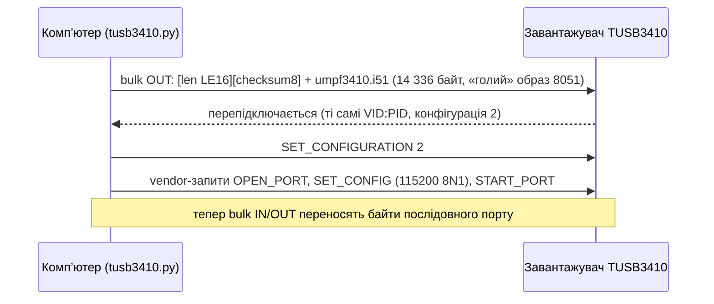
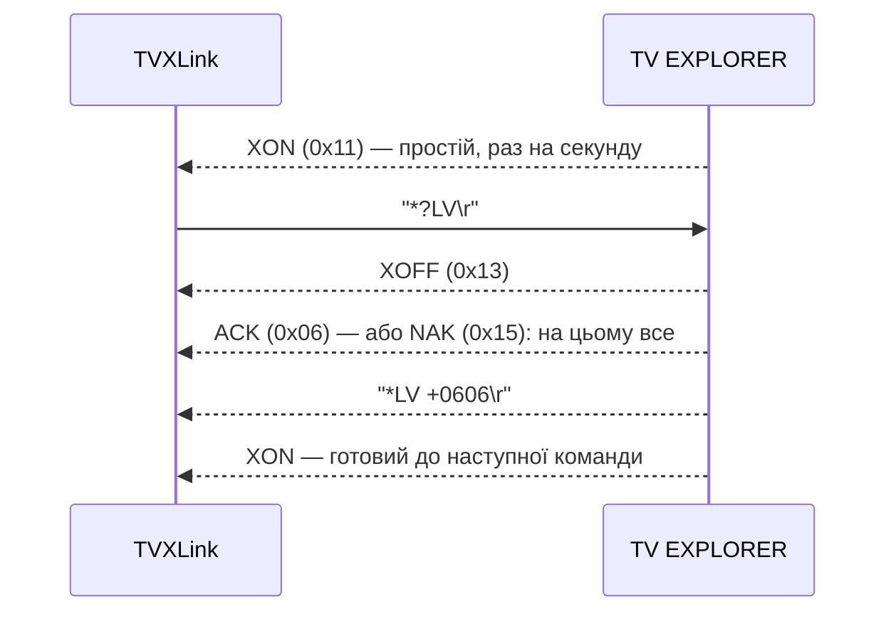
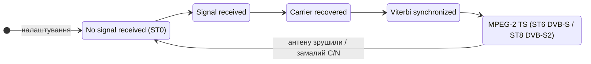
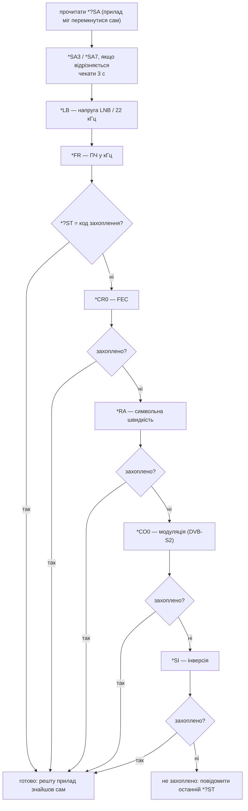

# Протокол дистанційного керування PROMAX (як його використовує TVXLink)

[English](PROTOCOL.md) · **Українська**

PROMAX не публікує цей протокол. Усе нижче відновлено з офіційних Windows-програм PROMAX:
**NetUpdate 4.35** (`NetUpdate4.exe`, C++/MFC), **NetUpdate 3.16** (формат `.dl`) і **RM-404 v2.60**
(налаштування). Їх розібрано в Ghidra та objdump. Кожен факт із позначкою ✔ потім перевірено на
справжньому **TV EXPLORER II+ (прошивка 1.30.1090.280)** 12.11.2026. Сирі нотатки, адреси й скрипти
лежать у [`reverse/`](../reverse).

Позначки: ✔ перевірено на приладі · ◇ лише з коду PROMAX, на приладі ще не бачили.

## Зміст

1. [Фізичне з’єднання](#1-фізичне-зєднання)
2. [Кадри й рукостискання](#2-кадри-й-рукостискання)
3. [Ідентифікація](#3-ідентифікація)
4. [Запити вимірювань і формати відповідей](#4-запити-вимірювань-і-формати-відповідей)
5. [Режим і стан захоплення](#5-режим-і-стан-захоплення)
6. [Налаштування на супутник](#6-налаштування-на-супутник)
7. [Передача даталогера й формат `.dl`](#7-передача-даталогера-й-формат-dl)
8. [Спектр](#8-спектр)
9. [Небезпечні команди (ніколи не надсилаються)](#9-небезпечні-команди-ніколи-не-надсилаються)
10. [Часові характеристики](#10-часові-характеристики)
11. [Як додати новий факт](#11-як-додати-новий-факт)

## 1. Фізичне з’єднання

| | |
|---|---|
| USB-міст | Texas Instruments **TUSB3410**, VID:PID `0451:3410` ✔ (у `Equipment.xml` є ще `24A7:0002` ◇) |
| Послідовний порт | **115200 бод, 8N1**, без апаратного керування потоком ✔ (`<Baud>115200</Baud>` родини EXPLORER-II) |
| Windows | драйвер TI `umpusbvista.sys` + прошивка `umpf3410.i51` → COM-порт ✔. TVXLink завантажує обидва з пакета PROMAX (див. [HOW_IT_WORKS](HOW_IT_WORKS.uk.md#2-встановлення-і-запуск)) |
| Linux | драйвер ядра `ti_usb_3410_5052` → `/dev/ttyUSB0` |
| macOS | драйвера немає: TVXLink сам завантажує прошивку через libusb (`tvxlink/tusb3410.py`) |

Як прошивка потрапляє в «чистий» TUSB3410 (так само, як у `ti_usb_3410_5052` у Linux):



## 2. Кадри й рукостискання

Команди — ASCII-рядки, що починаються з `*` і закінчуються `\r`. У запитах після зірочки стоїть `?`.
Керування потоком — окремими байтами:

| Байт | Назва | Значення |
|---|---|---|
| `0x11` | XON | «готовий до команди». Під час простою прилад шле його **раз на секунду** ✔ |
| `0x13` | XOFF | «команду прийнято, зайнятий» |
| `0x06` | ACK | команду прийнято |
| `0x15` | NAK | команду відхилено (невідома або неможлива на поточному екрані) |
| `0x0D` | CR | кінець команди / відповіді |



Обмін у NetUpdate (функція `0x4a1cd0`):

1. чекати XON, інакше помилка `ErrXON`;
2. надіслати рядок команди;
3. чекати XOFF, інакше `ErrXOFF`;
4. чекати ACK, інакше `ErrNAK`;
5. пауза 200 мс, потім прочитати до 50 байт.

Якщо одразу після CR відповіді прийшов XON, наступна команда вже не чекає іншого.
З відповіді вилучаються `\r` і `\x11`.

TVXLink (`tvxlink/protocol.py`, клас `PromaxLink`) повторює цю схему з двома змінами:

- читає до CR замість фіксованої паузи 200 мс;
- після відкриття порту чекає перший XON **до 12 с** і повторює ідентифікацію ✔. Одного разу прилад
  мовчав близько 35 с після відкриття порту, а за очікування 2,5 с модель і прошивка лишилися порожніми.

Кожен байт в обидва боки записується в `logs/session_*.log` у hex із міткою часу.

## 3. Ідентифікація

| Запит | Відповідь TV EXPLORER II+ 1.30 | |
|---|---|---|
| `*?NA` (також `*?NAM`) | `NATV EXPLORER II+` | модель ✔ |
| `*?VE` (також `*?VER`) | `VE1.30.1090.280` | прошивка ✔ |
| `*?ID`, `*?IDA`, `*?IDEXT` | NAK | у `Equipment.xml` є як `<EID>`, але ця прошивка їх **не підтримує** ✔. TVXLink вважає запит необов’язковим |
| `*?SY` | `SY00` | аналогова система ТБ, у супутниковому режимі нічого не означає ✔ |

## 4. Запити вимірювань і формати відповідей

Відповідь — це `*` + дві літери запиту + дані. TVXLink розбирає `data = reply[3:]` у
`device.parse_measure()`.

| Запит | Приклад відповіді ✔ | Значення | Одиниці |
|---|---|---|---|
| `*?FR` | `FR1174631` | 1174,631 | МГц. Прилад надсилає **кГц**; у супутниковому режимі це ПЧ 950–2150 МГц |
| `*?LV` | `LV +0591` | 59,1 | дБмкВ, **×10** |
| `*?CN` | `CN -0060` | −6,0 | дБ, ×10 |
| `*?ME` | `ME<+0030` | < 3,0 | дБ (MER), ×10 |
| `*?CB` | `CB +38E-3` | 3,8·10⁻² | CBER (до Вітербі / LDPC) |
| `*?VB` | `VB<+10E-9` | < 1,0·10⁻⁸ | VBER (DVB-S, після Вітербі) або LBER (DVB-S2, після LDPC) |

**Прапорці.** Один символ **перед знаком** ✔ (`ME<+0030`, а не `ME+<0030`):

| Прапорець | Значення | На екрані приладу |
|---|---|---|
| ` ` (пробіл) | звичайне значення | `59.1` |
| `<` | нижче межі вимірювання: значення — верхня межа | `<3.0`, `<1.0E-7` |
| `>` | вище межі: нижня межа | `>1.0E-1` |
| `!` | значення немає (зараз не вимірюється) | `---` |

**Формат BER.** Знак, **ціла** двоцифрова мантиса, `E` і від’ємний порядок ✔.
`CB +38E-3` = 38·10⁻³ = **3,8·10⁻²**, і екран приладу для цієї відповіді показував `3.8E-2`.
Так само `CB>+10E-2` = 0,10 на екрані виглядає як `>1.0E-1`. `lab.ber_value()` розбирає і цю форму,
і звичайну `1.2E-04`.

```text
CB  >  +  38  E-3
│   │  │  │   └ порядок
│   │  │  └ ціла мантиса  →  38·10⁻³ = 3,8·10⁻²
│   │  └ знак
│   └ прапорець (пробіл, <, >, !)
└ літери запиту
```

**NAK на вимірюваннях.** `*?LV/CN/ME/CB/VB` відповідають NAK, поки прилад показує **картинку ТБ** ✔.
`*?FR`, `*?SA` і `*?ST` при цьому відповідають. Виміри повертаються, щойно прилад переходить на екран
вимірювань (кнопка **[12]**). Якщо всі п’ять запитів дали NAK, самотест і вікно програми так і
пишуть. NAK також на мить бачили під час зміни режиму; тоді допомагає повторний запит.

Інші запити з NetUpdate ◇: `*?SE` (як BER, плюс `TOV`), `*?VA` і `*?FM` (лише аналогові режими).

## 5. Режим і стан захоплення

`*?SA` повертає режим демодулятора, `*?ST` — **рядок стану**, який прилад пише внизу екрана.
Обидва — hex після трьох літер (`*ST06` → 6).

| `*SA<n>` / `*?SA` | Режим |
|---|---|
| 0 | аналоговий |
| 1 | DVB-T |
| 2 | DVB-C |
| **3** | **DVB-S** ✔ |
| **7** | **DVB-S2** ✔ |
| 4, 5, 6, 8, 9, A, B | інші стандарти ◇ |

**Прилад сам перемикається між `SA3` і `SA7`** ✔ (автоматичне розпізнавання DVB-S2).
Тому TVXLink перед кожним налаштуванням знову читає `*?SA`, а не покладається на надіслане раніше.

Коди захоплення: RM-404 порівнює `*?ST` зі значенням «захоплено» для кожного режиму (функції
`0x4a3bee…0x4b2a2a`):

| `*?SA` | 1 | 2 | **3** | 4 | 5 | 6 | **7** | 9 | A |
|---|---|---|---|---|---|---|---|---|---|
| `*?ST` при захопленні | 2 | 4 | **6** ✔ | 7 | 3 | 5 | **8** ✔ | 9 | 10 |

Бачили на приладі ✔: `SA3`/`ST0` = «No signal received», `SA3`/`ST6` = «MPEG-2 TS DVB-S»,
`SA7`/`ST8` = «MPEG-2 TS DVB-S2».

Тексти екрана в порядку захоплення взято з інструкції (п. 5.2.11.7). Який код відповідає якому
проміжному тексту, **поки невідомо**:



Підписи зберігаються в [`tvxlink/satellites/st_codes.json`](../tvxlink/satellites/st_codes.json).
Самотест (стадія 5) записує кожен код, який побачив. Нові коди надсилайте через
[звіт про прилад](../.github/ISSUE_TEMPLATE/meter_report.yml).

## 6. Налаштування на супутник

Команди й коди з RM-404 v2.60 (`Config_dvbs`, функції `0x4ac2c0…0x4aca30`).
У `tvxlink/device.py`: `SAT_MODES`, `LNB_CODES`, `FEC_DVBS`, `FEC_DVBS2`, `MOD_DVBS2`.

| Команда | Значення | Коди |
|---|---|---|
| `*SA<n>` | стандарт | 3 DVB-S, 7 DVB-S2 |
| `*LB<n>` | живлення LNB | 0 зовнішнє · **2 13 В** · 6 13 В + 22 кГц · **4 18 В** · 7 18 В + 22 кГц |
| `*FR%07d` | частота, кГц | для супутника — **ПЧ**: `f − LO` (або `LO − f`), 950 000…2 150 000 |
| `*CR0<n>` | FEC, DVB-S | 1/2→0, 2/3→1, 3/4→2, 5/6→4, 7/8→6 |
| `*CR0<n>` | FEC, DVB-S2 | 1/2→0, 2/3→1, 3/4→2, 4/5→3, 5/6→4, 6/7→5, 7/8→6, 1/4→7, 1/3→8, 2/5→9, 3/5→10, 8/9→11, 9/10→12 |
| `*RA%05d` | символьна швидкість, кбод | `*RA27500` |
| `*CO0<n>` | модуляція, DVB-S2 | QPSK→8, 8PSK→9 (DVB-C: порядки QAM ◇) |
| `*SI<n>` | інверсія спектра | 0 / 1 |

Універсальний LNB: LO 9750 МГц нижче 11,7 ГГц (13/18 В без 22 кГц), 10 600 МГц вище (з 22 кГц).
Поляризація: V = 13 В, H = 18 В. `tune_satellite()` сам вибирає LO, ПЧ і код `*LB` за частотою та
поляризацією.

**Порядок і рання зупинка** (поведінка RM-404, яку зберігає TVXLink):



RM-404 чекає 3 с після `*SA` і 1,5 с після кожної іншої команди, а потім перевіряє `*?ST`.
TVXLink натомість опитує `*?ST` і йде далі, щойно код стабільний (`_settle`), тому захоплення
зазвичай займає 5–8 с. Реальний приклад ✔ (13°E 10992,1 V, DVB-S QPSK 2/3, SR 27500):

```text
*SA3  *LB2  *FR1242100  *CR01   → *?ST = 6 «MPEG-2 TS DVB-S» за 7,6 с
*RA27500, *SI0                  → пропущено, прилад уже захопив канал
```

## 7. Передача даталогера й формат `.dl`

Тип файлу `0A` — даталогер (NetUpdate 4, `0x5b4a20`, `0x5bab90`, `0x5b52a0`):

1. `*?FI0A` → `*FI` + кількість файлів (2 hex-цифри).
2. `*?FI0ANN` (NN — номер, `%02x`) → `*FI` + `r[3:5]` + `r[5:13]` + ім’я `r[13:]`.
3. `*?FL0A<ім’я>\r` → XOFF, ACK, пауза 300 мс, потім двійковий потік: `*FL` + 8 hex-цифр N +
   N байт. NetUpdate чекає рівно N + 11 байт і зберігає байти `[11 : 11+N−4]`, відкидаючи останні 4.
   Передача переривається після 15 с тиші двічі поспіль або понад 25 одиночних XON підряд.
   У TVXLink це `PromaxLink.receive_file()`. XON/XOFF усередині двійкових даних не чіпаються.

На перевіреному TV EXPLORER II+ 1.30 `*?FI0A` у супутниковому режимі відповів NAK ✔. Тому код
передачі перевірено лише на симуляторі.

Структура `.dl` (NetUpdate 3.16, функції `0x43a1c0`, `0x43cbd0`, `0x43e2b0`), розбирає
`tvxlink/dlfile.py`:

```text
0        0xDA
1        n, ім’я[n]
n+2      L (u24) — довжина блоку плану каналів; план = [n+5 : n+5+L]
           [0..1] кількість каналів, [2] прапорець
           [3..]  глобальні атрибути по 5 байт до FF FF (позиція i)
           канали від i: ім’я 8 симв. (+8), u32 (+0x10), u32 частота кГц (+0x14),
                         атрибути по 5 байт з +0x18 до FF FF; крок = s + 0x1a
P=n+L:   P+5 k; P+6..21 16 символів; P+0x16 день, +0x17 місяць, +0x18 рік u16,
         +0x1a година, +0x1b хвилина
n+L+k+6  по каналах: m, типи[m], режим ПЧ (1/3: f−LO, 2/4: LO−f), LO u24 кГц
далі     кількість тестових точок u16; запис: len, ім’я, одиниці (1 дБмкВ, 2 дБмВ, 3 дБм),
         по 3 байти на кожне вимірювання кожного каналу
```

Типи вимірювань: 0 Level, 1 V/A, 2 C/N, 3 POWER, 4 MER, 5 CBER, 6 VBER, 7 OFFSET (кГц), 8 MPEG-2,
9 NOISE/LINK MARGIN, 10 REF ICT, 11 C/N Auto, 12 SER, 13 LBER.

Кожне значення займає 3 байти:

- байт прапорця: 0x80 `>`, 0x40 `<`, 0xC0 `!!`;
- int16 ×10;
- для BER — мантиса ×10 і порядок;
- для OFFSET — int16 у кГц;
- для MPEG-2 — 0/1.

Атрибути каналу займають 5 байт, перший байт — тип:

| Тип | Атрибут |
|---|---|
| 1 | аналоговий (PAL/SECAM/NTSC) |
| 2 | цифровий стандарт: 0 COFDM, 1 QAM, 2 QPSK, 4 DSS, 5 8VSB, 6 QAM-B, 7 DVB-S2, 9 DVB-T2, 10 ISDB-T |
| 3 | живлення LNB |
| 4 | символьна швидкість |
| 6 | інверсія спектра |
| 7 | сузір’я QAM |
| 8 | 2K/8K |
| 9 | захисний інтервал |
| 11 | FEC |

## 8. Спектр

Ні в NetUpdate, ні в RM-404 немає команди, яка читає спектр або задає смугу огляду. Спектри,
збережені на приладі, — це ресурс `Spectrum`, тип файлу `14` (`20` у новіших версіях) ◇. Їх можна
було б завантажувати як даталогер; це не реалізовано.

TVXLink будує спектр сам. Він крокує `*FR` по смузі, чекає, поки встановиться рівень, і на кожному
кроці читає `*?LV`. Рівень встановлюється за **0,77 с** після `*FR` ✔, тому типова витримка —
**1,0 с** на точку. Смуга 120 МГц із кроком 4 МГц займає близько пів хвилини.

## 9. Небезпечні команди (ніколи не надсилаються)

Ці команди змінюють прошивку або пам’ять приладу. **TVXLink їх ніколи не надсилає.** Консоль
відхиляє все, що з них починається, якщо не ввімкнено «режим експерта». Оновлення прошивки й
видалення файлів відхиляються навіть тоді. Див. `DANGEROUS_PREFIXES` і `FORBIDDEN_PREFIXES` у
`device.py`. Кожна команда надсилається одним рядком із друкованих символів ASCII: CR/LF, інші
керівні байти чи другий `*` відхиляються в `protocol.py` ще до порту, тож за дозволеною командою
не можна сховати іншу.

| Команда | Що робить у програмах PROMAX |
|---|---|
| `*3141&` → `*BO` → `*SB230400` → `UpdEII.pro` | оновлення прошивки: завантажувач, зміна швидкості, передача образу |
| `*FD0A`, `*FD13`, … | видалення файлу на приладі |
| `*FL13`, `*FI13` | запис блоків файлів |
| `*RM`, `*EM`, `*FILE`, `*INSTALLATION`, `*OPEN`, `*CLOSE`, `*DIR`, `*LR` | операції з пам’яттю / файловою системою (родина RANGER та інші) |

`tvx set` пропускає лише безпечні команди налаштування: `*SA *LB *FR *CR0 *RA *CO0 *SI` і, для
аналогового та ефірного режимів, `*SY *GI *MO *BW`.

## 10. Часові характеристики

| Що | Значення |
|---|---|
| XON під час простою | 1 на секунду ✔ (виміряно 0,67–1,0/с) |
| перший XON після відкриття порту | зазвичай одразу; одного разу близько 35 с ✔ → TVXLink чекає до 12 с і питає знову |
| відповідь на запит | 20–850 мс ✔, медіана близько 530 мс у режимі DVB-S2 |
| рівень після `*FR` | встановлюється за 0,77 с ✔ |
| після `*SA` | 3 с (RM-404) |
| після кожної команди налаштування | 1,5 с (RM-404); TVXLink натомість опитує `*?ST` |
| захоплення сильного транспондера DVB-S | 5–8 с ✔ |

## 11. Як додати новий факт

1. Відтворіть його через `tvx`. Спитайте людину біля приладу, що в цей момент на екрані:
   `tvx q ST`, `tvx -v q LV`.
2. Додайте тест із точними байтами відповіді (`tests/test_protocol.py` або `tests/test_tune.py`) і
   навчіть симулятор (`tvxlink/simulator.py`) тієї самої відповіді.
3. Запишіть факт сюди з позначкою ✔, версією прошивки й датою.
