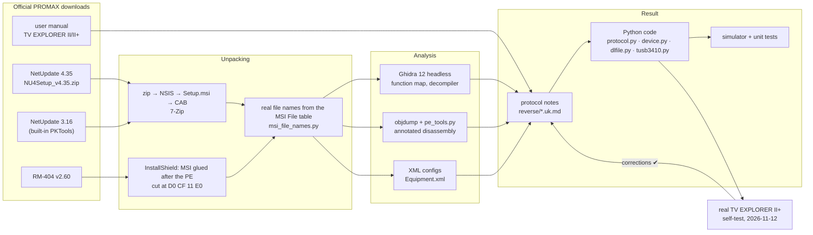

# How the protocol was recovered

**English** · [Українська](REVERSE_ENGINEERING.uk.md)

PROMAX ships no documentation for the TV EXPLORER II / II+ USB protocol and no software for
macOS or Linux. Its own Windows programs are from 2008–2018. Before TVXLink could talk to the
meter, the protocol had to be recovered from those programs. This page explains what was taken
apart, with which tools, what was found where, and how every finding was then checked on a real
meter.

The full notes, with every function address, are in Ukrainian in
[`reverse/FULL_REPORT.uk.md`](../reverse/FULL_REPORT.uk.md) and
[`reverse/NOTES.uk.md`](../reverse/NOTES.uk.md). The scripts are in [`reverse/scripts/`](../reverse/scripts).
The result, as a reference, is [PROTOCOL.md](PROTOCOL.md).

## The pipeline



## 1. Sources

All of them are public downloads from the PROMAX website. They were downloaded again on
2026-11-08 so that the analysis can be repeated from the same files.

| File | What it is | What it gave |
|---|---|---|
| `NU4Setup_v4.35.zip` | NetUpdate 4.35 (2017–2018), the firmware / resource updater | USB bridge and driver, `Equipment.xml`, the XON/XOFF/ACK exchange, the monitoring windows (reply formats), datalogger transfer |
| `NU3Setup_v3.16.zip` | NetUpdate 3.16 with **PKTools** built in ("Advanced utilities") | the binary `.dl` datalogger format |
| `RM-404v2.60.zip` | RM-404 v2.60 (2013), monitoring and alarm software for the TV EXPLORER series | **all satellite tuning commands** and codes, the lock codes of `*?ST`, the tuning order and pauses |
| `remote-control-commands-promax-analyzers.pdf` | remote-control commands of the HD RANGER family | the same XON/XOFF/ACK handshake, described in words |
| `TVExplorer-2-2p-ukrainian.pdf` | the TV EXPLORER II/II+ user manual | how BER looks on the screen (`3.3E-2`, `<1.0E-7`), the status-line texts, CBER/VBER/LBER |
| `ti_usb_3410_5052.c` | the Linux kernel driver for TUSB3410 | how to load the firmware into the chip and open its UART without a vendor driver (macOS) |

PKTools is no longer offered on its own on the PROMAX site, but it is fully contained in
NetUpdate 3.16.

## 2. Unpacking the installers

The programs are wrapped several times. 7-Zip opens every layer, but it gives MSI files hashed
names (`_C223B6…`). `msi_file_names.py` reads the MSI `File` table (`!_StringPool` /
`!_StringData`) and restores the real names.

```sh
# NetUpdate 4 / 3: zip → NSIS exe → Setup.msi → CAB
unzip NU4Setup_v4.35.zip && 7zz x -onu4 NU4Setup_v4.35.exe && 7zz x -omsi nu4/Setup.msi
7zz x -ocab msi/_<long key>
python3 reverse/scripts/msi_file_names.py msi cab named
# RM-404 (InstallShield): the MSI is appended to the PE — cut from the signature D0 CF 11 E0 A1 B1 1A E1,
# then 7zz x RM404.msi → Data.Cab → 7zz x Data.Cab
```

What is inside:

| Program | Language / compiler | Notes |
|---|---|---|
| `NetUpdate4.exe` (10.5 MB) | C++ / MFC, Visual C++ 9, x86 | strings in UTF-16 |
| `NetUpdate3.exe` | C++ / MFC, Visual C++ 8, x86 | |
| `RM404.exe` | Delphi (Borland, BDE/Paradox), x86 | ASCII strings next to the code; the tuning procedures are not recognised as functions by Ghidra |

## 3. Analysis

**Ghidra 12 in headless mode.** `reverse/scripts/run_ghidra.sh` analyses all three programs in
parallel, 10–15 minutes each. It then runs three small Java scripts:

| Script | Output |
|---|---|
| `ghidra/FuncMap.java` | for every function: callers, callees and the strings it uses → `funcmap.tsv` |
| `ghidra/Decomp.java` | decompiled C of the key functions by address → `key_functions.c` |
| `ghidra/DumpCmdFuncs.java` | decompiles every function that references a string matching `^\*[?A-Z]` (a meter command) → `command_functions.c`. In NetUpdate 4 that is 194 functions |

**objdump + `pe_tools.py`.** Ghidra does not cut RM-404's Delphi procedures into functions.
For those, `pe_tools.py` maps offsets ↔ virtual addresses and reads strings and doubles at an
address. It also annotates the disassembly, so a line shows the command it pushes:

```text
push $0x6702c8 ; '*?FR'
```

The annotated listings are `dvbs_config.s`, `dvbs2_config.s` and `set_frequency.s`.

**Configuration files.** `Equipment.xml` of NetUpdate 4 lists the EXPLORER-II family:

- the models: TV EXPLORER II, TE2000, TV EXPLORER II+;
- `<Baud>115200</Baud>`;
- the identification commands `*?NA`, `*?VE`, `*?ID`;
- the firmware file `UpdEII.pro`;
- the USB IDs `0451:3410` and `24A7:0002`.

## 4. What was found where

| Finding | Program | Where (function / file) |
|---|---|---|
| USB bridge TI TUSB3410, 115200 8N1, driver `umpusbvista.sys` + firmware `umpf3410.i51` | NetUpdate 4 | `Equipment.xml`, the driver INF |
| exchange: wait XON → command → XOFF → ACK/NAK → reply | NetUpdate 4 | `0x4a1cd0` (with `0x4a08b0` XON, `0x4a0780` XOFF, `0x4a05e0` ACK) |
| reply parsing of FR/LV/CN/ME/CB/VB | NetUpdate 4 | monitoring windows `0x41d610…0x41eaa0` |
| datalogger list and download `*?FI0A`, `*?FL0A` | NetUpdate 4 | `0x5b4a20`, `0x5bab90`, `0x5b52a0` |
| file resources and types (`0A` datalogger, `14` spectrum) | NetUpdate 4 | `0x475270` |
| firmware update `*3141&` → `*BO` → `*SB230400` → `UpdEII.pro` | NetUpdate 4 | found and **deliberately not implemented** |
| `.dl` file layout, measurement types, value encoding | NetUpdate 3 (PKTools) | `0x43a1c0` file, `0x43cbd0` channel plan, `0x43e2b0` month view; labels from `English.xml` |
| tuning commands `*SA *LB *FR *CR0 *RA *CO0 *SI` and every code | RM-404 | `Config_dvbs` `0x4ac2c0…0x4aca30`, DVB-S2 `0x4adda0…` |
| "locked" `*?ST` code per mode, stop tuning once locked | RM-404 | `0x4a3bee…0x4b2a2a` |
| pauses: 3 s after `*SA`, 1.5 s after each command | RM-404 | `push 0xbb8`, `push 0x5dc` |
| loading firmware into a bare TUSB3410 | Linux kernel | `ti_usb_3410_5052.c`: `ti_download_firmware()`, `ti_open()` |

## 5. From pseudo-code to Python

An example: how NetUpdate prints the level. The decompiler output of a monitoring window, shortened
and with readable names:

```c
r = SendCommand(dev, "*?LV");             // FUN_004a1cd0
if (r == NAK) { SetText("Err"); return; }
s = r + 3;                                // skip "*LV"
if (s[0] == '!') { SetText("---"); return; }
v = atof(s + 2) / 10.0;                   // s[1] is the sign
if (s[1] == '-') v = -v;
sprintf(buf, "%.1f dBuV", v);
```

The same logic in TVXLink, `device.parse_measure()`, extended with what the real meter showed:
the `<`/`>` flag stands **before** the sign. NetUpdate reads it in another place.

```python
_DB_RE = re.compile(r"^\s*([<>])?\s*([+-])?\s*([<>])?\s*(\d+(?:\.\d+)?)\s*$")
# "ME<+0030" → flag "<", value 3.0;  "LV +0591" → 59.1;  "CN!-0006" → no value
```

## 6. The macOS driver

macOS has no TUSB3410 driver. TVXLink therefore does in user space what the Linux driver does in
the kernel (`tvxlink/tusb3410.py`, through libusb):

1. a bare TUSB3410 boots with one configuration: upload `<len LE16><checksum8>` + the 14 336-byte
   8051 image over bulk OUT;
2. the chip re-enumerates with configuration 2;
3. open the UART with vendor requests:
   - `SET_CONFIG 0x05` (baud divisor 923077 / baud, 8N1);
   - `OPEN_PORT 0x06`;
   - `START_PORT 0x08`;
   - DTR/RTS through `WRITE_DATA 0x80` to the MCR register.

The firmware file itself is not in the repository. The launcher downloads the official PROMAX
package and extracts it, checking SHA-256 hashes (`tvxlink/vendor.py`).

## 7. Checking on the real meter

The code paths only showed how the PROMAX programs *read* the replies. The exact bytes of the
meter had to be seen. On 2026-11-12 a TV EXPLORER II+ (firmware 1.30.1090.280) was connected.
Every reply was compared with what the meter showed on its screen at the same moment. What the
code could not tell, and the meter answered:

| Question after the analysis | Answer from the meter |
|---|---|
| BER layout: mantissa ×10 or integer? | integer: `CB +38E-3` is shown as `3.8E-2` |
| where is the `<`/`>` flag? | before the sign: `ME<+0030` |
| does `*?ID` exist? | no, NAK |
| which `*?ST` means "locked"? | DVB-S 6, DVB-S2 8, as in RM-404; `ST0` = No signal received |
| why do measurements sometimes return NAK? | the meter is showing the TV picture; the measurement screen [12] answers |
| how long does the level take to settle after `*FR`? | 0.77 s → sweep dwell 1.0 s |
| does the meter change mode by itself? | yes, DVB-S ↔ DVB-S2 recognition → re-read `*?SA` before tuning |

The session is described step by step in [TESTING.md](TESTING.md#4-validation-on-a-real-meter-2026-11-12).

## 8. What was deliberately left out

- **Firmware update and file deletion.** Found, documented, never sent. TVXLink refuses them even
  in expert mode (`FORBIDDEN_PREFIXES` in `device.py`).
- **The PROMAX update server.** NetUpdate's `Server.xml` contains the address and login of PROMAX's
  update server. It was not used, and it is not reproduced anywhere in this project.
- **PROMAX code and binaries.** The repository contains no PROMAX code, no decompiled output and no
  installers (`reverse/originals`, `extracted`, `decompiled` are git-ignored). It contains only the
  facts needed for interoperability and the scripts to repeat the analysis. The TI driver and
  firmware are fetched from the official PROMAX package on the user's computer.

The analysis was done only to make the meter work with current computers, i.e. for
interoperability. Decompilation for this purpose is allowed by Article 6 of the EU Software
Directive 2009/24/EC.

## 9. Repeat it yourself

```sh
brew install sevenzip ghidra                       # macOS; elsewhere set JAVA_HOME and GHIDRA_HEADLESS
# download the three installers from promax.es, unpack as in section 2, then:
reverse/scripts/run_ghidra.sh <folder with NetUpdate4.exe NetUpdate3.exe RM404.exe> decompiled
objdump -d --no-show-raw-insn NetUpdate4.exe > disasm.txt
```

The results go to `decompiled/<program>/`: `funcmap.tsv`, `key_functions.c`, `command_functions.c`
and the log `ghidra.log`. Search for a command string, e.g. `'*?ST'`, and follow its callers.

## 10. Timeline

1. No modern or macOS software exists. PROMAX offers only NetUpdate for Windows; PKTools was taken
   off the site.
2. NetUpdate 4.35: TUSB3410, `Equipment.xml`, XON/XOFF/ACK, the monitoring windows, datalogger
   transfer.
3. A user-space macOS driver after the Linux `ti_usb_3410_5052`.
4. NetUpdate 3.16 (PKTools): the whole `.dl` format.
5. RM-404 v2.60: satellite tuning (mode, LNB, FEC, symbol rate, modulation) and lock codes.
6. Channel databases from KingOfSat, C/N thresholds from ETSI EN 300 421 / EN 302 307.
7. The program, simulator, tests; Windows support through the TI driver.
8. 2026-11-12: the real meter — formats confirmed, three behaviours found and fixed, a full lab
   session recorded.
