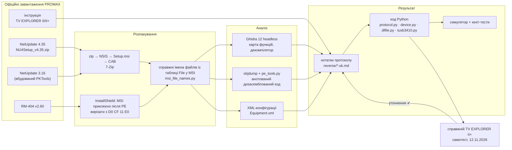

# Як відновлено протокол

[English](REVERSE_ENGINEERING.md) · **Українська**

PROMAX не публікує документації на USB-протокол TV EXPLORER II / II+ і не випускає програм для
macOS чи Linux. Власні Windows-програми виробника датовані 2008–2018 роками. Щоб TVXLink міг
спілкуватися з приладом, протокол довелося відновити з цих програм. Тут описано, що саме
розібрано, якими інструментами, що де знайдено і як кожну знахідку потім перевірено на справжньому
приладі.

Повні нотатки з усіма адресами функцій лежать у
[`reverse/FULL_REPORT.uk.md`](../reverse/FULL_REPORT.uk.md) і
[`reverse/NOTES.uk.md`](../reverse/NOTES.uk.md). Скрипти — у [`reverse/scripts/`](../reverse/scripts).
Результат у вигляді довідника — [PROTOCOL.uk.md](PROTOCOL.uk.md).

## Схема роботи



## 1. Джерела

Усе — публічні завантаження з сайту PROMAX. Їх повторно завантажено 08.11.2026, щоб аналіз можна
було повторити з тих самих файлів.

| Файл | Що це | Що дав |
|---|---|---|
| `NU4Setup_v4.35.zip` | NetUpdate 4.35 (2017–2018), оновлення прошивок і ресурсів | USB-міст і драйвер, `Equipment.xml`, обмін XON/XOFF/ACK, вікна моніторингу (формати відповідей), передача даталогера |
| `NU3Setup_v3.16.zip` | NetUpdate 3.16 із вбудованим **PKTools** («Advanced utilities») | двійковий формат даталогера `.dl` |
| `RM-404v2.60.zip` | RM-404 v2.60 (2013), програма моніторингу й сигналізації для серії TV EXPLORER | **усі команди налаштування на супутник** і їхні коди, коди захоплення `*?ST`, порядок налаштування й паузи |
| `remote-control-commands-promax-analyzers.pdf` | команди дистанційного керування родини HD RANGER | те саме рукостискання XON/XOFF/ACK, описане словами |
| `TVExplorer-2-2p-ukrainian.pdf` | інструкція користувача TV EXPLORER II/II+ | як BER виглядає на екрані (`3.3E-2`, `<1.0E-7`), тексти рядка стану, CBER/VBER/LBER |
| `ti_usb_3410_5052.c` | драйвер TUSB3410 з ядра Linux | як завантажити прошивку в чип і відкрити його UART без драйвера виробника (macOS) |

Окремо PKTools із сайту PROMAX прибрали, але він повністю міститься в NetUpdate 3.16.

## 2. Розпакування інсталяторів

Програми запаковано в кілька шарів. 7-Zip відкриває кожен шар, але файлам із MSI дає хешовані
імена (`_C223B6…`). `msi_file_names.py` читає таблицю `File` у MSI (`!_StringPool` / `!_StringData`)
і повертає справжні імена.

```sh
# NetUpdate 4 / 3: zip → NSIS exe → Setup.msi → CAB
unzip NU4Setup_v4.35.zip && 7zz x -onu4 NU4Setup_v4.35.exe && 7zz x -omsi nu4/Setup.msi
7zz x -ocab msi/_<довгий ключ>
python3 reverse/scripts/msi_file_names.py msi cab named
# RM-404 (InstallShield): MSI дописано в кінець PE — вирізати із сигнатури D0 CF 11 E0 A1 B1 1A E1,
# далі 7zz x RM404.msi → Data.Cab → 7zz x Data.Cab
```

Що всередині:

| Програма | Мова / компілятор | Примітки |
|---|---|---|
| `NetUpdate4.exe` (10,5 МБ) | C++ / MFC, Visual C++ 9, x86 | рядки в UTF-16 |
| `NetUpdate3.exe` | C++ / MFC, Visual C++ 8, x86 | |
| `RM404.exe` | Delphi (Borland, BDE/Paradox), x86 | рядки ASCII поруч із кодом; процедури налаштування Ghidra не розпізнає як функції |

## 3. Аналіз

**Ghidra 12 у режимі headless.** `reverse/scripts/run_ghidra.sh` аналізує всі три програми
паралельно, по 10–15 хвилин кожну. Потім запускає три невеликі Java-скрипти:

| Скрипт | Результат |
|---|---|
| `ghidra/FuncMap.java` | для кожної функції: хто її викликає, кого викликає вона, які рядки використовує → `funcmap.tsv` |
| `ghidra/Decomp.java` | декомпільований C ключових функцій за адресами → `key_functions.c` |
| `ghidra/DumpCmdFuncs.java` | декомпілює кожну функцію, що посилається на рядок за шаблоном `^\*[?A-Z]` (команда приладу) → `command_functions.c`. У NetUpdate 4 таких функцій 194 |

**objdump + `pe_tools.py`.** Процедури RM-404, написані на Delphi, Ghidra не ділить на функції.
Для них `pe_tools.py` перераховує зміщення ↔ віртуальні адреси й читає рядки та double за адресою.
Він також додає примітки до дизасемблованого коду, тож у рядку видно, яку команду той передає:

```text
push $0x6702c8 ; '*?FR'
```

Підписані лістинги — `dvbs_config.s`, `dvbs2_config.s` і `set_frequency.s`.

**Файли конфігурації.** `Equipment.xml` із NetUpdate 4 описує родину EXPLORER-II:

- моделі: TV EXPLORER II, TE2000, TV EXPLORER II+;
- `<Baud>115200</Baud>`;
- команди ідентифікації `*?NA`, `*?VE`, `*?ID`;
- файл прошивки `UpdEII.pro`;
- USB-ідентифікатори `0451:3410` і `24A7:0002`.

## 4. Що де знайдено

| Знахідка | Програма | Де (функція / файл) |
|---|---|---|
| USB-міст TI TUSB3410, 115200 8N1, драйвер `umpusbvista.sys` + прошивка `umpf3410.i51` | NetUpdate 4 | `Equipment.xml`, INF драйвера |
| обмін: чекати XON → команда → XOFF → ACK/NAK → відповідь | NetUpdate 4 | `0x4a1cd0` (із `0x4a08b0` XON, `0x4a0780` XOFF, `0x4a05e0` ACK) |
| розбір відповідей FR/LV/CN/ME/CB/VB | NetUpdate 4 | вікна моніторингу `0x41d610…0x41eaa0` |
| список і завантаження даталогерів `*?FI0A`, `*?FL0A` | NetUpdate 4 | `0x5b4a20`, `0x5bab90`, `0x5b52a0` |
| файлові ресурси й типи (`0A` даталогер, `14` спектр) | NetUpdate 4 | `0x475270` |
| оновлення прошивки `*3141&` → `*BO` → `*SB230400` → `UpdEII.pro` | NetUpdate 4 | знайдено й **навмисно не реалізовано** |
| структура `.dl`, типи вимірювань, кодування значень | NetUpdate 3 (PKTools) | `0x43a1c0` файл, `0x43cbd0` план каналів, `0x43e2b0` вигляд за місяць; підписи з `English.xml` |
| команди налаштування `*SA *LB *FR *CR0 *RA *CO0 *SI` і всі коди | RM-404 | `Config_dvbs` `0x4ac2c0…0x4aca30`, DVB-S2 `0x4adda0…` |
| код «захоплено» `*?ST` для кожного режиму, зупинка налаштування після захоплення | RM-404 | `0x4a3bee…0x4b2a2a` |
| паузи: 3 с після `*SA`, 1,5 с після кожної команди | RM-404 | `push 0xbb8`, `push 0x5dc` |
| завантаження прошивки в «чистий» TUSB3410 | ядро Linux | `ti_usb_3410_5052.c`: `ti_download_firmware()`, `ti_open()` |

## 5. Від псевдокоду до Python

Приклад: як NetUpdate виводить рівень. Результат декомпілятора для вікна моніторингу, скорочений і
з читабельними назвами:

```c
r = SendCommand(dev, "*?LV");             // FUN_004a1cd0
if (r == NAK) { SetText("Err"); return; }
s = r + 3;                                // пропустити "*LV"
if (s[0] == '!') { SetText("---"); return; }
v = atof(s + 2) / 10.0;                   // s[1] — знак
if (s[1] == '-') v = -v;
sprintf(buf, "%.1f dBuV", v);
```

Та сама логіка в TVXLink, `device.parse_measure()`, доповнена тим, що показав справжній прилад:
прапорець `<`/`>` стоїть **перед** знаком. NetUpdate читає його в іншому місці.

```python
_DB_RE = re.compile(r"^\s*([<>])?\s*([+-])?\s*([<>])?\s*(\d+(?:\.\d+)?)\s*$")
# "ME<+0030" → прапорець "<", значення 3,0;  "LV +0591" → 59,1;  "CN!-0006" → значення немає
```

## 6. Драйвер для macOS

Для macOS драйвера TUSB3410 немає. Тому TVXLink у просторі користувача робить те, що драйвер Linux
робить у ядрі (`tvxlink/tusb3410.py`, через libusb):

1. «чистий» TUSB3410 стартує з однією конфігурацією: передати `<len LE16><checksum8>` + образ 8051
   на 14 336 байт через bulk OUT;
2. чип перепідключається з конфігурацією 2;
3. відкрити UART vendor-запитами:
   - `SET_CONFIG 0x05` (дільник 923077 / швидкість, 8N1);
   - `OPEN_PORT 0x06`;
   - `START_PORT 0x08`;
   - DTR/RTS через `WRITE_DATA 0x80` у регістр MCR.

Самого файлу прошивки в репозиторії немає. Запускач завантажує офіційний пакет PROMAX і видобуває
його, перевіряючи хеші SHA-256 (`tvxlink/vendor.py`).

## 7. Перевірка на справжньому приладі

Код показував лише, як програми PROMAX *читають* відповіді. Точні байти приладу треба було
побачити. 12.11.2026 підключено TV EXPLORER II+ (прошивка 1.30.1090.280). Кожну відповідь
порівнювали з тим, що в ту саму мить показував екран приладу. Чого не міг сказати код і що відповів
прилад:

| Питання після аналізу | Відповідь приладу |
|---|---|
| формат BER: мантиса ×10 чи ціла? | ціла: `CB +38E-3` на екрані — `3.8E-2` |
| де стоїть прапорець `<`/`>`? | перед знаком: `ME<+0030` |
| чи існує `*?ID`? | ні, NAK |
| який `*?ST` означає «захоплено»? | DVB-S 6, DVB-S2 8, як у RM-404; `ST0` = No signal received |
| чому виміри іноді відповідають NAK? | прилад показує картинку ТБ; екран вимірювань [12] відповідає |
| за скільки встановлюється рівень після `*FR`? | 0,77 с → витримка спектра 1,0 с |
| чи перемикає прилад режим сам? | так, розпізнавання DVB-S ↔ DVB-S2 → перед налаштуванням знову читати `*?SA` |

Сесію покроково описано в [TESTING.uk.md](TESTING.uk.md#4-перевірка-на-справжньому-приладі-12112026).

## 8. Що навмисно не використано

- **Оновлення прошивки й видалення файлів.** Знайдено, задокументовано, ніколи не надсилається.
  TVXLink відхиляє ці команди навіть у режимі експерта (`FORBIDDEN_PREFIXES` у `device.py`).
- **Сервер оновлень PROMAX.** У `Server.xml` NetUpdate є адреса й логін сервера оновлень PROMAX.
  Їх не використано й ніде в проєкті не відтворено.
- **Код і двійкові файли PROMAX.** У репозиторії немає коду PROMAX, результатів декомпіляції чи
  інсталяторів (`reverse/originals`, `extracted`, `decompiled` у `.gitignore`). Є лише факти,
  потрібні для сумісності, і скрипти, щоб повторити аналіз. Драйвер і прошивку TI завантажує з
  офіційного пакета PROMAX сам комп’ютер користувача.

Аналіз зроблено лише для того, щоб прилад працював із сучасними комп’ютерами, тобто заради
сумісності. Декомпіляцію з цією метою дозволяє стаття 6 Директиви ЄС про програмне забезпечення
2009/24/EC.

## 9. Повторити самому

```sh
brew install sevenzip ghidra                       # macOS; на інших ОС задайте JAVA_HOME і GHIDRA_HEADLESS
# завантажити три інсталятори з promax.es, розпакувати як у розділі 2, далі:
reverse/scripts/run_ghidra.sh <папка з NetUpdate4.exe NetUpdate3.exe RM404.exe> decompiled
objdump -d --no-show-raw-insn NetUpdate4.exe > disasm.txt
```

Результати потрапляють у `decompiled/<програма>/`: `funcmap.tsv`, `key_functions.c`,
`command_functions.c` і журнал `ghidra.log`. Шукайте рядок команди, наприклад `'*?ST'`, і йдіть за тими,
хто його викликає.

## 10. Хронологія

1. Сучасних програм чи програм для macOS немає. PROMAX пропонує лише NetUpdate для Windows; PKTools
   прибрано із сайту.
2. NetUpdate 4.35: TUSB3410, `Equipment.xml`, XON/XOFF/ACK, вікна моніторингу, передача даталогера.
3. Драйвер для macOS у просторі користувача за зразком `ti_usb_3410_5052` з Linux.
4. NetUpdate 3.16 (PKTools): увесь формат `.dl`.
5. RM-404 v2.60: налаштування на супутник (режим, LNB, FEC, символьна швидкість, модуляція) і коди
   захоплення.
6. Бази каналів із KingOfSat, пороги C/N за ETSI EN 300 421 / EN 302 307.
7. Програма, симулятор, тести; підтримка Windows через драйвер TI.
8. 12.11.2026: справжній прилад — формати підтверджено, три особливості знайдено й виправлено,
   записано повну лабораторну сесію.
