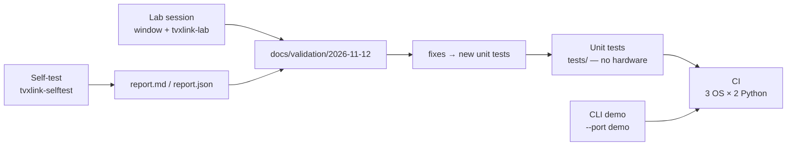
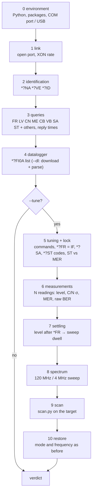

# Testing

**English** · [Українська](TESTING.uk.md)

TVXLink is tested at four levels:

1. unit tests against an emulated meter;
2. the command-line tools end to end in demo mode;
3. a self-test that checks a real meter stage by stage;
4. a full lab session on a real TV EXPLORER II+ (2026-11-12, KPI RTF satellite lab).



Every fact found on the real meter became a test with the exact reply bytes. The simulator
(`tvxlink/simulator.py`) answers the same way, so the next change cannot silently break it.

## 1. Unit tests

```bash
python -m unittest discover -s tests -t .          # everything, ~1 min
python -m unittest tests.test_tune -v              # one file
```

Tests use only the standard library. They need no meter, no network and no browser. Use a
temporary data folder so your own `~/TVXLink` stays untouched:

```bash
TVXLINK_DATA=$(mktemp -d) python -m unittest discover -s tests -t .
```

| File | Tests | What is checked |
|---|---|---|
| `test_protocol.py` | 4 | XON/XOFF/ACK/NAK handshake, replies split across reads, control bytes inside replies, timeouts |
| `test_serialport.py` | 3 | the pyserial transport and the protocol on top of it |
| `test_tune.py` | 5 | RM-404 order `*SA *LB *FR *CR0 *RA *CO0 *SI`; early stop on lock; DVB-S2 8PSK codes; `*?ST` lock table; firmware/delete refused even in expert mode |
| `test_security.py` | 8 | one command per line (CR/LF, control bytes or a second `*` refused before the port); datalogger names cannot carry a command; file-block writes need expert mode; POST only from the page's own Origin (exact host and port); a CSV locked by Excel does not lose a record; a clipped MER (`ME<`) is not a lock |
| `test_scan.py` | 4 | channel scan, seek, spectrum sweep with dwell, job stop |
| `test_lab.py` | 17 | look angles (Az/El/polarisation skew) against reference values, BER(C/N) theory, QPSK↔8PSK pair search, protocol and journal (append-only, hide/restore), threshold-run detection, coordinates in N/S/E/W and ПН/ПД |
| `test_datalogger.py` | 2 | `.dl` parsing; file transfer `*?FL0A` from an emulated meter (binary data with XON/XOFF inside) |
| `test_foundlog.py` | 2 | the found-channels log: merging repeats, CSV headers in both languages |
| `test_satdb.py` | 2 | rebuilding the KingOfSat databases offline (downloads replaced by saved pages) |
| `test_tools.py` | 3 | `tvx` and `tvxlink-selftest` against the simulator; `tvx set *BO` is refused; the demo self-test ends with verdict GO and no FAIL |
| `test_i18n.py` | 7 | both dictionaries have the same keys and placeholders; every key used in code exists; no Cyrillic in English; no hard-coded Cyrillic text in code; no Russian text in the repository |
| `test_ui.py` | 6 | every element id the page script uses exists; no external resources (CDN, fonts); page script syntax (`node --check`); `launcher.py --check` creates nothing; vendor status; pinned SHA-256 values |

### The simulator

`tvxlink/simulator.py` is a fake TV EXPLORER that talks the same bytes:

- XON once a second, XOFF + ACK, NAK for unknown commands;
- replies in the exact formats seen on the real meter (`LV +0606`, `ME<+0030`, `CB>+10E-2`);
- tuning: `*SA/*LB/*FR/*CR0/*RA/*CO0/*SI` change its state, `*?ST` reports a lock once the
  frequency hits a known transponder;
- level, C/N and MER follow the tuned frequency, so sweeps and scans draw real-looking peaks;
- a datalogger file for `*?FI0A` / `*?FL0A`.

Every program part works with it: `--port demo` in the CLI, "Demo" in the window.
Demo rows are marked **DEMO** in the protocol and the found-channels log.

## 2. Continuous integration

[`.github/workflows/tests.yml`](../.github/workflows/tests.yml) runs on every push and pull request:

| Job | What |
|---|---|
| `test` × {Ubuntu, Windows, macOS} × {Python 3.9, 3.13} | install `requirements.txt`; all unit tests; `tvx ident`, `tvx --json tune …` and a full `tvxlink-selftest --tune` in demo mode; build the wheel |
| `vendor` | download the official PROMAX NetUpdate package, unpack it and check that the TUSB3410 driver and firmware match the pinned SHA-256 hashes. If PROMAX ever changes the file, this job fails before users notice |

## 3. Self-test of a real meter

```bash
tvxlink-selftest                                   # read-only: safe, changes nothing
tvxlink-selftest --tune --verified 3 --sat 13E     # + tuning (powers the LNB!)
tvxlink-selftest --port demo                       # the same against the simulator
```

The self-test writes `~/TVXLink/selftest/<time>/report.md` and `report.json`. The `.md` holds
the verdict, a table of every check and the recommendations; the `.json` is for agents. It also
writes the full hex log of the exchange.



Each check is PASS, WARN, FAIL, INFO or SKIP. The verdict:

| Verdict | Meaning |
|---|---|
| **GO** | everything works, including tuning |
| **GO (read-only checked)** | link and readings work; tuning was not tested (no `--tune`) |
| **GO, with warnings** | works; the warnings say what to check (e.g. BER format vs screen) |
| **PARTIAL** | the link works, but readings or tuning fail — see the recommendations |
| **NO GO** | no link to the meter — stages 0–2 say why |

The self-test explains known situations in plain words. For example, if all five measurements
return NAK, the meter is showing the TV picture and you should press [12].

## 4. Validation on a real meter (2026-11-12)

Full log, in time order, with every console output: [validation/2026-11-12/REPORT.uk.md](validation/2026-11-12/REPORT.uk.md)
(Ukrainian). Equipment: TV EXPLORER II+ firmware 1.30.1090.280, Windows 11 laptop, Python 3.13,
TI driver → COM3, the dish of the KPI RTF satellite lab.

| Time | Step | Result | Fixed after it |
|---|---|---|---|
| 10:21 | `tvx ports`, `tvx listen 3` | ★ COM3 (0451:3410); XON 1.00/s | — |
| 10:22 | read-only self-test | NO GO: `*?LV`/`*?CN` NAK, `*?ID` NAK | `*?ID` made optional; NAK explained |
| 10:32 | manual queries vs the meter screen | formats confirmed: kHz, ×10, flag before the sign, BER `CB>+10E-2` = `>1.0E-1` | `parse_measure()` for the flag position and BER |
| 10:41 | self-test `--tune --caught 2 --sat 13E` | **GO, with warnings**: locked 13°E 10992.1 V in 7.6 s, ST 6 5/5, level settles in 0.77 s, sweep and scan pass, mode restored | sweep dwell default 1.0 s |
| 10:53 | first window start | the meter was silent ~35 s after the port opened → empty model | wait for XON up to 12 s and ask again |
| 11:05 | "Show USB devices" | `NotImplementedError` from libusb on Windows | name read errors caught |
| 11:15 | meter switched off | `WriteFile failed` | (not a program error) |
| 12:07–12:39 | lab session by chat (19.2°E) | aiming trend, optimum, 71-reading threshold run with 2 losses, QPSK/8PSK pair | tune result shown on the card; `*?SA` re-read before every tune (the meter had switched to DVB-S2 itself) |

### The lab protocol recorded by the program

| # | Kind | Channel | C/N, dB | MER, dB | CBER | VBER / LBER |
|---|---|---|---|---|---|---|
| 1 | optimum | 19.2°E 11156 V, DVB-S QPSK 5/6 (Canal Sur) | 5.1 | 7.4 | 1.1·10⁻² | VBER 2.0·10⁻⁴ |
| 2 | EDGE "+" | 11156 V | 4.2 | 6.0 | 2.6·10⁻² | VBER >1·10⁻³ |
| 3 | EDGE "−" | 11156 V | 4.6 | 5.7 | 2.9·10⁻² | VBER >1·10⁻³ |
| 4 | hidden: the program error above (the original row stays in `protocol.jsonl`) | | | | | |
| 5 | 8PSK | 11670.75 H, DVB-S2 8PSK 2/3 | 4.9 | 6.7 | 7.4·10⁻² | LBER 3.6·10⁻⁸ |
| 6 | QPSK | 11243.75 H, DVB-S QPSK 5/6 | 5.0 | 5.8 | 2.6·10⁻² | VBER >1·10⁻³ |
| 7 | 8PSK | 11670.75 H, repeat | 4.7 | 6.7 | 8.9·10⁻² | LBER <1.0·10⁻⁸ |

### Confirmed on the meter / still open

| Confirmed | Still open |
|---|---|
| BER format `[flag][sign][2 digits]E[exp]`; LV/CN/ME ×10; FR in kHz | the datalogger over USB (`*?FI0A` → NAK in satellite mode) |
| `*?ST` 6 = MPEG-2 TS DVB-S, 8 = MPEG-2 TS DVB-S2, 0 = No signal received | intermediate `*?ST` codes (Signal received, Carrier recovered, Viterbi synchronized) |
| level settles 0.77 s after `*FR` | DVB-T/C tuning |
| measurements NAK only in TV-picture mode | |
| DVB-S2 readings over USB: LBER as `VB<+10E-9`, `VB +36E-9` | |

## 5. Screenshots

The README screenshots are not mock-ups. `tools/screenshots.py` takes them from the real data in
`docs/validation/2026-11-12`:

- the aiming trend is decoded from the hex exchange log (12:16:57–12:19:07);
- the spectrum is the meter's own sweep;
- the protocol, journal, threshold run, QPSK/8PSK pair and found channels are the saved files.

The script starts the program in demo mode only so that the window has a "connection", then puts
the values back exactly as the meter reported them. It shoots both languages with headless Chrome
through the DevTools protocol (Node.js 22+, no packages):

```bash
python tools/screenshots.py                 # → docs/screenshots/{uk,en}/*.png
python tools/screenshots.py --only 01-aiming,02-meter
```

## 6. How to test a change

1. `python -m unittest discover -s tests -t .` — must stay green.
2. Changed a protocol detail? Add a test with the exact bytes and teach the simulator.
3. Changed the page? `test_ui.py` checks ids and syntax. Start the window (`python -m tvxlink`),
   press "Demo without a meter" and look.
4. Changed text? Both `locales/uk.json` and `locales/en.json` (`test_i18n.py`).
5. Have a meter? Run `tvxlink-selftest` and attach `report.md` to the pull request.
