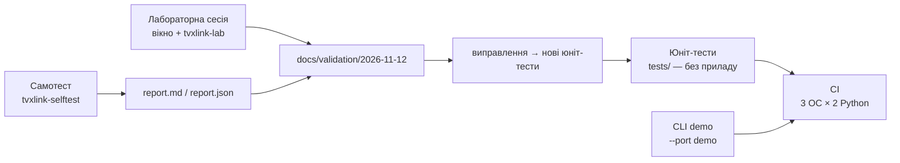
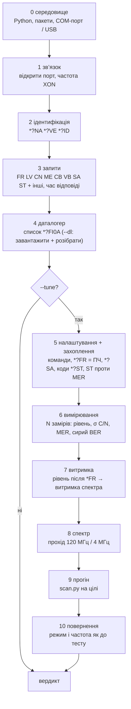

# Тестування

[English](TESTING.md) · **Українська**

TVXLink перевіряється на чотирьох рівнях:

1. юніт-тести проти емульованого приладу;
2. консольні інструменти від початку до кінця в демо-режимі;
3. самотест, що перевіряє справжній прилад стадія за стадією;
4. повна лабораторна сесія на справжньому TV EXPLORER II+ (12.11.2026, лабораторія РТФ КПІ).



Кожен факт, знайдений на справжньому приладі, став тестом із точними байтами відповіді. Симулятор
(`tvxlink/simulator.py`) відповідає так само, тож наступна зміна не зламає це непомітно.

## 1. Юніт-тести

```bash
python -m unittest discover -s tests -t .          # усе, ~1 хв
python -m unittest tests.test_tune -v              # один файл
```

Тести використовують лише стандартну бібліотеку. Їм не потрібні прилад, мережа чи браузер.
Запускайте з тимчасовою папкою даних, щоб ваша `~/TVXLink` лишилася недоторканою:

```bash
TVXLINK_DATA=$(mktemp -d) python -m unittest discover -s tests -t .
```

| Файл | Тестів | Що перевіряється |
|---|---|---|
| `test_protocol.py` | 4 | рукостискання XON/XOFF/ACK/NAK, відповіді, розбиті на кілька читань, керівні байти всередині відповіді, тайм-аути |
| `test_serialport.py` | 3 | транспорт pyserial і протокол поверх нього |
| `test_tune.py` | 5 | порядок RM-404 `*SA *LB *FR *CR0 *RA *CO0 *SI`; рання зупинка після захоплення; коди DVB-S2 8PSK; таблиця захоплення `*?ST`; прошивка й видалення відхиляються навіть у режимі експерта |
| `test_security.py` | 8 | одна команда в рядку (CR/LF, керівні байти чи другий `*` відхиляються до порту); ім’я даталогера не може нести команду; запис блоків файлів лише в режимі експерта; POST лише з Origin власної сторінки (точний хост і порт); CSV, заблокований Excel, не губить запис; обрізаний MER (`ME<`) не є захопленням |
| `test_scan.py` | 4 | прогін каналів, пошук, спектр із витримкою, зупинка завдання |
| `test_lab.py` | 17 | кути наведення (Az/El/нахил поляризації) проти еталонних значень, теорія BER(C/N), пошук пар QPSK↔8PSK, протокол і журнал (лише дописування, приховування/відновлення), визначення межі декодування, координати в N/S/E/W і ПН/ПД |
| `test_datalogger.py` | 2 | розбір `.dl`; передача файлу `*?FL0A` з емульованого приладу (двійкові дані з XON/XOFF усередині) |
| `test_foundlog.py` | 2 | журнал знайдених каналів: злиття повторів, заголовки CSV обома мовами |
| `test_satdb.py` | 2 | перебудова баз KingOfSat офлайн (завантаження замінено збереженими сторінками) |
| `test_tools.py` | 3 | `tvx` і `tvxlink-selftest` проти симулятора; `tvx set *BO` відхиляється; демо-самотест закінчується вердиктом «МОЖНА» без FAIL |
| `test_i18n.py` | 7 | обидва словники мають однакові ключі й підстановки; кожен ключ із коду існує; в англійській немає кирилиці; у коді немає вписаного кириличного тексту; у репозиторії немає російського тексту |
| `test_ui.py` | 6 | кожен id, який використовує скрипт сторінки, існує; немає зовнішніх ресурсів (CDN, шрифтів); синтаксис скрипту сторінки (`node --check`); `launcher.py --check` нічого не створює; стан vendor; закріплені SHA-256 |

### Симулятор

`tvxlink/simulator.py` — несправжній TV EXPLORER, що говорить тими самими байтами:

- XON раз на секунду, XOFF + ACK, NAK на невідомі команди;
- відповіді в точних форматах, які бачили на справжньому приладі (`LV +0606`, `ME<+0030`, `CB>+10E-2`);
- налаштування: `*SA/*LB/*FR/*CR0/*RA/*CO0/*SI` змінюють його стан, `*?ST` повідомляє про
  захоплення, коли частота потрапляє на відомий транспондер;
- рівень, C/N і MER залежать від частоти, тож спектр і прогони малюють правдоподібні піки;
- файл даталогера для `*?FI0A` / `*?FL0A`.

З ним працює кожна частина програми: `--port demo` у CLI, «Демо» у вікні. Демо-рядки позначено
**DEMO** у протоколі та журналі знайдених каналів.

## 2. Безперервна інтеграція

[`.github/workflows/tests.yml`](../.github/workflows/tests.yml) запускається на кожен push і pull request:

| Завдання | Що робить |
|---|---|
| `test` × {Ubuntu, Windows, macOS} × {Python 3.9, 3.13} | встановлює `requirements.txt`; усі юніт-тести; `tvx ident`, `tvx --json tune …` і повний `tvxlink-selftest --tune` у демо-режимі; збирає wheel |
| `vendor` | завантажує офіційний пакет PROMAX NetUpdate, розпаковує його й перевіряє, що драйвер і прошивка TUSB3410 збігаються із закріпленими SHA-256. Якщо PROMAX колись змінить файл, це завдання впаде раніше, ніж помітять користувачі |

## 3. Самотест справжнього приладу

```bash
tvxlink-selftest                                   # лише читання: безпечно, нічого не змінює
tvxlink-selftest --tune --verified 3 --sat 13E     # + налаштування (подає живлення на LNB!)
tvxlink-selftest --port demo                       # те саме проти симулятора
```

Самотест записує `~/TVXLink/selftest/<час>/report.md` і `report.json`. У `.md` — вердикт, таблиця
всіх перевірок і рекомендації; `.json` — для агентів. Поруч лежить повний hex-журнал обміну.



Кожна перевірка має стан PASS, WARN, FAIL, INFO або SKIP. Вердикт:

| Вердикт | Значення |
|---|---|
| **МОЖНА** | усе працює, разом із налаштуванням |
| **МОЖНА (перевірено лише читання)** | зв’язок і покази працюють; налаштування не перевірялося (без `--tune`) |
| **МОЖНА, із застереженнями** | працює; попередження кажуть, що перевірити (наприклад, формат BER проти екрана) |
| **ЧАСТКОВО** | зв’язок є, але покази чи налаштування не працюють — див. рекомендації |
| **НЕ МОЖНА** | немає зв’язку з приладом — причину пояснюють стадії 0–2 |

Відомі ситуації самотест пояснює простими словами. Наприклад, якщо всі п’ять вимірювань дали NAK,
прилад показує картинку ТБ, і треба натиснути [12].

## 4. Перевірка на справжньому приладі (12.11.2026)

Повний журнал за часом з усіма виводами консолі: [validation/2026-11-12/REPORT.uk.md](validation/2026-11-12/REPORT.uk.md).
Обладнання: TV EXPLORER II+ з прошивкою 1.30.1090.280, ноутбук із Windows 11,
Python 3.13, драйвер TI → COM3, тарілка супутникової лабораторії РТФ КПІ.

| Час | Крок | Результат | Що виправлено після цього |
|---|---|---|---|
| 10:21 | `tvx ports`, `tvx listen 3` | ★ COM3 (0451:3410); XON 1,00/с | — |
| 10:22 | самотест лише на читання | НЕ МОЖНА: `*?LV`/`*?CN` NAK, `*?ID` NAK | `*?ID` зроблено необов’язковим; NAK пояснюється |
| 10:32 | ручні запити проти екрана приладу | формати підтверджено: кГц, ×10, прапорець перед знаком, BER `CB>+10E-2` = `>1.0E-1` | `parse_measure()` для позиції прапорця й BER |
| 10:41 | самотест `--tune --caught 2 --sat 13E` | **МОЖНА, із застереженнями**: захоплено 13°E 10992,1 V за 7,6 с, ST 6 5/5, рівень встановлюється за 0,77 с, спектр і прогін пройшли, режим повернуто | типова витримка спектра 1,0 с |
| 10:53 | перший запуск вікна | прилад мовчав ~35 с після відкриття порту → порожня модель | чекати XON до 12 с і питати знову |
| 11:05 | «Показати USB-пристрої» | `NotImplementedError` від libusb у Windows | помилки читання назви перехоплено |
| 11:15 | прилад вимкнули | `WriteFile failed` | (не помилка програми) |
| 12:07–12:39 | лабораторна через чат (19,2°E) | тренд наведення, оптимум, межа з 71 заміру з 2 зривами, пара QPSK/8PSK | результат налаштування показується в картці; `*?SA` читається перед кожним налаштуванням (прилад сам перейшов у DVB-S2) |

### Протокол лабораторної, записаний програмою

| № | Вид | Канал | C/N, дБ | MER, дБ | CBER | VBER / LBER |
|---|---|---|---|---|---|---|
| 1 | оптимум | 19,2°E 11156 V, DVB-S QPSK 5/6 (Canal Sur) | 5,1 | 7,4 | 1,1·10⁻² | VBER 2,0·10⁻⁴ |
| 2 | EDGE «+» | 11156 V | 4,2 | 6,0 | 2,6·10⁻² | VBER >1·10⁻³ |
| 3 | EDGE «−» | 11156 V | 4,6 | 5,7 | 2,9·10⁻² | VBER >1·10⁻³ |
| 4 | приховано: помилка програми вище (вихідний рядок лишився в `protocol.jsonl`) | | | | | |
| 5 | 8PSK | 11670,75 H, DVB-S2 8PSK 2/3 | 4,9 | 6,7 | 7,4·10⁻² | LBER 3,6·10⁻⁸ |
| 6 | QPSK | 11243,75 H, DVB-S QPSK 5/6 | 5,0 | 5,8 | 2,6·10⁻² | VBER >1·10⁻³ |
| 7 | 8PSK | 11670,75 H, повтор | 4,7 | 6,7 | 8,9·10⁻² | LBER <1,0·10⁻⁸ |

### Підтверджено на приладі / ще відкрито

| Підтверджено | Ще відкрито |
|---|---|
| формат BER `[прапорець][знак][2 цифри]E[порядок]`; LV/CN/ME ×10; FR у кГц | даталогер через USB (`*?FI0A` → NAK у супутниковому режимі) |
| `*?ST` 6 = MPEG-2 TS DVB-S, 8 = MPEG-2 TS DVB-S2, 0 = No signal received | проміжні коди `*?ST` (Signal received, Carrier recovered, Viterbi synchronized) |
| рівень встановлюється за 0,77 с після `*FR` | налаштування DVB-T/C |
| виміри дають NAK лише в режимі картинки ТБ | |
| покази DVB-S2 через USB: LBER як `VB<+10E-9`, `VB +36E-9` | |

## 5. Скриншоти

Скриншоти в README — не макети. `tools/screenshots.py` бере їх із реальних даних у
`docs/validation/2026-11-12`:

- тренд наведення декодовано з hex-журналу обміну (12:16:57–12:19:07);
- спектр — власний прохід приладу;
- протокол, журнал, межа, пара QPSK/8PSK і знайдені канали — збережені файли.

Скрипт запускає програму в демо-режимі лише для того, щоб у вікна було «з’єднання», а потім
повертає значення точно такими, як їх видав прилад. Знімає обидві мови в headless Chrome через
протокол DevTools (Node.js 22+, без пакетів):

```bash
python tools/screenshots.py                 # → docs/screenshots/{uk,en}/*.png
python tools/screenshots.py --only 01-aiming,02-meter
```

## 6. Як перевірити зміну

1. `python -m unittest discover -s tests -t .` — має лишатися зеленим.
2. Змінили деталь протоколу? Додайте тест із точними байтами й навчіть симулятор.
3. Змінили сторінку? `test_ui.py` перевіряє id і синтаксис. Запустіть вікно (`python -m tvxlink`),
   натисніть «Демо без приладу» й подивіться.
4. Змінили текст? Обидва файли `locales/uk.json` і `locales/en.json` (`test_i18n.py`).
5. Маєте прилад? Запустіть `tvxlink-selftest` і додайте `report.md` до pull request.
